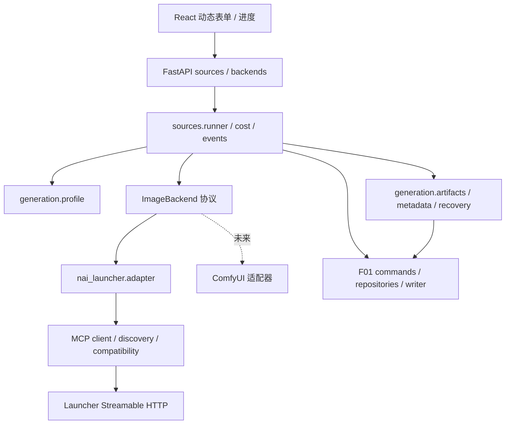
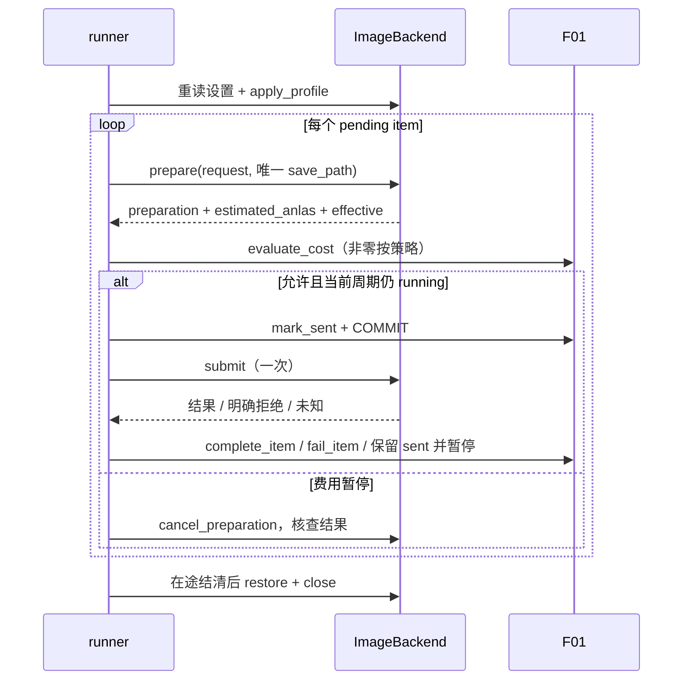

# F02–F05 生成后端模块设计

实现补充（0.57.0）：直连未知请求增加人工“结束来源、保留未知”决定。基于当前来源、条目、intent 与费用凭据审核；先持久保存 prepared 决定，再通过既有 F01 状态边结束来源，最后写 completed。两个阶段都不表示上游结清；`sent/unknown`、attempts、图片和费用证据均保留。中断后必须重新读取并明确完成，不自动补偿或重发。完整 response 仍走本地核查入库；缺失或损坏证据不提供强制处理。见 [直连未知请求人工处置验收](64-F02-直连未知请求人工处置验收.md)。

**0.52.0 路线更新（用户确认）**：新增独立 `NaiDirectBackend`，通过官方 HTTP API 生成，按请求冻结全部支持参数，不依赖 Launcher 的全局设置。已有源、F01 状态边和 Launcher 只读诊断保留；本文后续租约/CAS 要求继续约束共享设置后端。直连费用采用明确的未知金额合同，持久响应回执用于本地恢复；没有服务端幂等保证时不重发。设计和当前范围以 [直连实现与验收](59-F02-NovelAI直连实现与验收.md) 为准。下面各旧版本段落为历史实现记录。

实现更新（0.36.0）：生成源增加本地恢复证据分页、显式只读对账和单独设置恢复，受版本、租约绑定、后台排空和适配器门禁保护。见 [恢复工作台验收](43-F02-F05-恢复工作台与HTTP验收.md)。生产真实适配仍为空；无对应条目记录的设置 apply 恢复与强制冲突处置没有开放。

版本：设计稿 v0.1；日期：2026-10-12。本文保留模块设计，实际实现进度以下方补充和阶段验收为准；未消耗 Anlas。

F02 实现补充（0.50.0，2026-10-28）：已确认官方仓库 `Aaalice233/Aaalice_NAI_Launcher` 的 v4.3.1 固定提交，源码审阅后新增独立的只读设置/状态检查与 HTTP、工作台入口。仅精确匹配版本、服务名称、协议以及两个只读输入/输出 schema 时允许该两项读取，不授予生成写入权限。源码对照发现平铺设置、整数 UC 预设、prepare.parameters 与既有测试契约不同，且官方设置写入没有原子 expected/CAS；全局队列状态也不能证明具体 attempt 结清。§3 的生成契约清单、§4 的恢复约束继续保留。详见 [官方接口与只读接入验收](57-F02-Launcher官方接口与只读接入验收.md)。

实现进度：0.19.0 完成生成源草稿、参数本地校验、内容/画风/尺寸投影、完整 seeds 交接、F01 原子锁源与未知提交核对，见 [生成源交接验收](26-F06-F07-生成源交接验收.md)。0.32.0 完成本地产物检查与登记，0.33.0 完成下述设置租约核心及只读诊断。真实生成适配契约仍为空；0.34.0 已补费用核心与持久估算，0.35.0 已在注入式适配器上接通串行 runner、持久 prepare 屏障、结果对账和显式设置恢复，见 [调度验收](42-F02-F05-串行调度与未知结果对账验收.md)；真实适配与生产恢复入口仍未开放，生产启动关闭，不能把测试夹具视为真实后端。

## 1. 边界与硬约束

F05 实现补充（0.32.0）：本地 caller PNG 完整解码/尺寸/摘要检查、Comment 验证、内容提示词 original 解析、F01 收据登记和崩溃恢复已实现，见 [F05 验收](39-F05-产物检查与原子入库验收.md)。采纳 C07：可选 registration_check 随收据冻结，图片与初始审图状态同事务提交，检查摘要另存 `images/.checks/<item>/<attempt>.json`。本轮没有真实生成请求、外部归属证明、intent/未知发送对账和设置恢复 runner。

F24 实现补充（0.31.0）：已提供 `/api/presets` 自定义尺寸预设管理和 `#/settings/presets` 页面。内置大/小不可改删；选用预设只把实际三组像素填入生成源草稿，保存和锁源后均不引用预设。版本冲突、持久配置与来源脱钩测试见 [F24 验收](38-F24-自定义尺寸预设验收.md)。真实 Launcher 生成适配与费用/恢复 runner 的状态仍以上述进度说明为准。

依据：[F01](F01-project-db-设计.md) §5–§7、C01–C05；[MCP 方案](02-NAI-MCP使用方案.md)；[架构草案](04-工作流程与架构草案.md) §2.1、F02–F05/F21/F23/F24；[权威架构](05-项目结构与数据模型.md) §4.5、§5.2–5.3、§7。
冲突时以 F01 及权威架构为准：无 runs/manifest/stages 新模型；生成调度不用 jobs 表；不修改既定 8 表、93 列和状态边。
NAI 的 `skipped` 不可达（仅 import 查重使用）；失败生成不得自动重试。网络恢复与用户授权的新 attempt 是两种不同操作。
本设计细化模块合同；未决点集中 §12，推荐方案不视为已采纳架构变更。



建议沿用 F01 包名 `src/stylelora/`（相当于任务示例中的 slora），不同时引入第二个顶层包：

| 包/模块 | 职责与主要依赖 | 错误 / 幂等性 | 最小测试编号（§11） |
|---|---|---|---|
| backends/base.py、types.py | 通用协议和不可变 DTO；标准库、F01 公共 JSON 类型 | 入参错误在调用前拒绝；纯验证确定性 | T07、T22 |
| backends/nai_launcher/discovery.py | 发现文件、运行时凭据；pathlib、产品配置 | 不可用暂停；每周期重读，不缓存 token 到项目 | T01 |
| backends/nai_launcher/client.py | HTTP、会话、JSON-RPC、SSE、串行写；httpx | 读可限次重试；未知写绝不重放 | T02–T05 |
| backends/nai_launcher/compatibility.py | 版本与工具 schema 兼容清单 | 未通过拒绝启用该源；相同输入同哈希 | T06 |
| backends/nai_launcher/adapter.py | 工具映射、设置租约、证据查询；client、base | 外部写不承诺幂等；restore 先核查 | T08–T10、T18 |
| generation/profile.py | 锁定快照、aspect/像素、prompt 拼接；能力 DTO | 不支持参数拒绝；同锁定输入同请求 | T07–T09 |
| sources/cost.py | F01 费用协调服务的实现归属；DAL、周期内存 | 过期确认冲突；同周期确认不重复授权 | T11–T12 |
| generation/artifacts.py、metadata.py | 收据、解码/哈希、PNG 校验；Pillow、F01 | 冲突保留证据；相同 item/attempt/hash 不重复登记 | T14–T17 |
| generation/recovery.py | 为 F01 inspect_sent 提供只读 probe；adapter、artifacts | unknown 保持暂停；重复核查不生成 | T18–T20 |
| sources/runner.py、events.py | 派发、生命周期、摘要事件；上述模块 | 每源单任务；CAS、代次校验；无后台生成重试 | T13、T21–T23 |
| api/sources.py、backends.py | DTO/API、控制命令、SSE；runner | 409 状态冲突、422 参数、503 不可用；不自行重发 | T12、T23 |

通用 runner 负责顺序、状态/attempt、费用、限速、文件登记和进度；适配器负责工具名、会话、页面设置、Launcher 审批与资源定位。
未来 ComfyUI 仅实现相同协议：无状态设置句柄可为空操作；请求参数随任务提交。新增 source type 仍须按 F01 迁移 CHECK，本次不启用该类型。

## 2. 数据类与通用公开接口

以下是类型合同而非实现；DTO 默认 frozen dataclass，容器对外不可变。`JsonValue/JsonObject/Aspect/SourceStatus/ItemStatus/ItemSeed/SourceRow/SourceItemRow/ImageRow/ProjectHandle/ImageArtifact/OriginalInput/RecoveryEvidence` 复用 F01；JSON 编解码只在边界执行。Protocol/Literal、Mapping/Sequence、Path 为标准库类型。

| DTO | 字段（Python 类型）与约束 |
|---|---|
| PixelSize | width: int, height: int；正数、64 倍数、符合方向及模型尺寸限制 |
| GenerationProfile | backend: str; model: str='nai-diffusion-5-full'; effort: str; sampler: str; steps: int; scale: float; cfg_rescale: float; noise_schedule: str; uc_preset: None=None; quality_toggle: Literal[False]=False; smea: bool; smea_dyn: bool; variety_plus: bool; decrisp: bool; extra: JsonObject |
| SourceGenerationConfig | schema_version: int=1; profile: GenerationProfile; sizes: Mapping[Aspect, PixelSize]; default_aspect: Aspect；三方向齐全，不存预设引用、端点、token、cost_policy |
| GenerationRequest | item_id: int; attempt: int; positive: str; negative: str; width: int; height: int; seed: int \| None; count: Literal[1]; references: tuple[ReferenceInput,...]=(); source_image: Path \| None=None; characters: tuple[CharacterInput,...]=(); save_path: Path；绝对路径只在运行时 |
| ReferenceInput / CharacterInput | 前者 image: Path, strength: float；后者 positive: str, negative: str, position: tuple[float,float] \| None；本版非空一律 UnsupportedFeature |
| ParameterSpec | key: str; value_schema: JsonObject; default: JsonValue; required: bool; read_only: bool; locked_by_effort: Mapping[str, JsonValue]；未知锁定值用 null 且附说明 |
| BackendCapabilities | backend: str; schema_version: int; models: tuple[str,...]; parameters: tuple[ParameterSpec,...]; per_request_parameters: tuple[str,...]; session_settings: bool; supports_cost: bool; supports_cancel: bool; warnings: tuple[str,...] |
| ProfileHandle | lease_id: str; original: JsonObject; applied: JsonObject; writable_keys: tuple[str,...]; backend_instance: str；仅适配器解释，不入 sources.config_json |
| Preparation | handle: str; request_digest: str; estimated_anlas: int \| None; effective: JsonObject; expires_at: str \| None；绑定当前会话/设置租约，仅内存 |
| GenerationResult | resource_id: str \| None; saved_path: Path \| None; image_bytes: bytes \| None; metadata_stripped: bool \| None; actual: JsonObject；不得直接返回前端 |
| AccountStatus | source: Literal['backend','local_estimate']; subscription_tier: str \| None; anlas_balance: int \| None; fixed_quota_remaining: int \| None; estimated_anlas_total: int \| None; refreshed_at: str; estimate_scope: str; unknown_attempts: int |
| BackendError | code: str; phase: str; outcome: Literal['not_sent','rejected','unknown']; retry: Literal['read_only','manual','fatal']; safe_message: str；不携带可向前端泄露的原始响应 |

```python
class ImageBackend(Protocol):
    async def capabilities(self) -> BackendCapabilities: ...
    async def account_status(self) -> AccountStatus | None: ...
    async def apply_profile(self, profile: GenerationProfile) -> ProfileHandle: ...
    async def restore(self, handle: ProfileHandle) -> None: ...
    async def prepare(self, request: GenerationRequest) -> Preparation: ...
    async def submit(self, preparation: Preparation) -> GenerationResult: ...
    async def cancel_preparation(self, preparation: Preparation) -> None: ...
    async def reconcile(self, item: SourceItemRow, receipt: AttemptReceipt | None
                        ) -> RecoveryEvidence: ...
    async def close(self) -> None: ...

def validate_profile(profile: GenerationProfile, caps: BackendCapabilities) -> None: ...
def resolve_aspect(entry: Aspect | None, llm: Aspect | None) -> Aspect | None: ...
def build_request(config: SourceGenerationConfig, source: SourceRow,
                  item: SourceItemRow, project_root: Path) -> GenerationRequest: ...
```

后端实例绑定项目/源上下文，故 `account_status()` 无 source_id 参数也只统计本源。`reconcile/cancel_preparation/close` 是生命周期补充，不替代既定六个核心接口。
未来本地后端可声明 supports_cost=false 并返回 estimated_anlas=None，此时通用 runner 不调用 NAI 费用策略；Launcher 必须 supports_cost=true，缺估价不得冒充“不支持费用”。返回 image_bytes 的后端由文件模块先完整写入 staging，再复用同一收据登记流程。
统一使用 `scale` 表示 cfg；适配器按受支持 schema 映射键名。extra 仅允许能力 schema 声明的键，拒绝未知键和覆盖固定项，不靠透传绕过校验。

## 3. F02：发现、传输与兼容

```python
def discover(appdata: Path, *, explicit_token: str | None,
             environ: Mapping[str, str]) -> DiscoveryInfo: ...
async def connect(info: DiscoveryInfo) -> McpSession: ...
async def call_tool(session: McpSession, name: str, arguments: JsonObject,
                    *, kind: Literal['read','write']) -> ToolReply: ...
async def cancel_request(session: McpSession, request_id: str, reason: str) -> None: ...
async def close_session(session: McpSession) -> None: ...
def verify_compatibility(server: ServerInfo, tools: tuple[ToolSchema,...]
                         ) -> CompatibilityReport: ...
```

`DiscoveryInfo` 含 endpoint: str、port: int、token: str（repr 隐藏）、pid: int、protocol_versions: tuple[str,...]、app_version: str；来自 `%APPDATA%/nai-launcher/mcp-server.json`，仅服务运行时存在。
`McpSession` 含 session_id: str、protocol_version: str、generation: int；`ToolReply` 含 payload: JsonObject、is_error: bool；`ServerInfo` 含 name/version: str；`ToolSchema` 含 name: str、input_schema: JsonObject、output_schema: JsonObject | None；`CompatibilityReport` 含 accepted: bool、schema_hash: str、reason: str。
每次启动/继续以及断连后的诊断重读发现文件；校验 endpoint 为本机 127.0.0.1、端口一致、字段完整，pid 只作辅助诊断，不作为存活证明。文件缺失/半写 JSON 可有限重读后暂停，不把整批 items 标 failed。
token 优先级：显式运行时配置 > `NAI_LAUNCHER_MCP_TOKEN` > 发现文件；显式配置指注入内存的秘密值，不写普通配置文件、项目、日志或事件。HTTP 禁自动重定向，避免 Bearer 被转发。

会话时序：POST `initialize`（协商支持版本、clientInfo）→取 `Mcp-Session-Id` →POST `notifications/initialized` →分页 `tools/list` →兼容校验。随后带 Bearer、会话 ID、协商后的 `MCP-Protocol-Version`；Accept 同时允许 `application/json, text/event-stream`。
请求使用唯一 JSON-RPC id；通知无 id，接受通知的空 202 响应。普通调用必须收到匹配 id 的结果或错误，不能把 HTTP 200、SSE 连接建立或进度通知当成功。
JSON 响应按 JSON-RPC 解包；SSE 增量解析 UTF-8、CRLF、多行 data、注释心跳及多事件，忽略无关通知，按 id 路由；提前 EOF、坏 JSON 或缺最终响应视为结果未知。工具 `isError` 与 payload `ok:false/code` 都须转领域错误。
8 MiB 指完整 UTF-8 HTTP 请求体（含 JSON-RPC 包装），发送前计数，超过 8×1024×1024 字节拒绝；恰好上限允许。响应中的图片字节不经前端事件转发。
写锁覆盖整个写调用直至结果明确；只读允许并发查询状态。写工具包括 update、prepare、submit、cancel_preparation、save_generated_image；不信任工具自行声明的只读标记，使用兼容清单白名单。
session 404：单航班重新 initialize；只读可用新会话有限重发。任何已发送写调用（包括 404、502、超时）均不自动重放，返回 outcome=unknown，先对账；新会话不能使旧 preparation 自动有效。
通知 `notifications/cancelled` 仅请求取消在途 JSON-RPC，不证明生成停止、不把 sent 改 pending。结果未知时保留逻辑写屏障，只放行对账读取，直到副作用已核实或人工处理。
正常关闭先结清在途/设置恢复，再 DELETE 会话；DELETE 404 视作已关闭，断连只记诊断。不能以 DELETE 当撤销生成或扣费。

兼容检查同时比较发现文件 app_version、initialize serverInfo.version、协商协议和工具 schema：按工具名排序，对 inputSchema/outputSchema 做确定性 JSON 后 SHA-256；另保留全清单哈希用于升级诊断。
已测 v4.3.0 是首个基线候选；本资料没有实际 schema 哈希，实施时必须从可信 fixture 建兼容清单，不伪造哈希。已审核版本/哈希组合才启用；新增无关工具可审核后放行，关键字段变化或未知版本默认拒绝启动该源，不阻断项目查看。
关键工具为 docs/02 §4 核心集合；MCP 仅 tools 能力，`resource_ref.resourceId` 是工具返回的句柄，不假设存在 MCP resources/read。升级检查不执行生成探测。

## 4. F03 / F23 / F24：参数、页面租约与尺寸

F03 实现补充（0.51.0）：来源版本绑定的只读 Launcher 参数预检已接入 HTTP 与工作台。对照保存的 profile 与新读取的 v4.3.1 设置，显式映射 UC None→3、V5 Full high/medium 模型，报告差异和当前模型固定负面词冲突。字段相同仍不代表实际 prepare 参数、参考图、批量及恢复条件可用；不执行 update/prepare/submit，不授予生成能力。排队或执行期间来源变化丢弃结果，GET 仅查看缓存并标记过期。详见 [来源参数预检验收](58-F03-来源参数预检验收.md)。

F03 实现补充（0.33.0）：`generation/settings.py` 提供 Runtime 单例设置租约、写前持久快照、在途标记、只读对账和按键恢复，见 [F03 验收](40-F03-设置租约与恢复日志验收.md)。当前仅内部注入适配器协议和合成测试，未映射真实 MCP 工具、未接入生产 runner。产品恢复日志不进项目数据库；HTTP/Launcher 页面只读本地状态，未结清或损坏时阻止新的生成源启动。

恢复约束进一步明确：apply/restore 结果未知时，即便当前读到 original，也须先有该次写入已结清且不会迟到生效的权威证据；否则保留屏障。只读核查不重发 update。在途生成同样须证明对应 attempt 已结清，不能凭 recent 缺条目或取消请求成功解除。实际写入必须在同一个原子操作内检查待改键仍等于预期值；读后再无条件写不能保护期间的外部修改。内部 `update_settings(..., expected=...)` 表达此要求，不表示真实 MCP 已支持该参数。真实适配器缺少这种保证或精确结清证据时继续禁用，不能用本地写锁替代外部并发保护。

创建 draft 时默认 model 为 V5 full，其余参数从当前 Launcher 和能力读取，缺少必需值则表单要求填写；不硬编码 steps=14/28 或 sampler。启动前将完整参数、三组实际像素及 default_aspect 写入 draft config_json，再由 F01 start_source 锁定。
尺寸默认“小”：landscape=768×512、portrait=512×768、square=640×640；“大”为1536×1024、1024×1536、1472×1472。64 倍数校验同时在产品预设保存与启动执行；模型不支持某尺寸则拒绝，不暗改或缩图。
词条已有 aspect > LLM 输出 > 源默认；前两者都空时 item.aspect 保留 NULL，build_request 从锁定默认取值。续跑仅读 items/config，不访问字典或重新询问 LLM。
`positive` 拼接去首尾空白后的 style_prompt 和 content_prompt，非空段用 `, ` 分隔；保留原权重和内容。negative 取源输入；characters 明确编码为 `[]`，count=1、operation=generate，references/source_image 本版不填。
width/height 随单张请求传给 prepare；model/sampler/steps/scale 等只能通过 settings 更新。one-shot 的 prompt、negative、characters、尺寸不写回页面；适配器必须校验准备结果未继承页面角色。

设置生命周期（同一 Launcher 实例的全周期独占租约，跨源互斥）：

1. 启动或任何继续时重新 get_generation_settings，保存本周期原快照，绝不复用上次页面快照；读失败不应用参数。
2. 在产品级恢复日志保存可写设置快照和租约标记（不含 token），然后 update_generation_settings 应用锁定 profile；回读实际值并验证。
3. 每张 prepare 核对回显和能力锁定规则；steps 由14变28不能被“页面原值”掩盖。非 effort 可解释的漂移暂停；不修改锁定 profile 来迎合页面变化。
4. 结束、暂停、异常、取消进入 finally：先停派发，已提交生成结清或确认不再依赖设置后 restore；只恢复本适配器改过的可写键，不盲传只读字段。
5. restore 先读取当前值：已等于 original 则成功；等于 applied 才恢复；页面被外部修改则报告 restore_conflict，保留日志及写屏障，交用户处理，不覆盖新修改。

apply 结果未知时也必须利用预先保存的快照核查，不因没有返回 ProfileHandle 丢失恢复能力。restore 写结果未知同样只读核查，不能盲重放。
在途 submit 未决时暂停状态可立即落库，但页面恢复延后并展示 restore_pending；不声称暂停必然已恢复。进程重启先核查恢复日志和后端身份，再允许新源申请租约。日志位置/自动恢复范围见 Q03。
`locked_by_effort` 由版本能力表加 settings/prepare 回显生成；medium 已知会锁 steps/sampler/negative，自定义 negative 可能不生效。前端禁用锁定字段、显示有效值与“medium 会忽略自定义负面词”；切换 effort 重新验证表单。
固定 quality_toggle=false、uc_preset=None 不可被 effort 或 extra 覆盖。若受支持版本无法满足固定值，拒绝该组合。对非空自定义 negative 与 medium 的冲突推荐启动前拒绝并提示选择 high；不擅自切换 effort（Q01）。
GET `/api/backends/{id}/capabilities` 返回 schema 与锁定说明；前端不得将当前有效值当可编辑默认值保存。来源参数、有效回显的差异仅用于校验和诊断，逐图元数据只留档。

## 5. F04 / F21：费用和本地估算

实现补充（0.34.0）：费用控制、周期确认、策略 PATCH、内部派发前凭据/mark_sent 边界及 C06 持久估算已实现，见 [F04/F21 验收](41-F04-F21-费用策略与持久估算验收.md)。估算按 item/attempt 保存在项目 `images/.costs/`，GET account-status 指定当前项目和 NAI 来源时返回 `persisted_attempts` 口径，缺失历史凭据明确 incomplete，不从 PNG 猜费用。以下 process_observed 为未采纳 C06 时的旧降级方案，当前已由持久凭据方案替代。真实 prepare/submit/审批与完整 runner 仍未开放。

费用调用点固定为 prepare 成功后、mark_sent 前；estimated_anlas 必须是非负整数（bool 不算 int）。负值由 Launcher 拒绝；若异常响应仍含负值/缺失值，报 cost:invalid_estimate，暂停且不 submit，不把它当零。
每张执行 F01 `evaluate_cost(project, source_id, estimated_anlas=...)`：0 放行；非零 deny 暂停且无同意按钮；ask 无 ack 则暂停询问；ask 已有本周期 ack 或 allow 放行。allow 仍可能等待 Launcher 的付费确认。
暂停时不增加 attempts；取消未提交 preparation（写调用也须处理未知），继续时重新快照/应用/prepare/估价，不复用可能过期的 preparation。
`confirm_cost_and_resume(..., expected_cycle_id)` 与状态更新由单个源控制队列串行处理：核对暂停周期及 ask 策略，paused→running，并为新 cycle 设 ack。重复同一确认在内存请求记录中返回同结果；过期确认409，普通继续无 ack。
用户暂停/停止、错误暂停、完成、退出全部清 ack；修改 cost_policy 通过 F01 set_cost_policy 串行清 ack。每张提交关口重新取策略，保证尚未 sent 的下一张使用新值，已 sent 不撤回。
Launcher 审批明确拒绝/自动超时且契约证明未生成：当前 sent→failed，原因 approval:rejected/approval:timeout，源暂停；不自动再次弹审批。仅 HTTP 超时没有这个证明，必须保留 sent 对账（Q02）。
account_status 返回 source=local_estimate、余额/订阅/体力均 None；0 估算也可能消耗自回额度，不能显示“免费”。推荐累计本源本进程观察到的已派发 attempt 估算，按 item_id/attempt 去重，明确拒绝可扣除，未知单列 unknown_attempts。
未提交 prepare 和费用暂停不计累计；网络不明不冒称实际扣费。跨重启完整累计缺少 F01 持久字段，默认 estimate_scope='process_observed' 并提示不完整；是否持久化全源累计见 Q04/C06，绝不读取 png_meta 做账。

## 6. F05：单张文件、收据与元数据

```python
def inspect_png(path: Path, *, style_prompt: str, sent_prompt: str,
                metadata_stripped: bool | None) -> ArtifactInspection: ...
def write_receipt(root: Path, receipt: AttemptReceipt) -> str: ...
async def register_artifact(project: ProjectHandle, inspection: ArtifactInspection,
                            receipt: AttemptReceipt,
                            originals: Sequence[OriginalInput]) -> ImageRow: ...
```

`ArtifactInspection` 含 width/height/file_size: int、sha256: str、phash: str | None、png_meta: JsonObject | None、validation: Literal['pass','mismatch','unverifiable']、reason_codes: tuple[str,...]。
`AttemptReceipt` 为 versioned DTO：schema_version: int=1、source_id/item_id/attempt: int、request_digest/config_digest: str、phase: Literal['intent','complete','renaming']、relative_staging_path: str、resource_id: str | None、sha256: str | None、file_size/width/height: int | None、complete: bool、candidate_image_id: int | None、target_filename: str | None、metadata_stripped: bool | None、validation_codes: tuple[str,...]。
receipt.json 放 `images/.pending/<item_id>/<attempt>/`；同目录临时文件写入、flush/fsync 后原子替换。digest 用规范 JSON SHA-256（不含自身摘要）；校验摘要只防损坏，不能单独证明外部生成归属。引用路径均项目相对，拒绝穿越/符号链接逃逸；不保存外部绝对路径、token、页面快照。
首次预备路径 attempt=max(1,item.attempts)；prepare 的 save_path 是运行时绝对 `<项目>/images/.pending/<item_id>/<attempt>/out.png`。首次 mark_sent 置1，授权重试已经加序号，不再加。
prepare 前可写 intent 收据记录请求身份；提交关口 mark_sent COMMIT 确认后才 submit。提交前数据库状态不明则查询，不能把 CommitUnknown 当允许发送的凭证。
submit 接收 resource_ref.resourceId、saved_path、metadata_stripped；把 saved_path 解析为当前 expected staging 路径才读取，不能随响应读任意文件。若 caller 保存失败但返回可信资源，适配器可用 save_generated_image 补救；这是新写操作，结果未知先查目标，不再次导出覆盖。
Launcher 双写 `D:/ComfyUI/NAIGEN/<日期>/` 属外部画廊；产品不移动/删除、不计入项目占用，不按画廊路径批量扫描。补救导出只通过可信 resourceId 的工具能力。
完整解码 PNG、读取宽高、检查尺寸预期、计算文件大小/SHA-256、可选 pHash，然后保存 complete 收据；仅 PNG signature 或文件大小稳定不足以证明完整。
调用 F01 complete_item 的文件协议严格沿用 §5.5：事务内分配候选 ID→刷新 renaming 收据→同卷无覆盖改名→images/original/item 同事务提交→确认 COMMIT 及审图补记结束后清收据。文件解析、复制、网络均在事务外；最终短改名由 F01 协同执行，不自建第二套登记事务。
原始标注仅解析 source_items.prompt 的内容段，沿用 docs/05 §8.2；不从完整 PNG prompt 生成训练标注，避免画风串混入。PNG Comment JSON 原样解析存入带 schema_version 的 png_meta_json 对象，字段含 prompt/seed/steps/scale/sampler/v4_prompt/v4_negative_prompt/uc 等；不反向改参数、caption 或计费。

校验只在入库阶段运行；后续展示检查摘要不重新用 png_meta 驱动处理：

| 情况 | 推荐状态/原因码与处理 |
|---|---|
| style tags 均存在 | validation=pass；item done，image unreviewed |
| 缺画风 tag | meta:style_tag_missing；完整产物仍 item done，推荐 image reject（Q05），保留原文件和证据 |
| 自动多出质量词 | 对比 sent 已有词，新增 very aesthetic/masterpiece/no text 才报 meta:unexpected_quality_tags；推荐 reject，不把用户本来写的词误报 |
| Comment 缺失/非法、权重语法无法判定 | meta:missing / meta:invalid_comment / meta:unsupported_syntax；unverifiable、unreviewed、提示人工；不自动重生成 |
| metadata_stripped=true | 优先读 caller 保存的原 PNG；有元数据仍校验，无则 meta:stripped、unverifiable；不捏造 prompt 或判 missing-style |
| 文件损坏/尺寸不符 | artifact:invalid_png / artifact:size_mismatch；暂停核查，完整性不足不能 complete_item；确认无合格产物后 sent→failed |

tag 比较用小写、下划线转空格、首尾及连续空白归一，比较解析后的完整 tag，不用子串（`art` 不匹配 `artist`）。权重括号/转义逗号必须由版本化 tokenizer 处理；未支持语法判 unverifiable，不能靠删所有括号制造通过（Q06）。
不新增 item 状态或 images 原因列。0.32.0 采纳 C07，把入库检查摘要放 original.params_json 的独立 generation_validation 对象，并按 item/attempt 归档到 `images/.checks/`，包括没有 original 的图片。complete_item 可选 registration_check 仅允许初始 unreviewed/reject，与图片、original 和 item done 同事务提交；重放及恢复已提交图片不覆盖用户后续审图决定。没有检查 DTO 的原有路径仍默认 unreviewed。

## 7. runner 状态、控制与时序

```python
async def start(project: ProjectHandle, source_id: int,
                items: Sequence[ItemSeed]) -> SourceRow: ...
async def resume(project: ProjectHandle, source_id: int) -> SourceRow: ...
async def pause(project: ProjectHandle, source_id: int, reason: str) -> SourceRow: ...
async def stop(project: ProjectHandle, source_id: int) -> SourceRow: ...
async def retry_failed(project: ProjectHandle, item_id: int,
                       expected_attempt: int) -> SourceItemRow: ...
async def run_cycle(project: ProjectHandle, source_id: int, cycle_id: str) -> None: ...
async def publish(event: ProgressEvent) -> None: ...
```

每源一条控制队列、一个运行代次；同 Launcher 一张在途生成、一个设置租约。读查询并发不突破生成串行。重复 start 必须由 F01 比较完整 seeds/config；重复控制返回现有同结果，不新增任务。
启动顺序：冻结输入→预检发现/兼容/能力→F01 start_source→新周期→每次重读设置/apply→seq 顺序取 pending。预检连接失败时已运行源暂停；draft 保持 draft 并展示“启动受阻”，不能为暂停而伪造 started_at。



pending→sent→done/failed；仅用户 retry_failed 允许 failed→pending，attempts 语义引用 F01 §5.2。NAI 无 pending→failed、无 sent→pending、无 skipped；prepare 参数/审批错误发生在 pending 时暂停源，不制造 sent 只为写错误。
暂停立即阻止新派发并清 ack；若 mark_sent 已成功，暂停/停止仍允许该一次已授权派发结清，不启动下一张。停止映射 canceled，未发 pending 留作历史；迟到合法图片仍可 complete_item，canceled 不重新变 done。
正常所有 items 终态且无未定文件则 running/paused→done（failed 可存在）；done 的失败项手动重试由 F01 同事务重开 paused，再显式继续；canceled 必须新建源。
限速默认相邻 submit 起点至少1秒；429 的 Retry-After 仅用于确认安全的只读/未发送操作，退避采用1/2/4秒加0–25%抖动，上限30秒、最多重试3次。连接失败先整源暂停，诊断重连成功也不自动恢复生成。
写返回明确失败也不由传输层重发；生成自动重试上限=0。用户每次最多授权一个新 attempt；产品建议软提示总尝试3次（可再次人工授权），不把“重试上限”解释为后台重发。prepare 未知同样先核查 preparation/状态，不能借 pending 绕过写屏障。

## 8. 对账、崩溃恢复及 DAL 调用点

打开项目先 F01 pause_interrupted，再核查所有 sent 和未清理收据；派发门禁在恢复结束前关闭。恢复器只读 Launcher 状态/最近图片，绝不 submit；需要 save_generated_image 补救时返回待补救计划，由受控适配器执行并再次核查。
可信证据链要求 item/attempt/config/request 身份匹配、唯一 caller 路径关联或已记录 resourceId 的确切关联、完整解码、哈希一致。intent 收据加同名文件、相似 prompt、时间相近或 recent 列表唯一一张都不能单独证明归属。

| 窗口/事件 | 动作与状态 |
|---|---|
| prepare 返回 save_path_exists | 视为该 attempt 已有产物信号，暂停派发并核查；不换路径、不增 attempt、不重 prepare |
| save_path_exists 时 DB 仍 pending | 不能直接 complete_item；可信证据齐全后经用户继续使源 running，mark_sent 记录既有 attempt 意图，仅登记不 submit；证据不足保持 pending/paused（Q07） |
| sent 已提交但 submit 尚未调用就崩溃 | 与“已发但响应丢失”无法仅靠 DB 区分；查状态/最近资源，不因本地缺产物立即判无生成 |
| submit 断连/超时/session 404 | 保留 sent，暂停源；重握手仅用于 get_generation_status/get_recent_images 和设置核查 |
| PNG 已写但 complete 收据未写 | 通过 recent/resourceId 与 caller 路径证明身份后补建等价收据；工具不提供可靠关联则 unknown（Q02） |
| 收据完整、改名前 | 验证 staging 与收据后走 complete_item |
| 改名后 COMMIT 前 | 优先处理候选 ID/目标/hash；冲突重新分配 ID 并改名，禁止覆盖被其它行占用的文件（F01 §5.5） |
| COMMIT 后清收据前 | done/hash/归属匹配返回原 image_id，不新增；完成审图补记后清收据 |
| recent 不含资源/Launcher 重启 | 最近列表可能截断，缺记录不能证明不存在；仍可能在途、关联不足均 unknown，保持 sent/paused |
| 有可信终止证据且核查无完整产物 | RecoveryEvidence.verdict='absent'；sent→failed，recovery:no_complete_artifact；只能用户重试 |

无完整证据且无法继续查询时提示人工核查，保留孤立文件；不自动删除、冒认或通过“强制继续”重发 sent。路径移动后以项目相对路径重新定位；不能信旧项目绝对路径。

| 时点 | F01 接口及事务要求 |
|---|---|
| 读取源/队列/进度 | get_source/get_item/list_items/count_item_states，读快照；每页200，内部 seq 顺序 |
| draft 保存与首次启动 | update_source（未锁字段）后 start_source 完整 seeds；配置与 seeds 一致性校验，启动事务一次锁定 |
| 暂停/继续/停止/完成 | transition_source(expected,target,reason)，单控制队列串行 CAS；不直接 SQL |
| 费用 | evaluate_cost、confirm_cost_and_resume；set_cost_policy 后同步清内存 ack |
| 发送 | mark_sent；确认提交后一次 submit；不能在 WriterQueue 中 await 网络 |
| 完成/失败/用户重试 | complete_item(artifact, originals)；fail_item(item_id,attempt,error)；retry_failed_item(expected_attempt) |
| 文件恢复 | inspect_sent 接本模块 probe；reconcile_item 接 complete/absent/unknown，复用登记协议 |
| 审图标记 | set_review(expected='unreviewed',target='reject')，不覆盖用户并发决定；C07 未采纳前保留补记收据 |

所有写调用通过 submit_write，Future 异步桥接；F01 的 StateConflict/ArtifactConflict/CommitUnknown 原样分类到业务层，未知提交先查库。收据清理不得早于数据库结果核实。

进度用应用 SSE `GET /api/sources/{id}/events`（与 MCP SSE 不同）；`ProgressEvent` 含 source_id: int、cycle_id: str | None、sequence: int、status: SourceStatus、counts: Mapping[ItemStatus,int]、current_item_id: int | None、phase: str、reason_code: str | None、estimated_anlas: int | None、account: AccountStatus | None。
仅推摘要，不发 prompt、token、PNG/base64、原始工具响应或绝对路径；事件在 DB 提交后发布。刷新先 GET 状态快照，重连/sequence 缺口重取快照；事件不充当持久队列。慢客户端合并进度，暂停/审批/错误摘要保留最新并可由状态查询重建；重启 pause_reason 统一“中断后暂停”。

## 9. 错误分类与原因码

“可重试”只指无副作用读取/本地纯计算；“需人工”包括修复依赖后继续或明确授权新 attempt；“致命”指该源/后端组合不可运行，不把整个项目判损坏。error 只保存脱敏 reason code 和短说明，pending 阶段原因走内存事件。

| 原因码 | 分类 | 状态/处理 |
|---|---|---|
| discovery:not_running / invalid_file | 需人工 | draft 启动受阻或运行源 paused；items 不改 failed |
| mcp:unauthorized | 需人工 | 重新读凭据，暂停；不自动降级凭据尝试写调用 |
| mcp:read_timeout / rate_limited | 可重试 | 只读有限退避；耗尽后暂停 |
| mcp:session_expired | 可重试/需人工 | 重握手；读可重发，写已发一律转 unknown |
| mcp:write_outcome_unknown / disconnected | 需人工 | 设置写屏障；sent 保留，整源暂停对账 |
| mcp:body_too_large / malformed_response | 致命/需人工 | 前者发送前拒绝；后者写调用按 unknown，读有限重试 |
| backend:incompatible_schema / unsupported_protocol | 致命 | 拒绝该源启动，要求受支持版本/适配器 |
| profile:invalid / unsupported_feature / effort_conflict | 致命 | 启动前拒绝；锁定后需新建源修改参数 |
| profile:drift / restore_pending / restore_conflict | 需人工 | 暂停、核查设置，阻止后续写源取得租约 |
| cost:denied / confirmation_required | 需人工 | pending 不增 attempts，分别改策略/周期确认 |
| cost:invalid_estimate | 致命 | 暂停且不 submit，检查兼容契约 |
| approval:rejected / timeout | 需人工 | 确认未生成且已 sent 才 failed；prepare 阶段保持 pending |
| generation:rejected | 需人工 | 契约明确终止：sent→failed；未明确则 unknown |
| artifact:save_path_exists | 需人工 | 转收据核查，绝不自动新 attempt |
| artifact:invalid_png / size_mismatch / ownership_conflict | 需人工 | 暂停、保留证据；确认失败才 fail_item |
| artifact:disk_full / io_error | 需人工 | 暂停；恢复文件登记可重试，但不能重生成 |
| meta:style_tag_missing / unexpected_quality_tags | 需人工 | done 产物审图标记，见 Q05；不是生成失败重试 |
| meta:missing / invalid_comment / stripped / unsupported_syntax | 需人工 | 完整图片可登记 unreviewed，校验结果 unverifiable |
| recovery:no_complete_artifact / unknown | 需人工 | 分别 failed / 保持 sent；后者无自动重试入口 |
| dal:state_conflict / commit_unknown | 需人工 | 查询当前状态/证据；不重放外部副作用 |

## 10. 配置项与默认值

配置在产品层；生成配置启动时复制到源，运行策略在源独立保存。以下超时等为本模块建议默认，不继承视觉 job 的300秒。

| 配置 | 默认 / 限制 |
|---|---|
| discovery_path / token_env | `%APPDATA%/nai-launcher/mcp-server.json` / `NAI_LAUNCHER_MCP_TOKEN`；端口无默认常量 |
| connect_timeout_s / tool_timeout_s | 10 / 660；工具总截止时间与读取超时均≥600秒，心跳不能无限延长总截止；审批5分钟 |
| request_body_limit / read_concurrency / write_concurrency | 8 MiB / 2 / 1；额外全周期设置租约 |
| read_retry_limit / backoff / submit_interval_s | 3次重试 / 1秒指数至30秒、抖动25% / 1秒 |
| generation_auto_retry_limit / manual_attempt_warning | 0 / 总尝试3次提示，不修改 F01 人工授权规则 |
| cost_policy / model / dimensions | ask / nai-diffusion-5-full / 小；默认 aspect 推荐 square（Q08） |
| uc_preset / quality_toggle / count / characters | None / false / 1 / []，均固定 |
| effort/sampler/steps/scale/cfg_rescale/noise_schedule/smea等 | 建源时读取当前值并按能力校验、锁定；无可靠值不得猜默认 |
| seed | None（让后端选择随机种子）；有效范围按能力 schema；实际 seed 只留档 |
| event_coalesce_ms / recovery_poll_s | 250 / 5；轮询不作失败证据，用户暂停也不自动恢复 |
| compatibility_manifest / restore_journal | 随适配器发布的可信清单 / 产品级待恢复日志（Q03），不入项目配置 |

## 11. unittest 最小验收清单

使用 unittest / IsolatedAsyncioTestCase、TemporaryDirectory、固定时钟/随机源、fake backend、httpx MockTransport 或本机 fake MCP server；文件恢复集成测试用临时真实 SQLite + 小型 PNG fixtures。所有费用均为 fake 数值，不连接 Launcher/NAI，不花 Anlas。下表为完整设计规格；当前实现与实际测试范围以各阶段验收文档为准，不能把未适配的真实后端契约算作已验收。

| 编号 | 场景与最小断言 |
|---|---|
| T01 | 发现文件缺失、半写、重启换端口、token 三层优先级；每批重读，日志/事件无 token |
| T02 | initialize→initialized 顺序、认证/会话/版本头、工具分页；JSON、分片多行 SSE、心跳、202 通知正确处理 |
| T03 | session404 并发读只握手一次；读可重发；submit 已生成后返回404/502/断流，各场景 submit 计数恒1 |
| T04 | 8MiB 边界、中文 UTF-8 字节计数；审批等待301秒不触发短超时；660秒总截止生效（虚拟时钟） |
| T05 | 写调用互斥、只读可并发；未知写后只放行核查；cancelled/DELETE 均不把 sent 变 pending；DELETE404 幂等 |
| T06 | schema 键顺序不影响哈希；字段类型变化、未知版本、缺核心工具拒绝启用；无真实生成探测 |
| T07 | aspect 优先级、NULL 默认、两档实际像素、64倍数及方向校验；产品预设修改不影响已锁源 |
| T08 | 每次继续重新快照；页面14但 prepare28必须核对 effort；medium negative 冲突提示/拒绝，固定参数不可覆盖 |
| T09 | positive 精确拼接、characters=[]、one-shot 不写页面 prompt；extra 未知键和本版 references 拒绝 |
| T10 | 正常/暂停/异常 restore；apply 响应丢失仍有快照；restore 未知先读、外部编辑触发冲突；两个源租约不交叉 |
| T11 | 首张非零和0→非零均走 deny/ask/allow；负/缺估价不 submit；费用暂停不加 attempts |
| T12 | 周期同意一次、普通继续再问、任意暂停清 ack、策略变更清 ack、过期确认409；重复确认不创建双任务 |
| T13 | fake 明确审批拒绝/自动超时：sent failed 且源暂停；普通 HTTP 超时保留 sent；无自动重试/再次弹窗 |
| T14 | save_path 精确包含 item/attempt；已有目标走核查不换路径；saved_path 逃逸/无关画廊路径拒绝；画廊不删不计占用 |
| T15 | PNG 完整解码/尺寸/hash；下划线与空格等价、完整 tag 防子串误报；用户已有质量词不误报追加 |
| T16 | stripped=true 但原文件有 Comment 仍校验；无 Comment 降级；坏 JSON/未知权重 unverifiable；不伪造元数据 |
| T17 | complete_item 重复只一 image/一套 original；标注只取内容段，PNG 只留档；reject CAS 不覆盖用户手改 |
| T18 | 无收据但 resourceId/caller 路径可信可补证据；仅同名/同 prompt、recent 截断、Launcher 重启都不能判 absent |
| T19 | 在发送意图后、PNG写完前、收据后、改名后提交前、提交后清理前各注入崩溃；恢复不重复生成/登记、不覆盖孤立文件 |
| T20 | 候选 image_id 被回滚后复用、哈希冲突、项目搬迁、损坏收据；恢复正确重分配或保持 unknown |
| T21 | 暂停/停止与 mark_sent 竞态；已派发允许结清、pending 不再取；canceled 迟到完成不重开；done 手工重试只加一次 attempts |
| T22 | fake 无状态本地 backend 的 apply/restore 空操作也跑通 runner；capabilities 动态表单不依赖 Launcher 字段 |
| T23 | 连接失败整源暂停、只读限次退避、生成自动重试为0；SSE断连重取摘要、无图片/token/prompt；估算按 attempt 去重 |

验收重点：每个 unknown 写场景断言 submit 调用总数不增加；只检状态是不够的。DB/文件故障点由 fake 文件操作和 F01 写队列故障注入提供，不用真实扣费验证恢复。

## 12. 建议变更 Cxx 与待确认 Qxx

C01–C05 为 F01 已采纳决议，本设计全部继承。以下接续编号仅为提案，未修改 F01 或任何 DDL；不建议增加表/列。

| 编号 | 建议变更与推荐 | 未采纳时边界 |
|---|---|---|
| C06（0.34.0 已实现） | 每 attempt 保留最小费用估算凭据，含来源/item/attempt、估价、派发/拒绝/未知结果；归档 images/.costs，随项目搬迁，无 DDL 变化 | 缺失旧凭据或损坏记录时标明不完整；估算始终不表示余额或实际扣费 |
| C07（0.32.0 已采纳） | ImageArtifact 增加可选 registration_check；complete_item 同事务设置初始 review_status。检查信封归档 images/.checks/item/attempt.json，无 original 也保留，无 DDL 变化 | 未提供检查 DTO 的旧调用仍默认 unreviewed；带检查的新收据须使用支持该扩展的版本恢复 |

Q 编号为本文局部编号，不覆盖 F01 的历史 Q01–Q13。

| 编号 | 待确认问题 | 推荐选项与实施边界 |
|---|---|---|
| Q01 | effort 锁定精确字段、medium 自定义 negative 的产品策略 | 从可信版本 fixture 建能力表；非空 negative 被忽略时拒绝启动，提示用户选 high；不自动切换，固定 None/false 无法满足也拒绝 |
| Q02 | preparation 有效期、审批错误码、recent/resourceId/caller 路径关联及“已终止”证据尚未实测 | 先按最保守 unknown 分支实现；补无付费协议 fixture，付费审批契约另行验证；不能凭 recent 无结果判 absent，不虚构字段/错误码 |
| Q03 | 崩溃后的页面设置恢复日志位置及外部编辑冲突 | 0.33.0 已实现产品级 `%LOCALAPPDATA%/StyleLoraAutom/recovery/launcher/settings-lease.json` 和只读诊断；保存最小可写快照、租约/后端身份。仅在待改键仍等于 applied 且原子前置条件成立时恢复；冲突保留屏障。真实恢复、冲突选择 UI 和适配契约仍待后续，未提供强制清除入口 |
| Q04（0.34.0 已实现本地统计） | 跨重启累计、拒绝/未知如何展示 | 采用 C06，按已登记 attempt 范围查凭据，明确拒绝剔除、未知单列；缺失/损坏/超限不声称完整。真实审批证据与账号查询仍待外部适配 |
| Q05 | 校验不符的审图策略及无 original 的持久原因位置 | 推荐完整图片 item=done；确定缺画风/追加质量词则 image=reject；无法校验则 unreviewed。采用 C07 原子标记；摘要有 original 时放 params，无 original 时独立归档检查凭据，不塞入伪造 PNG 元数据 |
| Q06 | style_prompt 权重/转义语法 tokenizer 的准确支持集 | 推荐与提示词解析模块共用版本化 tokenizer；只支持经 fixture 验证的语法，未知语法 unverifiable 并人工检查，不误拒/误通过 |
| Q07 | save_path_exists 却仍 pending 的可信既有产物如何登记 | 推荐沿既定状态边：暂停核查，用户继续后 mark_sent→complete_item，仅登记不 submit；无法证明同 attempt 归属则保持暂停，不新设恢复状态 |
| Q08 | 未选 default_aspect 时的产品默认 | 推荐 square，启动必须显式物化进 config_json；已有词条/LLM 的 aspect 优先，不影响既定小档默认 |

以上待确认不阻塞接口、fake 测试与保守暂停分支的实现；涉及 C06/C07 的持久协议扩展在采纳前不得当作 F01 已支持功能。

## 0.53.0 实现同步：能力驱动表单与草稿校验

`GET /api/backends/nai_direct/capabilities` 增加展示层 `form`，含版本、默认配置、标签和提示。参数限制仍来自 `config_schema`；展示元数据不参与内部能力摘要，不改变 0.52.0 请求/回执协议。直连来源创建和更新在写入前校验已审核能力，返回 422 `generation:unsupported_configuration` 与安全的字段 issues；更新仍先核对来源版本和锁定状态。无 Token 可读取描述及保存合法草稿。Launcher 草稿继续使用原结构校验，不自动转换为直连。详见 [参数表单验收](60-F14-生成参数表单与能力校验验收.md)。
