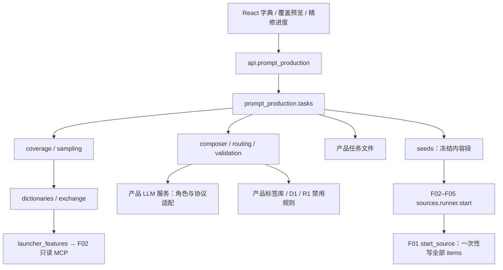

# F06–F07 提示词生产模块设计

实现补充（0.59.0）：新任务冻结 composer-v2，补齐 R1-nsfw 与 R0-routing-v2；一次评级/围栏复查后的 SFW→NSFW 回退共用修复预算，旧 composer-v1 保持原模板。真实 LLM 质量与费用验收由用户暂缓，见 [本地综合验收](66-本地功能收尾与综合验收.md)。

版本：设计稿 v0.1；日期：2026-10-12。仅模块规格、类型合同与测试清单；不含实现，不修改既有架构文件。

0.30.0 补齐 §4 的特征词典多文件 TXT 导出和导入有效行选择，见 [验收记录](37-F06-词典TXT与选择导入验收.md)。特征按维度打包 UTF-8 TXT 与编号文件映射；两种词典的 TXT 均要求明确确认信息损失及当前版本。原始导入预览冻结完整记录及诊断，选择无错误记录后生成新预览并重新校验聚合冲突；追加沿用版本与持久请求凭据。文件整体格式损坏不能通过选择部分内容绕过。无模型/Launcher 调用，不新增项目字段。

0.26.0 完成整份词典和覆盖方案删除，见 [验收记录](33-F06-词典与覆盖方案删除验收.md)。删除携带读取版本、请求键；先原子保存删除记录，再按内容摘要清理原文件。旧创建/更新/导入/追加请求不能复活已删除资源，清理中断有只读清单及手动重试。已创建任务使用冻结输入和结果；自动回写到已删词典明确报错，不丢任务结果。界面沿用确认与长按，草稿未处理不能删除。真实 Launcher、词库和 NSFW 独立模板仍待后续。

0.25.0 补齐图形化覆盖方案编辑，见 [验收记录](32-F06-图形化覆盖方案编辑验收.md)。表单维护主维度/取值、整体比例与数量、排除谓词和无人物规则；格子矩阵选择权重，后端按原算法预览计划配额。数值以字符串编辑，uint64 种子完整往返；非法表单和失效权重明确保留，沿用草稿保护、版本冲突检查及请求凭据。这里是纯方案配额规划，仍须采样预览确认词典候选可行性。

0.24.0 完成 §5 覆盖报告与 F14 §5.2 的矩阵预览、三维切片及键盘格子明细，见 [覆盖矩阵验收](31-F06-F14-覆盖矩阵与格子明细验收.md)。预览明细冻结完整已选集合并有数量/字节/时间上限；任务明细绑定 revision，读取已持久结果，不重新采样。报告矩阵仍为只读；方案规则由独立方案编辑器修改。

0.23.0 补齐 §4 的词典条目表单编辑：特征维度/候选与提示词条目的新增、修改、复制、排序、删除确认及即时撤销，20 条分页与本地检索；表单和高级 JSON 共用草稿，未知字段保留原文。沿用已有整体替换 API、revision CAS、持久请求凭据及原子保存，展示重复合并报告；已有任务快照不变。见 [词典条目编辑器验收](30-F06-词典条目编辑器验收.md)。历史进度段中的“完整词典条目编辑器”缺口由本轮补齐；覆盖图形化矩阵、覆盖方案删除及真实 Launcher 相关部分仍待后续。

0.22.0 按 §6 的“编辑后重验”合同完成待审核提示词人工复验，见 [人工复验验收](29-F06-F07-提示词人工复验验收.md)。仅处理已完成且后台排空任务中的 review_required 条目；使用冻结输入/词库/规则/参数检查，明确人工评级且不能低于已有证据，通过后原子保存并重算结果。不提供禁用内容/待审表达强制放行，不自动调用模型、补位或回写词典。已保存条目保留原始/模型/人工三份内容与只读复验记录。

0.21.0 实现产品级覆盖方案保存、版本冲突保护、JSON/YAML 模板交换及采样表单载入，见 [覆盖方案与模板交换验收](28-F06-覆盖方案与模板交换验收.md)。运行存储遵循 §4 的 `coverage/<uuid>.json`，模板按同一 Plan schema 校验；任务仍冻结规则值，不增加项目或来源追溯字段。模板编辑器为文本表单，方案删除、图形化矩阵编辑器与待审核条目编辑/复验仍待后续。

0.20.0 实现任务占用统计、手动批量清理和部分合格结果 JSON／CSV／TXT 导出，见 [任务管理与结果导出验收](27-F06-F07-任务管理与结果导出验收.md)。0.19.0 的源草稿、完整 seeds 交接和未知提交核对见 [生成源交接验收](26-F06-F07-生成源交接验收.md)；真实生成仍受未审核适配器阻止。0.18.0 的 R1 SFW 精修、可选 R5 分级、逐项持久化与有限补位、手动/自动词典追加见 [精修与词典回写验收](25-F06-F07-精修与词典回写验收.md)；0.17.0 的词典/采样见 [本地提示词生产验收](24-F06-F07-本地提示词生产验收.md)。Launcher 词库与语义审核编辑工作流仍待后续实现；NSFW 模板遵循 C08 未开放。下文保留完整目标规格。

## 1. 边界、依据与依赖

权威依据：[05](05-项目结构与数据模型.md) §4.4–4.5、§6–9；[F01](F01-project-db-设计.md) §5.1、§6.5；[F02–F05](F02-F05-生成后端设计.md) §4；[R1](../skills/prompt-composer/SKILL.md)；[06](06-Skill需求清单.md) R0/R1、D1/D3；[02](02-NAI-MCP使用方案.md) §4。冲突以这些合同为准，变更仅提案。
F06 负责字典、约束、采样与批内去重；F07 负责可选精修、结果验收及词典追加。输出只有内容段；画风拼接、像素选择、NAI 调度归 F02–F05。import 不经过本模块。
项目只接收完整 `ItemSeed(seq,prompt,aspect)`；不存字典引用、采样配置、rating、生产任务 ID 或生产模型信息。生产任务属于产品层，不写 project.db 的 jobs/images/annotations。



## 2. 包布局与模块合同

下表路径以 `src/stylelora/` 为根；仅规划，不创建 Python 文件。每模块公开接口见 §3、§6–9；测试编号见 §12。

| 模块 | 职责 / 依赖 | 错误处理 / 幂等性 | 最小测试 |
|---|---|---|---|
| prompt_production/types.py、validation.py | 不可变 DTO、R1/字典 schema、内容校验；标准库、标签索引 | 非法输入在边界拒绝；同版本输入确定性 | T01、T08 |
| dictionaries.py | 产品字典 CRUD、revision CAS、原子追加；文件系统、validation | IO 保留旧文件；同请求键同内容 no-op | T02 |
| exchange.py | JSON/CSV/TXT、YAML 模板交换；dictionaries、标签索引 | 逐行诊断，默认整批不写；同预览提交不重复导入 | T03 |
| launcher_features.py | 只读词库适配、别名候选；F02 MCP client | 未知 schema 拒绝；冻结响应后重采样确定性，远程随机不承诺 | T04 |
| coverage.py、sampling.py | 格子/比例配额、混合候选、seed 化求解；types、字典快照 | 区分无解与搜索耗尽；同快照/算法/seed 同结果 | T05–T07 |
| routing.py | 围栏、D1/R0 分级、角色选择；产品分级服务 | 未知 verified=false；不因重试反复升级 | T09 |
| composer.py | R1 请求、校验、精修；LLM 服务、routing、validation | 单项失败隔离；已提交 outcome 不再调用，外部费用非 exactly-once | T08–T11 |
| tasks.py、task_store.py | 产品批处理、恢复、结果冻结；以上模块、产品文件 | 代次/CAS 防迟到；提交 outcome 和计数原子，重复结果不增计数 | T12 |
| seeds.py | 最终去重、序列化、导出 ItemSeed；F01 类型 | 不足数拒绝就绪；同冻结结果同 seeds | T13–T14 |
| api/prompt_production.py | FastAPI DTO/分页/摘要事件；tasks、dictionaries | 422/409/503；写请求键防重复 | T15 |
| tagging/trigger_validation.py（F22） | 触发词与标签/style_prompt 冲突检查；标签索引 | 索引未知返回 unverifiable；纯只读确定性 | T16 |

## 3. 数据类与类型接口

以下均为声明规格；DTO 用 frozen dataclass，JSON 边界数组转 tuple；`Aspect/ItemSeed/JsonObject/ProjectHandle/SourceRow` 复用 F01，`Path/Mapping/Sequence/Protocol/Literal` 为标准库类型。ID 均为产品内 UUID 字符串，禁止当路径拼接。
```python
Tag = str
Dimension = str
Rating = Literal['general', 'sensitive', 'questionable', 'explicit']
Aspect = Literal['landscape', 'portrait', 'square']

@dataclass(frozen=True)
class FeatureCandidate:
    dimension: Dimension
    tag: Tag
    rating: Rating | None = None
    source: Literal['dictionary', 'launcher', 'manual'] = 'dictionary'

@dataclass(frozen=True)
class PromptEntry:
    tags: tuple[Tag, ...]
    natural_language: str | None
    aspect: Aspect | None
    rating: Rating | None

@dataclass(frozen=True)
class FeatureDictionary:
    dictionary_id: str
    name: str
    schema_version: int
    dimensions: Mapping[Dimension, tuple[FeatureCandidate, ...]]
    revision: int

@dataclass(frozen=True)
class PromptDictionary:
    dictionary_id: str
    name: str
    schema_version: int
    entries: tuple[PromptEntry, ...]
    revision: int

@dataclass(frozen=True)
class ConstraintSpec:
    dimension: Dimension
    tag: Tag
    minimum_ratio: float | None
    maximum_ratio: float | None
    minimum_count: int | None
    maximum_count: int | None

@dataclass(frozen=True)
class CoveragePlan:
    primary_dimensions: tuple[Dimension, ...]
    cell_values: Mapping[Dimension, tuple[Tag, ...]]
    constraints: tuple[ConstraintSpec, ...]
    target_count: int
    random_seed: int

@dataclass(frozen=True)
class CompositionRequest:
    features: Mapping[Dimension, tuple[Tag, ...]]
    rating_policy: Literal['sfw', 'nsfw']
    nl_enabled: bool
    composition_mode: Literal['normal', 'scenery_first']
    tag_range: tuple[int, int]
    aspect_hint: Aspect | None

@dataclass(frozen=True)
class ComposerResult:
    status: Literal['ok', 'refused_nsfw', 'invalid_input']
    tags: tuple[Tag, ...]
    natural_language: str | None
    out_of_frame: tuple[str, ...]
    added: tuple[str, ...]
    dropped: tuple[Mapping[str, str], ...]
    aspect: Aspect | None
    reason: str | None

@dataclass(frozen=True)
class SeedRecord:
    seq: int
    prompt: str
    aspect: Aspect | None
    normalized_tags: tuple[Tag, ...]

@dataclass(frozen=True)
class TaskOutcome:
    task_id: str
    index: int
    status: Literal['pending', 'running', 'ok', 'skipped', 'failed']
    reason_code: str | None
    entry: PromptEntry | None

def normalize_tag(tag: str) -> str: ...
def build_feature_snapshot(source: FeatureDictionary | None, *, launcher: bool) -> FeatureDictionary: ...
def sample_seeds(plan: CoveragePlan, features: FeatureDictionary) -> tuple[SeedRecord, ...]: ...
def deduplicate_seeds(records: Sequence[SeedRecord]) -> tuple[SeedRecord, ...]: ...
```

`CompositionRequest.rating_policy='nsfw'` 仅为 C08 扩展预留，现有 R1 调用严格只传 sfw。`rating_verified: bool` 由 R0 请求信封追加，不改 R1 核心六字段。reason 在内部可空，序列化严格遵守 ok 省略、非 ok 必填；dropped 每对象恰有 tag/reason 两个字符串键。
补充 DTO 字段合同（等同数据类声明；所有字段必须验证）：

| 类型 | 字段与约束 |
|---|---|
| SamplingRequest | plan: CoveragePlan；prompt_dictionary_ids: tuple[str,...]；feature_dictionary_ids: tuple[str,...]；live_features: bool；source_weights: Mapping[str,int]；optimize: bool；options: CompositionOptions；fence: FencePolicy |
| CompositionOptions | nl_enabled: bool；composition_mode: Literal['normal','scenery_first']；tag_range: tuple[int,int]；aspect_hint: Aspect \| None |
| FencePolicy | enabled: bool；threshold: Rating；nsfwfallback: bool；use_rating_model: bool；阈值以上才排除 |
| RatingDecision | rating: Rating \| None；verified: bool；reason: Literal['explicit','keyword','rating_model','nsfwfallback','refused_nsfw','default']；route: Literal['normal','nsfw'] |
| CoverageReport | requested/available: int；cell_counts: Mapping[str,int]；constraint_counts: Mapping[str,int]；deficits: Mapping[str,int]；status: Literal['satisfied','unsatisfiable','search_exhausted'] |
| ImportPreview | preview_id: str；digest: str；entries: tuple[PromptEntry,...]；features: tuple[FeatureCandidate,...]；issues: tuple[Issue,...]；base_revision: int |
| Issue | code/message: str；row: int \| None；field: str \| None；severity: Literal['error','warning'] |
| AppendResult | revision: int；inserted/duplicates: int；conflicts: tuple[Issue,...] |
| TaskView | task_id: str；revision: int；status: Literal['pending','running','paused','done','failed','canceled']；outcomes: tuple[TaskOutcome,...]；coverage: CoverageReport；ready: bool |
| FrozenSeeds | digest: str；items: tuple[ItemSeed,...]；count: int；只有这份投影可交给生成源 |

## 4. 产品字典与交换格式

根目录固定 `%APPDATA%/StyleLoraAutom/`；`dictionaries/features/<uuid>.json`、`dictionaries/prompts/<uuid>.json`、`coverage/<uuid>.json`。推荐 JSON 为唯一运行存储格式；YAML 仅可选模板导入导出，安全加载后按同一 schema 验证，禁自定义对象/重复键。没有项目副本或生成源溯源字段。
共同信封：`schema_version:1, kind:'features'|'prompts', dictionary_id, name, revision:1`；features 载荷为 dimensions，prompts 为 entries。未知高版本拒绝；旧版本通过显式迁移另存备份，不猜字段。原子写为同目录临时文件→flush/fsync→replace；单进程产品写队列串行，revision CAS 防覆盖。

```json
{"schema_version":1,"kind":"features","dictionary_id":"<uuid>","name":"基础特征","revision":1,
 "dimensions":{"count":[{"tag":"no humans","rating":"general"},{"tag":"1girl","rating":null}],
 "scene":[{"tag":"forest","rating":"general"}],"view":[{"tag":"wide shot","rating":null}]}}
```

```json
{"schema_version":1,"kind":"prompts","dictionary_id":"<uuid>","name":"内容段","revision":1,
 "entries":[{"tags":["no humans","forest","wide shot"],"natural_language":"A river runs through the forest.","aspect":"landscape","rating":"general"}]}
```

FeatureCandidate.dimension 从父键恢复，source 仅运行时用、不写词库；条目不加来源追踪字段。NL 缺省/空串统一 None，tags 必须非空；rating 缺省 None，aspect 缺省 None。示例为格式样例，无 LLM 时不要求达到 R1 的 15 tags。

| 格式 | 完整提示词词典映射 | 特征字典映射 |
|---|---|---|
| JSON | 上述完整信封；无损往返 | dimensions → 候选对象数组；同维度规范 tag 重复合并，rating 冲突取高并报告 |
| CSV | UTF-8-sig 读取，列 tags/natural_language/aspect/rating；tags 单元格为 JSON 数组，CSV 标准引号转义；空字段为 None | dimension/tag/rating，每行一个候选；dimension 必填，不按文件名猜 |
| TXT | 一行一个 prompt；逗号分段，标签索引命中归 tags，余段顺序并入 NL；aspect/rating=None；无 tag 的行报错 | 每行 `tag<TAB>rating`，rating 可省；导入时指定 dimension；支持 D3 每维一文件 |
| TXT 导出 | tags 用 `, ` 连接后追加 NL；不导出 aspect/rating，合并描述内部换行；必须提示有损并给 JSON/CSV 选项 | 每维一个编号 TXT，以 ZIP 下载；保留 rating，dimensions.json 对照维度，不保留词典信封信息 |

导入先预览再提交，错误默认整批拒绝；允许用户明确选有效行新建预览。不静默剥权重或丢禁用词，给逐行修正建议。别名规范化需可信标签映射；search/suggest 结果只是候选，未确认不得自动替换。TXT 原始片段保留在产品预览供核对。

0.30.0 细化：CSV 行号按逻辑记录（表头为1）、JSON 按维度/条目遍历的全局序号、TXT 按物理行；空白 TXT 行不参与选择。原文件摘要、完整逐行摘要与解析内容一起绑定预览。按分页读取记录，只能提交存在且无逐行错误的编号；服务端使用冻结值重新执行格式/数量/去重/评级冲突检查，不读取新词库或接受客户端替换值。JSON 信封非法或 CSV 未闭合等整体解析错误禁止选行；重复提示词评级冲突可通过明确选一条生成新预览，选取冲突双方仍不可提交。预览有效期沿用15分钟，成功追加的持久凭据支持过期后的原请求重放。

字典追加推荐：规范 tag 集合 + 规范 NL（仅首尾/连续空白归一）+ aspect 全同才算内容重复；rating 不进键，遇不同 rating 报冲突、推荐高值，不自动覆盖。相同 tags 但 NL/aspect 不同可存为不同条目，抽同一批 seeds 时仍只能取一个。请求键和请求摘要随该字典文件的 `_operations` 映射原子保存（产品写入凭据，不是来源）；导出剔除它，重放先查凭据再做 revision CAS。

```python
def load_dictionary(dictionary_id: str) -> FeatureDictionary | PromptDictionary: ...
def save_dictionary(value: FeatureDictionary | PromptDictionary, *, expected_revision: int,
                    request_key: str) -> int: ...
def preview_import(data: bytes, *, format: Literal['json','csv','txt'],
                   kind: Literal['features','prompts'], dimension: str | None) -> ImportPreview: ...
def commit_import(dictionary_id: str, preview: ImportPreview, *, request_key: str) -> AppendResult: ...
def append_entries(dictionary_id: str, entries: Sequence[PromptEntry], *,
                   expected_revision: int, request_key: str) -> AppendResult: ...
def export_dictionary(dictionary_id: str, format: Literal['json','csv','txt']) -> bytes: ...
async def read_launcher_features(selection: JsonObject) -> tuple[FeatureCandidate,...]: ...
```

Launcher 适配（全部待实测）：docs/02 只确认 `search_tags` 的 search/suggest 用途、`list/get_tag_library_*` 家族与 `list_fixed_tags`，没有随机词库专用工具名称/参数/返回字段。实施时先 tools/list，按版本/schema fixture 映射准确工具名、分页、分类、词条文本与评级，不把通配名直接发送。
内部中间格式为 `{group_path: tuple[str,...], text: str, rating: Rating|None}`；这是本产品 DTO，不声称是 Launcher 返回格式。UI 显式将 group_path 映射为维度；包含逗号的多 tag 行必须预览拆分，不能默认为一个候选；整段提示词应导入 prompts 类型。无评级保持 None，禁止从分类名猜安全等级。
随机词库若仅有文件导出，先由用户选择文件并建立版本化适配器；若有只读枚举工具，则冻结全部分页结果再用本地 PRNG 抽取。只有远程随机工具且不能指定 seed 时，仅冻结首次结果可重放，不宣称远端采样可复现；不调用写页面/随机化 UI 工具。现场模式不落字典，只进产品任务输入快照。

## 5. 覆盖矩阵 schema 与默认模板

CoveragePlan 核心字段见 §3，JSON 另含 `schema_version:1, algorithm_version:'coverage-v1', cell_weights:Mapping[str,int], exclude:tuple[Predicate,...]`；Predicate 为 `all_tags:tuple[str,...], none_tags:tuple[str,...]`，仅完整 tag 集合判断，禁止表达式执行。每维抽一个候选，需多 tag 特征可由多个维度表达，本版不引入随机语法。
主维度必须 2–3 个；cell_values 给各维取值，笛卡尔积构成格子。cell_id 为各维名/规范值的规范 JSON 字符串，非易碰撞分隔串；权重为正整数、默认1，显式 exclude 才能删格。constraints 对整批最终 tags 计数，不仅对现场生成部分计数，dimension 用于 UI 分类；比例为有限 [0,1]，上下界与绝对数量同时存在时取更严格者。

```json
{"schema_version":1,"algorithm_version":"coverage-v1","primary_dimensions":["scene","lighting"],
 "cell_values":{"scene":["forest","beach","city street"],"lighting":["sunlight","night"]},
 "cell_weights":{},"exclude":[],"target_count":100,"random_seed":20261012,
 "constraints":[{"dimension":"count","tag":"no humans","minimum_ratio":0.15,"maximum_ratio":null,"minimum_count":null,"maximum_count":null},
 {"dimension":"view","tag":"wide shot","minimum_ratio":0.10,"maximum_ratio":null,"minimum_count":null,"maximum_count":null}]}
```

模板的其余维度：count=`no humans/1girl/1boy/2girls`；view=`wide shot/full body/upper body`；angle=`from side/from above`；服装/动作由用户词库提供。no humans 时不抽 appearance/clothing/pose/expression；这些兼容规则随模板存为版本化规则，不作为所有用户方案的隐藏比例。六格 N=100 时均匀配额为17/17/17/17/16/16，余数归属由 seed 决定。
覆盖评价要求每候选在每主维度恰命中一个配置值；零命中或多命中报 unclassified/ambiguous，预览后用户补充标签/改模板或改用纯随机。不开覆盖时 plan 可由 API 用独立 `coverage_enabled:false` 禁用，随机抽取本身仍可用；不会强迫每个提示词词典有主维标签。

采样算法（无实现）：

1. 冻结已选词典内容、D1/标签映射/规则版本、矩阵和来源权重。seed 缺省由系统生成 uint64 并立即返回/保存；候选按规范键排序，用 `Random(seed)` 独立实例；记录 Python/算法版本，不用 hash()、全局随机或异步完成顺序。
2. 完整条目保留原顺序；现场候选按维度组合，先做围栏和互斥过滤。普通无覆盖模式将去重后的词典候选视为一个池，现场生成是另一池；默认两池等权，只有一个池则全取，词典多选不因重复条目增权。
3. 建格后每格先保底1，N<有效格数报无解；剩余 N-K 按 cell_weights 用最大余数法分配，余数同值用 seed 排序。整体下界 ceil(N×min_ratio)，上界 floor(N×max_ratio)，与数量界取交集；比例可以重叠，不能把所有 min_ratio 相加简单判无解。
4. 用来源权重产生候选优先序；有限候选最多默认10000个，现场按确定序号子 seed 生成。以规范 tag 集合为唯一键，跨来源重复只保留优先候选；来源权重是抽样偏好而非覆盖硬配额，统计实际占比。
5. 对候选做确定顺序的回溯选择：每格精确配额、整体上下界、每键至多一次；先搜索最少可选格，用剩余容量/上界剪枝。达到默认100000节点停止，返回 search_exhausted，不能说数学无解。只有完整枚举所有允许组合/词条且搜索穷尽才 unsatisfiable；现场池因候选上限截断或随机未取全时亦属 search_exhausted。
6. 返回各格目标/实际、比例缺口、围栏排除/重复/不可分类数量和修改建议；绝不自动放宽围栏、配额或重复要求。用户改 N/方案后创建新预览；允许导出部分结果，但不足数不能标 ready 或启动源。
7. LLM 后重新用最终 tags 分类、去重、验配额；移出格/重复的结果淘汰，按冻结候选顺序补位，最多2轮精修补位；仍不足返回缺口。可复现只保证抽样输入，远端 LLM 文本不保证确定性；重放已持久结果才逐字一致。

## 6. 围栏、R1 与 LLM 服务接口

rating 顺序 general < sensitive < questionable < explicit。组合的显式 rating 取已知最高值；任一候选未知时最高值仅为下界、verified=false，全部显式已知才 verified=true。再匹配 D1（精确规范 tag、最高命中等级）；已知 NSFW 下界不可被较低结果降级。没有结论时仅在用户启用 rating 角色后请求分级；uncertain 保持未知，再按 nsfwfallback/普通兜底。此处只存产品任务判定，不伪造 images 行。
围栏默认开、threshold=sensitive（Q02）；开时排除高于阈值的条目/组合，未知按 docs/05 普通未验证路线，不冒称围栏完成可靠分级。关闭围栏仍执行路由；nsfw 路线分界固定 questionable，独立于用户围栏阈值。fallback 走 nsfw 但 verified=false，围栏开时保守排除 fallback 组合并说明是策略排除。
`refused_nsfw` 将本项提升到至少 questionable（保留已有更高值）、verified=true，先重验围栏；围栏排除则跳过候选并补位，围栏允许才走 prompt_nsfw，至多一次重路由。nsfw 角色空则 skipped/role_empty、保留原始条目；该“跳过”是精修状态，可仍为有效 seed，不是 source_items.skipped。第二次拒绝标 skipped/refusal_repeated，保留原始条目并重验门禁，不循环。
R1 当前只有 sfw；C08 未采纳时，即使 prompt_nsfw 有模型也不能用 R1 冒充 nsfw 模板，记 skipped/nsfw_contract_missing 并保留原组合。prompt 角色空或用户关闭优化同样保留原值。原值仍须通过内容校验、围栏和覆盖，不能借跳过 LLM 绕过门禁。

| LLM 服务 DTO | 最小字段（本模块需求，不实现服务层） |
|---|---|
| RoleBinding | binding_id: str；role: Literal['prompt','prompt_nsfw','rating']；model: str；protocol: Literal['openai_chat','openai_responses','anthropic_messages']；revision: int；不包含密钥 |
| LlmRequest | request_id: str；binding: RoleBinding；system_text: str；payload: JsonObject；response_schema: JsonObject；timeout_s: int；transport_retry_limit: int |
| LlmReply | text: str；actual_model: str；request_id: str；服务层可附脱敏用量，产品任务不依赖它生成 seeds |
| LlmFailure | code: str；retryable: bool；outcome: Literal['not_sent','unknown','rejected']；safe_message: str |

```python
class LlmService(Protocol):
    async def resolve_role(self, role: Literal['prompt','prompt_nsfw','rating']) -> RoleBinding | None: ...
    async def complete(self, request: LlmRequest) -> LlmReply: ...

def classify_rating(entry: PromptEntry, policy: FencePolicy) -> RatingDecision: ...
async def resolve_rating(entry: PromptEntry, policy: FencePolicy, llm: LlmService) -> RatingDecision: ...
def validate_composer_result(text: str, request: CompositionRequest) -> ComposerResult: ...
async def refine(entry: PromptEntry, request: CompositionRequest, *, task_id: str, index: int,
                 rating: RatingDecision, llm: LlmService) -> TaskOutcome: ...
def plan_coverage(request: SamplingRequest) -> CoverageReport: ...
async def create_task(request: SamplingRequest, *, request_key: str) -> TaskView: ...
```

classify_rating 是本地阶段，resolve_rating 才可调用 rating 服务。每次 complete 通过产品全局并发闸门（默认2），本模块不直接实现三协议、令牌轮换或429退避；服务层先轮换令牌、全部受限再有限退避，共享单请求重试预算，避免双层倍增。
一候选一请求，批次并发而非把多项塞进 R1。输入 features 使用抽样维度；完整词条没有维度时由标签分类映射，无法分类的合规 tag 放 content 维，已有 NL 不塞进 tags、不扩展 R1 输入字段；精修生成新 NL，原 NL 保存在产品任务原值中供对照（Q04）。
aspect_hint 优先词条已有 aspect，再取用户显式 hint；无 hint 传 null，不能把源默认当 hint。ok 必须合法非空 aspect；最终词条 aspect 取原值 > 合法 LLM 值，均无则 None。返回合法 hint 却未照抄视作 schema_contract 错误；源默认只在生成时使用。
system_text 为冻结 R1 文本加 R0/最终 JSON 契约，features 仅作为数据。禁用规则以 R1 §3.5 为准，不在本设计重列；输出 tags/NL/added 都检查，artist 分类由标签库辅助。确定命中拒绝，语义不确定给 review_required，不声称正则可识别全部同义画风描述；人工确认仅接受合规内容或编辑后重验。
严格 JSON：禁止代码围栏、额外文本、重复键、NaN；校验状态分支、全部字段、tag_range、NL 开关、禁用/权重/负面、out_of_frame 泄漏及 added/dropped 一致性。ok 不得带 reason，非 ok 必须空 tags/数组及 null NL/aspect、非空 reason。tag 规范化去重只用于比较，不重排 R1 人物块；语义检查无法确定的情形统一 review_required。
JSON/契约错误可带校验摘要修复重问1次；invalid_input 为语义终态，不原样自动重试，保留诊断后补其他候选。连接/429/5xx 最多2次传输重试；请求超时结果未知时标 failed/llm_outcome_unknown，人工重试新任务以免悄悄重复计费。认证/绑定缺失暂停整批；普通单项失败继续。R0 重路由与修复预算各自计数且有总上限：每候选至多4次语义调用，每次至多3次传输尝试。

## 7. 产品批处理状态与持久化

推荐持久化于 `%APPDATA%/StyleLoraAutom/prompt_tasks/<task_id>.json`，schema_version=1；输入快照、算法/seed、角色绑定、Skill/D1 文本快照与哈希、候选有序清单、逐项 outcome、配额报告、请求键/摘要、revision、计数、最终 seeds 均在同文件原子更新。无 URL/token、项目路径/ID或 source_id；不是项目溯源记录。结果取索引顺序，不取完成顺序。
状态：pending→running→done/paused/failed/canceled；paused→running/done/failed/canceled；pending→failed/canceled。done 表示所有候选处理完，可能有缺口；仅数量、内容、围栏、去重及覆盖全部通过时 ready=true。终态重做创建新任务，允许引用产品旧快照，不回开终态。
冻结输入→本地预检/抽样→分级→逐项精修→原子 outcome→最终复验/有限补位→冻结 seeds。每项 index 在派发前持久化 running；返回提交时比对任务运行代次和 revision。暂停停止新派发、接收当前代次在途结果；取消丢弃迟到结果，不自动追加词典。计数从 outcomes 重算。
应用重启将 running 任务转 paused；已落终态不重做，未落结果的 running 项标 llm_outcome_unknown，用户选择新任务重试；不能仅凭请求 ID 保证服务端去重。冻结角色绑定不可用时保持 paused，不换模型；密钥仍由服务层按 binding 解析，配置修正后可继续未派发项。
词典追加是独立动作：用户可在建任务时指定目标词典并授权自动追加合格优化结果，或完成后手动追加。使用 task_id+选中结果摘要作 request_key；词典凭据先落、任务标记后落，崩溃重放返回原 AppendResult。目标 revision 冲突时重新预览合并，不覆盖现有条目；任务成果不会因追加失败丢失。
任务文件保留至用户删除，界面展示大小与批量清理；不按 TTL 自动删除未知在途或尚未取走结果。任务清理与项目无依赖，源已启动后删任务/词典不影响生成。产品任务内部快照仅用于重放本任务，不提供“由图片追溯字典/LLM”功能。

```python
def get_task(task_id: str) -> TaskView: ...
async def control_task(task_id: str, action: Literal['pause','resume','cancel'],
                       *, expected_revision: int) -> TaskView: ...
def freeze_seeds(task_id: str, *, expected_revision: int) -> FrozenSeeds: ...
def serialize_content(entry: PromptEntry) -> str: ...
def to_item_seeds(entries: Sequence[PromptEntry]) -> tuple[ItemSeed,...]: ...
def validate_trigger(trigger: str, style_prompt: str) -> tuple[Issue,...]: ...
```

## 8. 去重、内容序列化与 F01 启动交接

normalize_tag：小写、下划线换空格、首尾去空白、连续空白折叠；只有标签索引确认的别名才折成同 canonical tag。批内键为排序后的规范 tag 集合；不含 NL/aspect/rating，保留候选优先序中的第一项并报告被抑制差异。输入 tags 必须非空，避免纯 NL 全部落空集合键。重复补位不能用改 NL/aspect 来绕过。
输出保留 tag 原有语义顺序、使用空格形式，`", ".join(tags)` 后以 `, ` 追加非空 NL；不带权重、方位比例元标签、画风段或触发词。NL 中的逗号仍按 docs/05 §8.2 解析，不引入自定义转义；输出预检逐片段分类，未知 tag 提示将被解析成 NL，NL 某片段恰好命中标签也提示。不保证纯文本能无损重建原始结构；有结构的交换用 JSON/CSV（Q05）。
freeze_seeds 必须先完成全部预检并生成最终不可变列表，seq=1..N 连续、N等于源 target_count。aspect 保持词条已有 > LLM > None；generation_presets 及默认 aspect 由源服务物化，不传进采样器、不在这里选像素。
UI/源协调层取得 FrozenSeeds 后调用 F02–F05 `start(project, source_id, items)`，后者经 writer 调 F01 `start_source(db, source_id, items)`；外部 LLM/MCP/文件导入均在该事务之前完成。事务一次写入所有 seeds 并锁源，不逐张边采边入库。只有 items 投影传给 F01，不把任务/字典/模型/随机 seed/评分塞进 config_json。
启动未知提交先查询 source/items，严格比较锁定配置和全量 `(seq,prompt,aspect)`；相同返回现状，不同报 StateConflict，不重抽。若响应丢失且产品任务已删除，直接查询既有源确认状态，不能重建输入再启动。续跑调用 resume，仅读 items/config；词典删改、角色移除或任务清理都不触发重采样。
生产阶段候选跳过/失败发生在启动之前，不生成 source_items 占位；NAI 源绝不写 skipped。批内只保证内容 tag 集合不同，不宣称图片视觉去重，后者属于 F08。

F22 属项目设置/生成源表单/导出前校验，非提示词生产职责。触发词规范化后查完整 Danbooru tag/alias（包含 artist 等分类）；搜索建议无精确命中不能证明不存在。style_prompt 检查规范化连续文本包含触发词，权重解析不确定则 unverifiable。索引缺失不伪装通过；编辑可暂存，正式使用前修复校验。触发词由导出前挂，禁止本模块添加到内容段。

## 9. FastAPI 端点草案

均为产品级 `/api/prompt-production` 前缀，除 F22；React 使用返回 schema、预览与报告，不在前端重新计算配额。GET 分页默认200、上限1000；任务 outcome 分页不意味着分段启动源。

| 方法/相对路径 | 输入 → 输出 | 合同 |
|---|---|---|
| GET /dictionaries；GET /dictionaries/{id} | kind/page → 摘要或字典 | 只读，含 revision |
| POST /dictionaries；PUT /dictionaries/{id} | 字典 DTO → revision | request_key；更新 If-Match revision |
| DELETE /dictionaries/{id}；DELETE /coverage-plans/{id} | 无 body；If-Match、Idempotency-Key → 删除摘要 | 版本一致才删除，先落删除记录再移除原文件；410 阻止复活 |
| GET /dictionaries/deletions；GET /coverage-plans/deletions | limit/cursor → 尚存原文件的删除记录摘要 | 只读分页，重试仍走原 DELETE 和原版本，不强制覆盖剩余文件 |
| POST /imports/preview | multipart file、format/kind/dimension → ImportPreview | 不写字典，10MiB 上限 |
| GET /imports/{id}/rows | digest + cursor/limit → 冻结记录分页 | 不重新解析；错误行不可选择；跨预览游标拒绝 |
| POST /imports/select | preview_id/digest/rows → 新 ImportPreview | 重新检查选中集合并报告排除数；原预览保持 |
| POST /dictionaries/{id}/imports | preview_id/digest/request_key → AppendResult | 校验预览内容未变及 revision |
| GET /dictionaries/{id}/export | format → 附件 | TXT 须 acknowledge_lossy=true + If-Match 当前版本；响应附有损字段，features 返回 ZIP；JSON/CSV 可携带版本校验 |
| GET /launcher/capabilities | 无 → 受支持只读导入能力/schema | 不探测生成、不改页面 |
| POST /launcher/preview | 已校验选择/分组映射 → ImportPreview | 未实测版本拒绝，报告待适配 |
| POST /coverage/preview | SamplingRequest → CoverageReport/预览摘要 | 不调精修 LLM；标记未知 rating |
| POST /tasks | SamplingRequest/request_key → TaskView（202） | 立即冻结输入，后台处理 |
| GET /tasks/{id}；GET /tasks/{id}/outcomes | 无/page → 状态/分页结果 | 供轮询/重连恢复 |
| POST /tasks/{id}/control | action/expected_revision → TaskView | 同目标幂等，过时代次409 |
| POST /tasks/{id}/append | 目标词典/结果索引/revision/request_key → AppendResult | 只追加已通过校验结果 |
| POST /tasks/{id}/seeds | expected_revision → FrozenSeeds | ready=false 返回409及缺口 |
| GET /tasks/{id}/events | Last-Event-ID → SSE摘要 | 单调 sequence；缺口重新 GET，不发送 prompt/token |
| POST /api/validation/trigger（F22） | trigger/style_prompt → Issue[] | 只读，不改项目 |

POST 创建请求键同键同摘要返回旧对象，不同摘要409。编辑/导入/追加默认全成全败。0.26.0 的删除记录存于产品目录 `dictionary_tombstones/<uuid>.json`、`coverage_tombstones/<uuid>.json`，仅保留名称、原版本/修订、内容摘要、请求键和历史操作键等去重信息，不保留词典或方案载荷。删除记录落盘后原编号返回410，旧创建请求也不返回已删除对象。删除不会联动项目或既有任务；源启动沿用既有 sources API，本文不增第二套 start_source。

## 10. 错误与原因码

统一错误 DTO：`code: str, message: str, retryable: bool, issues: tuple[Issue,...]`；message 脱敏，无端点密钥或整段 LLM 原文。下表 skipped/failed 指产品任务项。

| 原因码 | HTTP / 处理 |
|---|---|
| schema:invalid / newer_version / import_mapping_required | 422；字段/行定位，禁止部分静默写入 |
| dictionary:revision_conflict / request_key_conflict / rating_conflict | 409；重预览，不覆盖 |
| storage:io_error / corrupt_snapshot | 503；旧文件保留、任务暂停；损坏文件隔离，不重采 |
| launcher:unsupported_schema / unavailable | 503；只影响该来源，用户修改来源后新预览 |
| coverage:unsatisfiable / search_exhausted / unclassified / ambiguous | 422（预览）或任务报告；不同原因分别展示，不自动放宽 |
| sampling:duplicate / exhausted / coverage_drift | 候选淘汰并有限补位；最终不足 ready=false |
| routing:fenced / rating_unknown / refused_nsfw | 排除 / 未验证标记 / 一次升级；见 §6 |
| composer:role_empty / disabled / nsfw_contract_missing / refusal_repeated | skipped，保留合规原值；区别于没有可用 seed |
| composer:invalid_input / forbidden_content / review_required | 单项不可接受；修正或换候选，绝不直接采用违规输出 |
| llm:invalid_json / schema_contract / timeout / outcome_unknown | 格式最多修复1次；未知结果不自动重发 |
| llm:unauthorized / binding_unavailable / rate_limited / server_error | 前两者暂停；后两者服务层限次重试，耗尽项 failed |
| seeds:not_ready / state_conflict | 409；不启动或查询已有 source，不重新抽取 |
| trigger:existing_tag / in_style_prompt / unverifiable | 422/校验 issue；提示冲突或缺失索引 |

## 11. 配置默认值与实现限制

以下是本设计推荐默认，可由产品表单改；不覆盖既定架构默认。

| 配置 | 默认 / 验证 |
|---|---|
| schema_version / algorithm_version | 1 / coverage-v1；Python PRNG 版本随产品快照记录 |
| count / random_seed | 100 / 缺省生成 uint64；count=1..10000，不以当前时间充当可复现 seed |
| coverage_enabled / 主维模板 | true / scene×lighting 六格；可显式关闭改纯随机 |
| source_weights / live_features | dictionary_pool:1, feature_pool:1 / false；现场选中时合并所选特征字典，不暗启 Launcher |
| optimize / nl_enabled | false / true；不开精修时保留原 NL，不虚构 NL |
| composition_mode / tag_range / aspect_hint | normal / [15,40] / null；仅精修强制 tag_range，min≥1、max≥min、max≤100 |
| fence.enabled / threshold / nsfwfallback / use_rating_model | true / sensitive / false / false；显式未验证标识 |
| prompt / prompt_nsfw | 按产品角色读取，默认未配置可跳过；nsfw 模板另见 C08 |
| concurrency / timeout_s | 2 / 300；与产品全局 LLM 闸门取最小值，等待队列不算单次调用时间 |
| transport_retry_limit / json_repair_limit / reroute_limit | 2 / 1 / 1；传输退避1、2秒（尊重 Retry-After，截止时间优先），本层不二次重试 |
| candidate_limit / search_nodes / refill_rounds | 10000 / 100000 / 2；预算耗尽如实报告 |
| import_limit / page_size / task_retention | 10MiB / 200（最大1000）/ 手动清理 |

§3 数据类展示核心字段，序列化完整 schema 必须包含 §5 与本节所需字段：SamplingRequest 增加 `coverage_enabled: bool, launcher_selection: JsonObject|None, append_target_id: str|None`；CoveragePlan 增加 `schema_version: int, algorithm_version: str, cell_weights: Mapping[str,int], exclude: tuple[Predicate,...]`。launcher_selection 由兼容层 schema 校验，只有 live_features=true 才启用；feature_dictionary_ids 可单独现场组合，无需 Launcher。
覆盖采样内部以 PromptEntry 而非字符串为中间值，保留 NL/rating/aspect；§3 sample_seeds 是仅特征、无精修的便利投影，混合任务主接口为 create_task。SeedRecord.normalized_tags 仅产品内部去重，不传 F01。持久化未知字段默认拒绝（保留明确的 `_operations`），不以 JsonObject 绕过已定义 DTO 校验。

## 12. unittest 最小验收清单

使用 unittest、IsolatedAsyncioTestCase、TemporaryDirectory、固定时钟/PRNG、fake LLM/标签索引/只读 MCP；不连接真实端点，不生成图片，不消耗 Anlas。下列仅验收规格，本次不编写或运行实现测试。

| 编号 | 用例与关键断言 |
|---|---|
| T01 | schema 高版本、NaN、bool 充当整数、非法 rating/aspect、空 tags 均拒；大小写/下划线/空白规范化幂等 |
| T02 | 写中断旧字典完整；CAS 冲突；相同追加请求重放不多条，NL/aspect 变体可存，rating 冲突不覆盖 |
| T03 | JSON/CSV 无损往返（逗号/引号/NL）；TXT 有损提示与 unknown→NL；UTF-8 BOM、坏编码、逐维 TSV 分级 |
| T04 | fake tools/list 缺随机工具不猜名字；分页冻结、分组映射、未知版本拒；现场输入不落词典、不调用写工具 |
| T05 | 固定 seed/快照多次生成同序列；打乱文件枚举/异步完成顺序不改变结果；六格100个总和准确 |
| T06 | no humans≥15、wide shot≥10按最终100条计；重叠约束可行；N<格数、上界冲突、围栏清空分别诊断 |
| T07 | 候选池完整穷尽才 unsatisfiable，节点超限为 search_exhausted；多词典重复不增权，混合池偏好不破格配额 |
| T08 | R1 ok/非ok/缺aspect/错误reason/未知字段/坏JSON；禁用词、语义待审、物体属性例外、消歧括号、out_of_frame 泄漏 |
| T09 | 四级边界与最高值、未知 verified=false、D1/R5/fallback 优先；围栏开过滤、关仍路由、refused 后仅一次升级 |
| T10 | 角色空保留原组合；nsfw有模型但无模板不调用 sfw R1；fake 已支持 C08 模板时 reroute 至多一次 |
| T11 | 三协议绑定原样交服务；全局在途≤2；格式修复1次、invalid_input不重试、429轮换归服务、超时未知暂停重发决策 |
| T12 | outcome 原子提交/重复回调不增计数；崩溃在调用后落盘前为unknown；暂停/取消迟到结果、词典追加双文件窗口 |
| T13 | aspect 原值>LLM>None；批内tag集合相同但NL/aspect不同仍去重；精修漂移后补位、耗尽禁止ready |
| T14 | fake F01一次收到完整1..N及prompt/aspect；不足零调用；启动重放不新增；续跑即使字典/LLM全部不可用仍无调用 |
| T15 | API请求键重复/不同摘要409、分页/SSE缺口重读、错误脱敏；产品任务无project.db jobs写入 |
| T16 | F22精确tag/alias冲突、style包含触发词、无索引unverifiable；内容段绝不添加触发词或画风段 |

## 13. 建议变更 Cxx 与待确认 Qxx

C01–C07 沿用既有文档编号，本文从 C08 起；以下仅提案，未改动权威文档、R1 或 F01。其余内容为模块细化，推荐尚不等于用户已裁决。

| 编号 | 建议变更 / 推荐 | 未采纳时边界 |
|---|---|---|
| C08 | 补齐 R1 的 nsfw 契约：推荐新增独立 prompt-composer-nsfw 模板，沿用相同结构、可见性/禁用画风规则，明示 rating_policy=nsfw；现有 sfw R1 不放宽。同步 docs/06，R0 注入 rating_verified 并保持 R1 完整非ok输出 | prompt_nsfw 有模型但无相应模板时跳过优化、保留合规原值并提示 nsfw_contract_missing；不能发送 nsfw 给 sfw R1 |
| C09 | 澄清 docs/05 §9 的提示词生产分支：无图片时 rating/refusal 缓存在产品任务候选，不写 images；跳过记产品任务精修统计，不记 project.db jobs。推荐同步这项文字澄清，保留全部既定表结构 | 按 §6–7 产品任务实现，不伪造图片/job，也不把提示词评级当生成图片评级 |

Q 编号仅限本文；每条附推荐与实现边界，无需在本次设计交付前阻塞写文档。

| 编号 | 待确认 | 推荐 |
|---|---|---|
| Q01 | 矩阵存储/默认维度及搜索预算是否接受 | JSON为运行格式、YAML仅交换；scene×lighting，整体无人物≥15%、远景≥10%；10k候选/100k节点，搜索耗尽与无解分开 |
| Q02 | 围栏阈值、未知rating与显式rating可信度 | 默认sensitive；全部显式已知才verified，混合未知标false；不把关键词未命中当general；有已知高等级先按下界路由/过滤 |
| Q03 | Launcher随机词库/标签库真实工具、导出格式、分页/别名/评级 | 用受支持版本只读fixture实测后建适配；未知工具不猜；用户映射分类→维度，本地seed抽样优先 |
| Q04 | 完整提示词词典已有NL的精修方式 | 默认抽取不精修；用户选择精修时以tags重组新NL、原NL保留对照。若要“保留原句润色”，另提R1输入扩展，不偷偷加入字段 |
| Q05 | 标签解析兼容与未知tag、NL逗号片段碰撞 | 保持docs/05逗号判定；预览提示，结构交换用JSON/CSV；标签索引补齐后重验，首版不扩展解析语法 |
| Q06 | 词典去重与批内变体取舍 | 词典键=tag集合+NL+aspect，rating冲突人工采纳高值；批内只看tag集合、候选优先序保留一个 |
| Q07 | 产品任务持久化与保留时间 | 单任务原子JSON，无project关联；用户手动清理，已落结果重放、未知调用人工重试；不保证外部只计费一次 |
| Q08 | 语义禁用词审核与F22完整标签索引 | 自动规则确定命中拒绝、不确定待审；F22需要完整Danbooru索引/alias，search_tags建议结果不足以证明非已有tag |
| Q09 | 混合来源数量分配是否需要硬配额 | 默认合并词典池与现场池等权偏好、覆盖优先，展示实际占比；硬来源配额另加显式约束，不能用多选词典数隐式加权 |

验收界限：可直接按已定合同实现产品词典、采样、sfw精修、任务与完整seeds交接；C08相关能力及Launcher未知格式只启用已验证适配。本文不要求更改项目schema、生成源状态机或aspect优先级。
