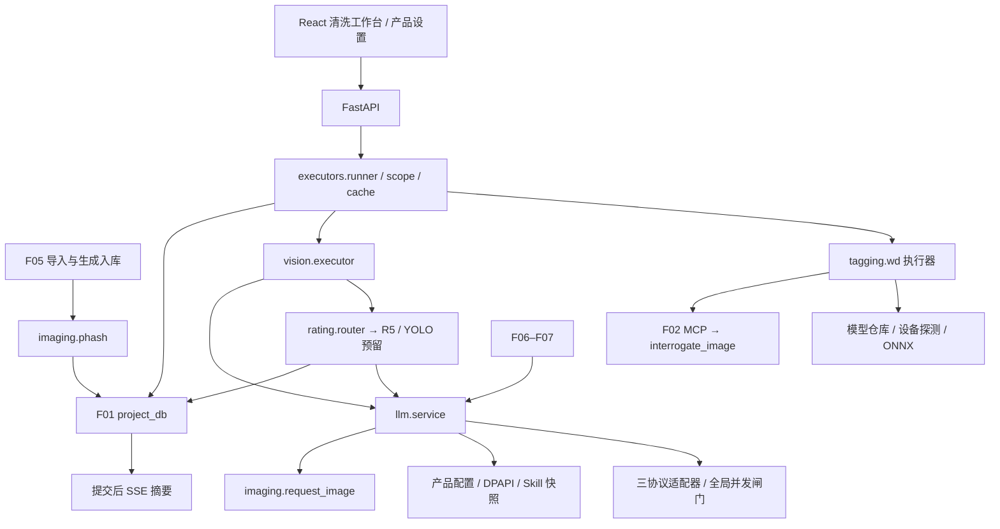
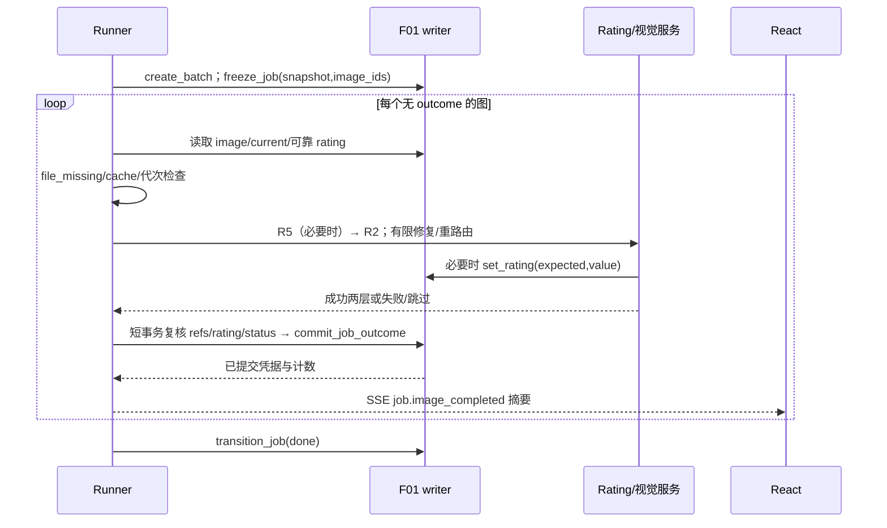

# F08–F12 视觉与执行器设计（含 F15、全局 LLM 服务）

版本：设计稿 v0.1；日期：2026-10-12。仅模块规格与接口声明，不含实现代码；不修改权威架构、不 commit。

## 1. 依据、范围与模块依赖

硬约束：[05](05-项目结构与数据模型.md) §4、§5.4–5.6、§8–9；[F01](F01-project-db-设计.md) §5.3–5.4、§6–7；[F06–F07](F06-F07-提示词生产设计.md) §6；[06](06-Skill需求清单.md) R0/R2/R5；[02](02-NAI-MCP使用方案.md) §1、§4–5。引用处不另定义表结构或状态取值。
F08 只提供近似重复候选；导入的 SHA-256 精确去重仍归 F01/F05。F12 写 `wd/tags`，F15 写 `llm/tags` 与 `llm/nl`；不合并最终 caption、不改 original/manual/rule、不自动删除图片。
LLM 服务为产品级共享设施，供 prompt/prompt_nsfw/vision/vision_nsfw/rating 使用；clean/clean_nsfw、YOLO、F13 只留接口。R3 虽在 docs/06 标为 MVP，按 docs/05 的优先级本版不启用。
`src/stylelora/` 是目标包布局；当前工作区尚无 src 目录，本次只新增本文。TagCleaner 是迁移来源，不假定其现有代码、模型默认值或私有格式已经验证。



依赖只能向下：执行器不持有 sqlite3 连接；LLM、tagger 不直接写项目；rating 的项目协调层负责 CAS 回写，纯判定层可复用于 F06–F07 的无图片任务。所有网络/推理在事务外，项目写入走 F01 单写队列。

## 2. 包布局与模块合同

以下路径相对 `src/stylelora/`；同一行文件构成一个合同模块，公开类型/签名见后续章节，Txx 对应 §12。

| 模块 | 职责与依赖 | 错误处理与幂等性 | 最小测试 |
|---|---|---|---|
| imaging/phash.py | 指纹/汉明候选；Pillow、DCT 库、F01 只读投影 | 坏图报告；同算法/字节同指纹，无删除副作用 | T01–T02 |
| imaging/request_image.py | 内存 JPEG；Pillow | 解码/体积错误；原图不写，固定参数确定 | T03 |
| tagging/catalog.py | 下划线/空格、类别/别名/翻译索引；产品标签库 | 未知 tag 保留、未知别名不猜；规范化幂等 | T04 |
| tagging/models.py | HF 版本清单、下载、校验、原子发布 | 校验失败禁加载；同 manifest 重入复用已验文件 | T05 |
| tagging/device.py | 显存探测与 batch 规划；pynvml/nvidia-smi | 不可用选 CPU；只读探测，计划确定 | T06 |
| tagging/wd.py、backends/onnx.py、backends/launcher.py | WD 执行与统一后端；ORT 或 F02 MCP | 图级坏图隔离；未知远程结果不盲重放；提交由 runner 去重 | T07–T08 |
| llm/types.py、config.py、secrets.py | DTO、角色绑定、产品配置、DPAPI | revision 冲突/解密失败明确返回；相同配置更新 no-op | T09 |
| llm/adapters/{chat,responses,anthropic}.py | 协议编码/解析；异步 HTTP transport | 统一 LlmFailure；无业务重试、无持久副作用 | T10 |
| llm/service.py、limiter.py | 全局闸门、轮换、退避、取消、调用预算 | 有限重试；请求 ID 只用于关联，不承诺远端去重 | T11–T12 |
| llm/contracts.py | 严格 JSON/schema 验收与一次重问协调 | 不静默修内容；验收纯函数，修复预算单一所有者 | T13 |
| llm/capabilities.py、audit.py | /models、图像测试、脱敏审计 | 探测失败不误判成功；审计按 attempt_id 去重 | T14 |
| rating/router.py、project_rating.py | 关键词/R5/缓存与 CAS；LLM、F01 | uncertain 继续兜底，手改冲突重读；可靠缓存避免重复调用 | T15–T16 |
| vision/executor.py、contracts.py | R2 构造/验收/结果投影；rating、LLM | 缺角色跳过或批次错误；不自行写标注 | T17 |
| executors/types.py、scope.py、cache.py | DTO、冻结范围、覆盖键；F01 只读接口 | 非法范围拒绝；固定输入得到同序列/键 | T18–T19 |
| executors/runner.py、events.py | 调度、逐图提交、控制、摘要事件；以上模块/F01 | CAS、代次、提交未知查证；outcome 为唯一记账凭据 | T20–T22 |
| api/{executors,llm,tagger,duplicates}.py | FastAPI DTO 与状态映射；服务接口 | 422/409/503，禁止透传原始异常；batch_id 幂等 | T23 |
| executors/extensions.py | R3、YOLO、F13 Protocol 与能力声明 | 未启用固定 unsupported；无 jobs/annotations 写入 | T24 |

依赖选型为实现建议：Python 3.11+、Pillow、numpy/scipy（pHash）、httpx、JSON Schema 验证器；ORT 是按需可选依赖。CPU/GPU 安装档只安装一种 ORT 分发包，GPU 包内也可选 CPUExecutionProvider，不要求同时安装两个冲突包。

## 3. 公共数据类与类型约定

声明规格使用 frozen dataclass，表格中的字段合同等同数据类；不提供函数体。`Path/Protocol/Literal/Mapping/Sequence/AsyncIterator` 来自标准库；F01 的 `JsonObject/Tag/ImageRow/AnnotationRow/CurrentRef/RatingValue/Scope/JobSnapshot/JobOutcome/JobRow/ProjectHandle/Page` 原样复用。

| 类型 | 必需字段及类型 |
|---|---|
| CancelToken | `cancelled: bool`；`raise_if_cancelled() -> None`；`wait() -> Awaitable[None]` |
| ImageInput | `image_id: int; path: Path; sha256: str; file_size: int; width: int; height: int`；path 只在内存 |
| ImageTier | `max_pixels: int; jpeg_quality: int` |
| EncodedImage | `data: bytes; mime: Literal['image/jpeg']; width: int; height: int; tier: ImageTier; encoder_version: str` |
| RatingDecision | `rating: Rating | None; verified: bool; route: Literal['normal','nsfw']; reason: str; source: RatingSource | None` |
| Evidence | `original_tags: tuple[Tag,...]; original_nl: str; wd_tags: tuple[Tag,...]; refs: tuple[CurrentRef,...]; digest: str` |
| ImageContext | `image: ImageInput; evidence: Evidence; rating: RatingValue | None; snapshot: JobSnapshot; cancel: CancelToken` |
| ExecutionResult | `kind: Literal['done','failed','skipped']; reason: str | None; annotations: tuple[AnnotationInput,...]`；由 runner 绑定 job_id |
| JobEvent | `epoch: str; sequence: int; job_id: int; image_id: int | None; kind: str; counts: Mapping[str,int]; reason: str | None` |

`Rating = Literal['general','sensitive','questionable','explicit']`；`RatingSource` 为 F01 六个合法来源。全部 JSON 拒绝非有限数、重复键、bool 冒充 int；时间使用 F01 UTC 格式。内部 path、图片字节、连接对象不参与项目 JSON 序列化。

## 4. F08 pHash 与去重候选

推荐 `phash64-v1`：EXIF 方向归正、透明通道白底合成、灰度、Lanczos 缩到 32×32、二维 DCT-II，取左上 8×8 的中位数并按严格 `>` 生成 64 位；包含 DC 的中位数规则固定，按行高位优先编码为 16 位小写 hex（Q01）。库/缩放版本固定并用 golden fixture 锁定；动画首帧，不把动画各帧当多图。
`images.phash` 不带新列；v1 项目格式统一算法，不混存不兼容指纹。导入复制后计算，并通过 `ImageArtifact.phash` 交 `complete_item`；生成入库亦复用此接口。组件失败可写 NULL（F01 已允许），同时报告 `phash_unavailable`；不可解码图片由入库完整性验证拒绝。
SHA-256 完全相同的导入跳过先于近似候选；pHash 即使距离为0也不能证明字节或画面相同，不触发删除、reject 或合并归属。

```python
@dataclass(frozen=True)
class HashRecord:
    image_id: int
    phash: str
@dataclass(frozen=True)
class DuplicatePair:
    left_id: int
    right_id: int
    distance: int
def compute_phash(path: Path, *, algorithm: Literal['phash64-v1'] = 'phash64-v1') -> str: ...
def hamming(left: str, right: str) -> int: ...
def find_candidates(records: Sequence[HashRecord], *, threshold: int) -> tuple[DuplicatePair,...]: ...
async def scan_duplicates(project: ProjectHandle, scope: Scope, *, threshold: int,
                          cancel: CancelToken) -> AsyncIterator[tuple[DuplicatePair,...]]: ...
```

threshold 必须由用户提供，整数0..64，无静默阈值默认；返回所有 `distance<=threshold`、`left_id<right_id` 的唯一 pair。按 `(distance,left_id,right_id)` 稳定排序；连通分量只能作 UI 分组，不能把 A≈B、B≈C 宣称 A≈C。
F01 `list_images` 在同一读快照分页提取 ID/phash，随后释放连接再算距离；缺失文件/NULL/坏 hash 排除并汇总。v1 分块全配对，O(n²) 时间，流式输出避免一次存全部 pair；取消停止后续块。相同 hash 的 B-tree 可加速0距离候选，不承诺加速近似距离。大集上限与后台分页见 Q01。

## 5. F12 WD 模型、推理与替代后端

模型存产品层 `%LOCALAPPDATA%/StyleLoraAutom/models/wd/<model_id>/<revision>/`（Q02）；manifest 仅收 HF repo_id、固定 commit revision、文件名、字节数、已审核的 SHA-256、输入/输出 tensor schema、预处理版本和标签 CSV schema。必须同时校验 ONNX 与标签表；首次下载后计算的值不能冒充发布者预期摘要。

2026-10-25 用户明确确认的摘要来源规则：ONNX 权重使用发布者固定版本的 Git LFS SHA-256。普通 Git 存储的标签表允许先独立取得官方固定 commit 下的 Git blob SHA-1 与长度，验证 `SHA1("blob " + length + NUL + bytes)` 后，再将本地复算 SHA-256 固定进开发审核清单。审核记录必须区分“发布者 SHA-256”与“核对官方 Git 对象后本地计算的 SHA-256”，保留 repo、commit、blob、长度及来源。安装仍同时检查固定 SHA-256 和官方 CSV blob；HTTP 不可登记任意摘要或清单。这是固定官方 Git 对象的来源核验，不是发布者数字签名。
只响应用户明确的安装动作，不在程序启动/job 启动时静默下载。下载到同目录 `.partial`，限制长度、拒路径逃逸，校验通过后原子发布 ready manifest；中断可清理本次暂存，旧 ready 版本不动。同模型并发下载合并为一项，取消不删除其它任务正在使用的版本。

| 类型 | 字段合同 |
|---|---|
| ModelFile | `name: str; sha256: str; size: int` |
| ModelManifest | `model_id: str; repo_id: str; revision: str; files: tuple[ModelFile,...]; tensor_schema: JsonObject; preprocess_version: str; digest: str` |
| DeviceInfo | `provider: Literal['cuda','cpu']; total_bytes: int | None; free_bytes: int | None; reason: str | None` |
| TaggerConfig | `backend: Literal['onnx','launcher']; model: str; revision: str; general_threshold: float; character_threshold: float; batch_size: int; manifest_hash: str` |
| TaggerResult | `tags: tuple[Tag,...]; actual_model: str; params: JsonObject` |

```python
async def install_model(manifest: ModelManifest, *, cancel: CancelToken) -> Path: ...
def verify_model(manifest: ModelManifest) -> Path: ...
def probe_device() -> DeviceInfo: ...
def plan_batch(device: DeviceInfo, manifest: ModelManifest, requested: int) -> int: ...
def normalize_tag(tag: str) -> str: ...
class TaggerBackend(Protocol):
    async def predict(self, images: Sequence[ImageInput], config: TaggerConfig,
                      cancel: CancelToken) -> tuple[TaggerResult,...]: ...
```

预处理严格由已校验 manifest 决定：RGB/白底、等比填充正方形、目标分辨率、RGB/BGR 顺序、NHWC/NCHW、dtype 和归一化不可凭 WD 名称猜测；不复用 LLM JPEG 副本。动态 batch 才合批，固定 batch=1 不强塞多图；结果顺序与输入 ID 一一对应。
通用/角色阈值各为 [0,1]，分别应用于 CSV general/character 类别，`conf>=threshold` 保留；rating 类输出不冒充普通 tag，也不绕过 §7 已定评级链。规范键按 F01 小写、下划线换空格、首尾去空白；同键保留首次位置、conf 取最高。保留模型原名和类别于 params 的 tag 映射证据；翻译仅 UI 展示，未知标签不删，别名只能用已验证版本索引。
启动自动探测 pynvml，失败再执行有超时的 nvidia-smi 查询；两者都不可用、无 NVIDIA 或 CUDA provider 初始化失败则 CPU，注明 reason。读到显存不代表 CUDA 可用；启动和每批推理前看空闲显存，推荐保留 max(1GiB,总量20%)，用模型实测显存档案决定 batch；无档案取1。
本地 worker 默认1、CPU batch=1；GPU batch 初始最多4（Q03）。OOM 把 batch 减半直至1，再试 CPU 一次，仍失败记图级失败；设备/实际 batch 写 params。不得因此换模型。可用显存信息只在产品内存，实际 provider/预处理版本参与结果键，设备编号和瞬时空闲量不参与。
本地 batch 的计算可合并，但每图仍独立提交；ORT 阻塞调用放 worker，取消不强杀进程共享 session，待返回丢弃被取消图。CPU 回退与 OOM 次数属于本地预算，不消耗 LLM 重试预算。
Launcher backend 复用 F02 客户端、发现/凭据/握手，不建立第二套 MCP。先验证 tools/list 中 `interrogate_image` 的精确 inputSchema、版本与响应 fixture；docs/02 尚未确定路径/字节输入、模型、conf、类别与阈值参数，未验证则能力 unavailable（Q04），不能编造参数名。
若后端只返回 tags，conf=NULL，必须明确不支持本地阈值，用户选择对应能力方案后才启动；否则返回 unsupported_threshold。actual_model 必须来自已验证工具合同，未知模型不写成功标注。后端差异纳入键，不自动从本地切 Launcher；这是可选替代，不是隐式降级。
MCP 请求遵循 docs/02 的8MiB上限与≥600s工具超时，不套用 LLM 的300s。未知副作用/未定结果不自动重放；session404只能重握手，是否重试 interrogate 以已验证只读契约为准。不得为反推调用生图/改页面工具。

## 6. 全局 LLM 服务

### 6.1 兼容接口、配置与密钥

扩展 F06–F07 §6 最小接口：已有必填字段与 `complete(request)` 调用方式不变；新增字段均有默认值。`complete` 是一次语义调用（含有限传输尝试），不自行发起 JSON 修复；`complete_json` 可供新调用方使用，内部仍委托 complete，F06–F07 可继续自行验收及重问。

| DTO | 字段合同 |
|---|---|
| RoleBinding | `binding_id: str; role: Role; model: str; protocol: ProtocolName; revision: int`；无密钥 |
| LlmRequest | 原有 `request_id: str; binding: RoleBinding; system_text: str; payload: JsonObject; response_schema: JsonObject; timeout_s: int; transport_retry_limit: int` |
| LlmRequest 扩展 | `images: tuple[EncodedImage,...]=(); cancel: CancelToken | None=None; timeout_policy: Literal['fail_unknown','vision_downgrade']='fail_unknown'; tiers: tuple[ImageTier,...]=(); image_input: ImageInput | None=None; sampling: JsonObject={}`；空映射用不可变默认语义 |
| LlmReply | 原有 `text: str; actual_model: str; request_id: str`；新增 `usage: JsonObject | None=None; actual_tier: ImageTier | None=None; attempts: int=1` |
| LlmFailure | 可捕获异常：`code: str; retryable: bool; outcome: Literal['not_sent','unknown','rejected']; safe_message: str` |
| JsonReply | `value: JsonObject; reply: LlmReply; repair_used: bool` |
| EndpointConfig | `endpoint_id: str; base_url: str; protocol: ProtocolName; token_refs: tuple[str,...]; models: tuple[ModelConfig,...]; revision: int`；只在产品层 |
| ModelConfig | `name: str; supports_images: bool; capability_source: Literal['manual','models','tested']; tested_at: str | None` |

`Role = Literal['prompt','prompt_nsfw','vision','vision_nsfw','rating','clean','clean_nsfw']`；`ProtocolName = Literal['openai_chat','openai_responses','anthropic_messages']`。clean 角色可保存空配置，但 resolve_role 不意味着执行器已启用。
补充可选字段：`LlmRequest.repair_budget: RepairBudget | None=None`，RepairBudget 为步骤级共享计数对象 `limit: int=1; used: int=0`，原子领取；complete_json 有该对象时沿用，重路由传同一对象。无对象时只为本次 complete_json 建预算；F06 自行重问时不调用 complete_json。本版 images 最多1张，image_input 与 images 二选一；需降档必须有原图 ImageInput，禁止从已压缩副本反复缩放。

```python
class LlmService(Protocol):
    async def resolve_role(self, role: Role) -> RoleBinding | None: ...
    async def complete(self, request: LlmRequest) -> LlmReply: ...
    async def complete_json(self, request: LlmRequest, *, repair_limit: int = 1) -> JsonReply: ...
    async def cancel(self, request_id: str) -> None: ...
def load_endpoints() -> tuple[EndpointConfig,...]: ...
def save_endpoint(value: EndpointConfig, *, expected_revision: int) -> EndpointConfig: ...
def put_secret(token_ref: str, plaintext: str) -> None: ...
def resolve_secret(token_ref: str) -> str: ...
```

角色解析：`resolve_role` 读取当前产品配置，但 runner 在 job 启动仅冻结 binding 的 role/model/protocol/参数投影；binding_id/revision 只留产品层与内存。快照不存 base URL、token、明文 Skill，仅存 Skill 内容 hash 和关键词表 hash。恢复时按角色重新解析连接并核对冻结模型/协议；不能静默换模型/协议，失败保持 paused。
非密钥配置推荐 `%APPDATA%/StyleLoraAutom/llm.json`；密钥 `%LOCALAPPDATA%/StyleLoraAutom/secrets.json`，Windows DPAPI 加密，原子替换。环境变量按产品定义的 token_ref 映射优先，环境变量名/值均不回 API。API 只返回 `has_secret`, masked endpoint/token suffix（如允许）和 revision；审计、异常、快照、SSE 永不包含 URL 中 query secret、token、图片字节或完整 prompt。
具体密钥规则：DPAPI CurrentUser，不用LocalMachine；文件限制当前用户访问。推荐环境变量 `STYLELORA_LLM_TOKEN_<TOKEN_REF规范ID>`，空值视为显式无可用凭据并报错，不悄悄退到旧秘密；非Windows不得明文降级。项目运行期间连接配置留内存冻结，密钥按引用取当前值以支持轮换；恢复仅要求角色投影匹配，不将URL写项目。
令牌以 endpoint 的 `token_refs` 顺序做轮询游标，单请求绑定一个 token；429 标记该 token 的 `Retry-After` 冷却并切换下一个。所有 token 冷却时尊重最早可用时间并在全局预算内退避；认证错误不轮换重试，配置失效暂停。一个请求的 transport retry 不超过快照 limit，避免 F06–F07 与服务层重复计算；Retry-After 不能超过请求 deadline。

### 6.2 适配器与传输策略

```python
class ProtocolAdapter(Protocol):
    name: ProtocolName
    async def complete(self, endpoint: EndpointConfig, token: str,
                       request: LlmRequest, image: EncodedImage | None) -> LlmReply: ...
    async def list_models(self, endpoint: EndpointConfig, token: str) -> tuple[ModelConfig,...]: ...
def adapter_for(protocol: ProtocolName) -> ProtocolAdapter: ...
```

`openai_chat` POST /chat/completions，使用 messages/content parts 与 image_url data URI；`openai_responses` POST /responses，使用 input_text/input_image，抽取 output message 的 output_text；两者 Bearer。`anthropic_messages` POST /messages，使用顶层system、image source/base64，x-api-key及版本头，抽取text块。base_url为版本前缀根，不重复拼/v1；模型枚举GET /models。适配器不负责业务重试，错误body不原样返回。
原生JSON schema/structured output只在端点声明支持时映射，所有协议仍本地严格验收；不支持时使用最终system契约，不发送未知参数试错。max_tokens等采样字段逐协议显式转换；空文本、tool-call-only、截断输出报契约错误，不能当成功空描述。模型返回别名必须在冻结映射中，否则暂停model_mismatch。
单次默认 timeout=300s，连接/读取均受单次总deadline约束。429先换token；408/网络断开/502/503/504可有限重试，401/403/400 schema不重试。视觉timeout按§6.3降低档位后重发，仍属同一次语义调用的传输尝试并消耗同一预算；文本timeout直接unknown。超时不证明服务端未处理。
服务级并发闸门默认2，跨所有角色、执行器、F06–F07 共享；队列等待不计请求 timeout。取消在发送前为 not_sent，发送中尽力 cancel HTTP 并返回 canceled；服务端已接受的调用不承诺取消和费用回滚，runner 不把取消结果写 done。

### 6.3 图片编码、JSON 与能力探测

```python
def encode_for_vision(path: Path, *, file_size: int, tier: ImageTier) -> EncodedImage: ...
def next_timeout_tier(current: ImageTier, cause: str) -> ImageTier | None: ...
def validate_json_reply(text: str, schema: JsonObject) -> JsonObject: ...
async def test_image_capability(endpoint_id: str, model: str, *, fixture: bytes,
                                cancel: CancelToken) -> ModelConfig: ...
async def probe_models(endpoint_id: str) -> tuple[ModelConfig,...]: ...
```

视觉请求始终用内存 JPEG 副本：保持宽高比，最大像素默认2,000,000；原图 `<10MB` 也照样缩放，`≥10MB` 无例外缩放。默认质量推荐92（Q05）；超时依次1.6MP/质量88、1MP/质量84。图片已低于目标像素时不放大，仍按 JPEG 副本编码。副本不落 cache、不覆盖原图；actual tier、原图 sha256、编码器版本写 annotation params/cache key，不写 bytes。
只对 timeout 做降档；429、5xx、服务端拒绝、JSON 错误不降档。降档总尝试最多2次，仍失败为 unknown/failed，不能无界重问。对于“请求已成功但响应解析失败”，按 JSON repair 一次发送修复请求，沿用同一图片档位；修复仍失败为 `llm:invalid_json`，不再降档。
JSON 解析拒绝代码围栏、额外文本、重复键、NaN、未知字段（schema 显式允许除外）；R2 结果为 `{vision_tags, vision_description}`，R5 为 `{rating,reason}`，rating 可为 uncertain。语法失败最多一次修复重问，修复 prompt 只带脱敏错误摘要和原 schema，不把整段不可信回复拼回规则。语义 invalid_input 不重问；`refused_nsfw` 由路由处理，不当作普通修复。
`/models` 有明确输入模态元数据时可自动标 supports_images，source=models；仅有模型名则不能推断，允许手填。测试按钮发送服务端固定小图及图中特征问题，答案与fixture预期匹配才记tested/true，不能仅凭HTTP200。失败保留人工配置并附失败诊断，不冒称实测成功；模型列表/测试更新产品revision，已冻结job不受影响。

### 6.4 审计、错误与幂等

```python
def audit_start(request: LlmRequest, *, endpoint_id: str, token_index: int) -> str: ...
def audit_finish(attempt_id: str, *, outcome: str, code: str,
                 model: str, duration_ms: int) -> None: ...
```

审计 JSONL 只存 UTC、request_id/attempt_id、角色、endpoint_id、协议、模型、token index（不存 token）、状态码分类、重试序号、tier、耗时和安全原因；不存图片、prompt、响应正文、密钥。写审计失败不改变业务调用结果，但应计内部告警；attempt_id 重放只追加 outcome，不覆盖旧事实。
同一 `request_id` 在本地只防止并发重复 dispatch；服务端无幂等保证。文本超时不重发；视觉仅允许冻结策略内的超时降档重试，预算耗尽返回 unknown。job 崩溃恢复按 F01 对未提交图可再次调用，不保证不重复付费；终态失败重试须新 job。配置读写使用 revision CAS；相同内容返回 changed=False，未知提交先查询 revision，禁止盲重存 token。

## 7. F15 视觉反推与 NSFW 路由

```python
def read_evidence(project: ProjectHandle, image_id: int) -> Evidence: ...
async def decide_rating(context: ImageContext, *, llm: LlmService) -> RatingDecision: ...
async def persist_rating(project: ProjectHandle, image_id: int, *,
                         expected: RatingValue | None, value: RatingValue) -> RatingValue: ...
async def reclassify(project: ProjectHandle, scope: Scope, *, cancel: CancelToken) -> tuple[int,...]: ...
def build_vision_request(context: ImageContext, decision: RatingDecision,
                         binding: RoleBinding) -> LlmRequest: ...
async def execute_vision(context: ImageContext, *, llm: LlmService) -> ExecutionResult: ...
```

证据读取 original/tags、original/nl、wd/tags 当前版本，缺层用空值；不把 manual/rule 当 R2 原始证据。R2 `tags` 为规范化 original 在前、WD 在后去重的字符串数组；conf 与来源留内部证据，不编造 R2 字段。original NL 供 R5 的 natural_language 使用并保留对照，R2 当前无 original_natural_language 输入，不能悄悄扩展（Q06）。
R2 发送图片、tags、dataset_mode_policy，以及 R0 的 rating_verified/rating_policy；system 由冻结 R2 文本加最终 JSON 契约、受保护触发词、模式规则构成。画风模式只描述可见内容，禁止画风/笔触/媒介；禁用词检查确定命中报 contract_violation，不确定返回 review_required，不能假称完整语义审核。
成功必须同时有 `vision_tags: list[str]` 和 `vision_description: str`，允许空数组/空描述作为明确空结果；投影到 `llm/tags`（conf=NULL）与 `llm/nl`。另一合法分支为 R0 精确 `{status:'refused_nsfw',reason:str}`；不强制成功分支带 status。R5 同样采用正常结构与 R0 拒绝结构的联合 schema。
rating 链：可靠 images 缓存 → 关键词规范 tag 精确匹配、取最高等级 → YOLO 接口跳过 → 用户启用的 rating 模型 → nsfwfallback → 普通未验证。questionable/explicit 走 nsfw，general/sensitive 走 normal；关键词无命中不是 general。入库跑关键词，启用 rating 时复用此服务；后台网络判定不放进 complete_item 事务。
R5 输入 tags、original NL、可选图片；视觉分级仅对支持图像的模型发送图片，文本模型只按标签/NL 判定并记录能力来源（Q07）。uncertain 不写可靠评级，继续策略；传输耗尽记安全诊断并走同一兜底，认证/绑定失效则暂停 job，不能悄悄绕过配置错误。
关键词/模型结论四列 CAS 写入 images，verified=true；fallback 推荐 rating=questionable、source=fallback、verified=false（Q07）。普通兜底不写库，请求 verified=false；fallback 也为 false。manual 与 refusal 已缓存时直接用；重新分级只清 keyword/model/fallback，不动 manual/refusal。
R0 在未验证普通线路返回 refused_nsfw，先 CAS 写 questionable/refusal/true，再改 vision_nsfw；每图视觉步骤只重路由一次。R5 自身返回该拒绝也按同一评级回写，不递归调用 rating。nsfw 角色为空记 skipped/role_empty，保留全部旧层；nsfw 再拒绝记 skipped/refusal_repeated，不修复不循环。
R0 字面规则对 nsfwfallback（verified=false）会再次拒绝，暂按一次重路由及再次拒绝跳过实现；是否将 R0 限定普通线路，作为 C10，不偷偷改模板。R2/R5 模板尚未落地，加载缺失报 skill_unavailable，不造一个无 hash 的隐式 prompt。
CAS 遇用户并发手改：重读可靠评级、丢弃旧推理结果，本地重新求值一次；若尚未发送R2可按新路由继续，已发送则 failed/rating_conflict，不追加预算外调用。提交标注前在同一写事务复查评级四列与证据 refs，防止将过期路由结果标为 current；未知旧输出不覆盖用户修改。
params 记录 role、actual_model、route/route_reason/rating_verified、rating_source、证据 ID/digest、R0/R2/R5 hash、requested/actual tier、采样参数与调用尝试摘要；不记录图片、URL、token。缓存读取可靠评级时 route_reason 沿原来源映射，manual 用 `default` 并另存 rating_source=manual，避免擅自扩充 docs/05 枚举。

## 8. 执行器、缓存、状态机与 DAL

### 8.1 范围、冻结与公开接口

```python
class Executor(Protocol):
    name: Literal['wd','llm_vision']
    async def execute(self, context: ImageContext) -> ExecutionResult: ...
def resolve_scope(project: ProjectHandle, scope: Scope, *, mode: str) -> tuple[int,...]: ...
def cache_keys(context: ImageContext, *, actual_model: str,
               actual_params: JsonObject) -> Mapping[tuple[Layer,AnnotationType],str]: ...
async def create_jobs(project: ProjectHandle, requests: Sequence[JobRequest], *,
                      batch_id: str) -> tuple[JobRow,...]: ...
async def run_job(project: ProjectHandle, job_id: int) -> None: ...
async def control_job(project: ProjectHandle, job_id: int,
                      action: Literal['pause','resume','cancel']) -> JobRow: ...
```

多选一次 `create_batch` 同事务建 WD/LLM 两个单值 job，稳定 batch_id 同请求重放返回原 job，不同请求冲突。按 job_id 顺序串行，WD 先完成 LLM 才首次启动，因而 LLM 能读本批 WD。前 job paused 阻塞后 job；failed/canceled 时推荐后 job 保持 pending 等用户处理（Q08），不自行跳过依赖。
selected 去重排序用户 ID，允许明确选中的 reject；all/uncovered 按筛选器默认排除 reject，只有显式 review_statuses 包含 reject 才纳入。file_missing 可列入冻结 IDs 但永远不调用执行器，提交 skipped/file_missing。selected 中不存在 ID 整请求422。冻结后新增图片/筛选属性改变不改变范围，已选 reject 的授权也冻结。
首次启动从同一 F01 读快照物化有序 image_ids，短事务 `freeze_job` 保存 snapshot 与 IDs，total=len(ids)。uncovered 对候选作覆盖检查、命中写 skipped/cache_hit（保留精确账本），UI 展示实际待调用数与候选总数；不为计算列表先付费调用 R5。

**0.15.0 组合批次实现细化**：建批事务即物化两阶段共同的有序 IDs，并冻结各自配置；内部 `freeze_job(..., start=False)` 允许已冻结的 pending 阶段尚未启动，`started_at` 仍为空。随后同事务只将 WD 转为 running；WD done 后才启动 LLM。这样待启动阶段也可跨重开恢复，后续导入/审核变化不会扩大已确认范围。单阶段默认 `start=True` 保持兼容，未冻结任务禁止直接转 running。没有增加表、状态枚举或快照 schema。

整批暂停对运行阶段执行 pause，同时给 pending 阶段持久化 `error=job:batch_paused` 的等待原因；即使当前最后一张在暂停后正常完成，下一阶段也不会接续。继续批次校验冻结依赖后清除此等待原因，按顺序运行；整批取消在一个事务中取消全部未结束阶段，已完成阶段保持不变。单 job 控制仍只影响对应阶段，跨阶段暂停应使用整批接口。项目重开从不自动启动 pending/paused。

覆盖预览只使用本地元数据和当前缓存，不调用 R5、不写评级、不解码或重新计算原图摘要；实际执行仍核验文件。WD 待推理的候选在 LLM 阶段计为 `waiting_for_wd`，不假定未来输出。预览 `scope_digest` 可随创建请求提交，writer 事务内校验图片成员列表；范围变化返回 `job:preview_stale`，需刷新后重新确认。这是范围校验，不是缓存命中保证。具体 API、实现边界和测试见 [组合批次验收](22-F15-组合批次与覆盖预览验收.md)。
snapshot schema_version=1，含目标层、角色→实际模型/协议、采样参数、WD backend/manifest/阈值、图像档位列表、并发/超时/重试、模式/受保护词规则及 R0/R2/R5/标签索引/D1 hash。不含 URL/token/产品绝对路径。Skill、D1 等原内容留产品版本仓库/内存；恢复缺原 hash 版本保持 paused，不能拿新文本配旧 hash。
证据按每图派发时读取，并在提交 CAS 校验，不把整个项目所有文本塞快照。图片读取核验 sha256；文件改动不沿用旧指纹，报 image_changed 并停止该图，交入库/恢复服务修正元数据后新 job。file_missing 在派发前与提交前复核，丢失则 skipped，不能写成功层。

### 8.2 缓存键与覆盖

`key = 'exec-v1:' + SHA256(UTF8(canonical_json({config,model,skill_hash,image_sha256})))`。canonical_json 键排序、紧凑分隔、Unicode 原样、无 NaN；列表保留语义顺序，空值显式；不得使用 Python hash()。

| 要素 | WD | LLM 视觉 |
|---|---|---|
| config | source/type、backend、manifest/CSV/preprocess hash、阈值、tag 索引/归一版本、actual provider | source/type、协议、role、采样、schema/hash、模式、保护词规则 hash、route/rating/verified、D1 hash、Evidence.digest、actual tier/encoder |
| model | 实际模型名+固定 revision | 实际返回模型名；必须与冻结允许模型匹配，别名映射须预先固定 |
| skill_hash | 固定无 Skill 标记 `none:wd-v1` | 冻结 R0+R2+最终契约 hash；路由配置含 R5 hash |
| image_sha256 | 原图指纹 | 原图指纹，不能用 JPEG 字节替代 |

Evidence.digest 包含 original/WD 文本、conf、顺序与存在/缺失标记，不含 annotation_id；相同内容新版本不无谓失效，refs 另供 CAS。actual provider 枚举 CPU/CUDA，Launcher 只接受其冻结能力所列参数；重试次数、并发、timeout、batch 大小、job_id、时间、token/binding revision、rated_at 不入键，排除规则固定版本。
requested 档位及允许降档策略在快照；写入用 actual 档位。覆盖枚举允许的 actual tier/provider 键组，不能任意交叉拼 tags/nl；二者必须来自同一次成功 outcome、具有一致模型/params/档位。调用 F01 `is_covered` 检查一个完整 key 映射；仅 current 匹配才命中，不复活历史。
rating 缓存改变、证据改变使 LLM 键改变；D1 hash 改使标注覆盖失效但不自动清可靠 rating。未知评级不能匹配其它路由的旧键；先使用当前不付费可得决策查缓存，无覆盖才调用 R5，判定落库后重新构造键。WD 结果变化能使下游未覆盖，不自动触发 LLM 或规则。
selected/uncovered 命中当前整组键提交 skipped/cache_hit；all 新 job 首轮无条件执行，使用 force_new_job；恢复先查本 job outcomes，即使 current 后来换版也不重做。结果写 params 的 requested/actual 与键一致，失败/跳过不造 annotation。

### 8.3 状态、提交与恢复

合法 job 边完全复用 F01 §5.3：pending→running/failed/canceled；running→paused/done/failed/canceled；paused→running/done/failed/canceled；终态不重开。done 允许单图 failed；failed 仅批次级错误。running 重启由 F01 `pause_interrupted` 变 paused，不自动继续。
progress_json 使用既定 `{schema_version:1,image_ids:[...],outcomes:{'id':{kind,reason,annotation_ids,cache_keys}}}`；只有终态入 outcomes，在途集合/运行代次只在内存。计数从 outcomes 重算，三类计数之和≤total；同 outcome 重交 unchanged，不同终态 OutcomeConflict。失败和跳过恢复也不重做。
暂停停止派发，允许当前代次在途结果落库，耗尽自然 paused→done；取消停止派发并尽力取消 HTTP，先状态写 canceled 后迟到结果丢弃。控制和提交共用串行协调锁/写队列验证，不能先检查 running 再越过 canceled 写入。模型/配置不可用恢复保持 paused，用户放弃才 failed。
LLM 全局并发2；单 job 最多2张在途，每图 R5→R2 顺序调用，退避释放网络闸门后再排队。WD 本地 worker1；Launcher 请求纳入外部请求闸门并遵循 MCP 串行约束。数据库写始终串行，不跨 await 持有 WriteSession。
COMMIT 结果未知先查 job/outcome/标注 ID，确认已提交即发摘要；未确认暂停，不重新发模型调用。模型响应收到但进程在提交前崩溃，未有 outcome 的图恢复可能再次付费，这是 F01 已定边界；同进程重试数据库提交复用原结果，不重新推理。



| 调用点 | F01 接口与事务要求 |
|---|---|
| 入库 pHash | `complete_item(ImageArtifact, originals)`，复用已有入库事务 |
| 候选/范围/证据 | `read_snapshot`、`list_images/get_image/get_current`；元数据快照后释放 |
| 建批/启动 | `submit_write` → `create_batch`；启动 `freeze_job` 原子冻结状态/IDs/快照 |
| rating | `set_rating(expected,value)` 四列原子 CAS；`clear_recomputable_ratings` 清理后在事务外重跑 |
| 一图完成 | writer 内复核 CurrentRef、rating、文件状态、job 代次；`commit_job_outcome` 内部 append_version，两层+outcomes+计数同事务 |
| 控制/恢复 | `transition_job` / `pause_interrupted`；网络不在事务内 |

复核逻辑是 runner 提交的 writer 短任务，使用 F01 公开读取接口后调用既有 command，不改 DAL 签名、不直接写 SQL。若证据已变，单图 failed/input_changed，旧层保留；库忙在未产生副作用前有限重试，磁盘满暂停、保留内存结果。历史 cache 命中 annotation_ids 记入 skipped 凭据，不把历史 job_id 改成本 job。

## 9. API 草案与 SSE

产品前缀 `/api`，项目前缀 `/api/projects/{project_id}`；ID 是服务解析句柄，不接受客户端绝对文件路径。GET 分页默认200/上限1000；POST 配置/创建均返回脱敏 DTO。

| 方法 / 路径 | 输入 → 输出 | 行为 |
|---|---|---|
| POST 项目 /duplicates/scan | scope、threshold → scan_id（202） | 会话只读任务；GET /duplicates/scans/{id} 分页 pair，DELETE 取消，无图片删除 |
| POST 项目 /jobs/batches | batch_id、executors、mode、scope → JobRow[]（202） | WD 优先拆 job；同 batch 同内容复用 |
| GET 项目 /jobs；/jobs/{id} | filters/page → 摘要/详情 | progress outcomes 可单独分页读取 |
| POST 项目 /jobs/{id}/control | action → JobRow | 同目标幂等；终态 resume409 |
| GET 项目 /jobs/events | Last-Event-ID → SSE | 仅提交后摘要，不传 tags/NL/图像 |
| POST 项目 /ratings/reclassify | scope → accepted IDs（202） | CAS 清可重算值；不创建不合法 rating executor job |
| GET/PUT /llm/endpoints/{id} | EndpointConfig/expected_revision → 脱敏配置 | 密钥另 PUT /tokens/{ref}，仅入不出；GET 列表 /llm/endpoints |
| GET/PUT /llm/roles | role bindings/revision → 脱敏角色 | 只按产品层存储 |
| POST /llm/endpoints/{id}/models/probe | 无 → 模型候选 | /models 不可用允许手填 |
| POST /llm/endpoints/{id}/models/{model}/test-image | 无 → 实测能力 | 服务端固定小图，使用全局闸门 |
| GET /tagger/capabilities；/tagger/models | 无 → 能力/模型安装状态 | 含设备探测/Launcher 未验证原因 |
| POST /tagger/models/install | manifest_id → installation_id（202） | 明确下载动作；GET 查询、DELETE 取消本次安装 |

SSE ID=`epoch:sequence`，事件 job.started/image_completed/paused/done/failed/canceled；含 job/image ID、计数、reason、当前 outcome kind。进程内有界环形缓存，重连可补发；epoch 改变或缺口发送 resync_required，客户端 GET job/progress 重建。SSE 不充当持久账本，客户端按 event ID 去重；数据库提交成功但事件丢失仍可恢复。
重新分级是项目协调动作，不新增 jobs.executor 枚举；只读/清理可重复，可靠缓存使重复请求不再付费，但崩溃时未完成模型调用仍未知。响应附已处理/未处理 IDs，恢复由用户再触发（Q09）。安装/扫描会话失效返回410，不能把会话 ID 当持久 job。

## 10. 错误与原因码

API 错误 DTO：`code: str; safe_message: str; retryable: bool; request_id: str | None`；LLM 另有 outcome。jobs.error 存批次错误，逐图原因存 progress；下表“失败”均指图级，除明确暂停/批次失败。

| 码 | 处理 / HTTP |
|---|---|
| input:invalid / threshold_invalid / unsupported_schema | 入参拒绝422，不创建任务 |
| phash:unavailable / invalid_hash | 导入允许 NULL并诊断；候选跳过坏 hash |
| image:file_missing / image_changed / decode_failed | missing 跳过，其余失败；原图不改 |
| tagger:model_missing / checksum_mismatch / manifest_invalid | 启动拒绝或暂停503；不自动下载/加载损坏文件 |
| tagger:cuda_unavailable / oom | 有限 CPU/减 batch 回退；耗尽失败 |
| tagger:launcher_unavailable / unsupported_threshold / model_unknown | 暂停503/参数422，不隐式换后端 |
| llm:role_empty / binding_unavailable / skill_unavailable | vision 未配置 pending→failed；nsfw 空跳过；恢复依赖丢失 paused |
| llm:unauthorized / secret_unavailable | 停止派发、暂停503，绝不输出密钥 |
| llm:rate_limited / server_error / connection_error | 服务内有限重试，耗尽图失败；同步 API 503 |
| llm:timeout / outcome_unknown | 文本不自动重发；视觉超时按冻结预算降档，耗尽失败 |
| llm:invalid_json / schema_contract / contract_violation | 一次修复，耗尽失败；review_required 留待人工 |
| llm:model_mismatch / image_unsupported | 不接纳为冻结结果，暂停/启动422 |
| routing:role_empty / refusal_repeated | skipped，旧标注保留 |
| routing:refused_nsfw / rating_uncertain | 前者写 refusal 并一次重路由，后者继续兜底；不是传输重试 |
| executor:cache_hit / file_missing | skipped，持久 outcome，恢复不重做 |
| executor:input_changed / rating_conflict | 复核失败不覆盖 current；有限重读后图失败 |
| job:state_conflict / outcome_conflict / batch_conflict | 409，不重开终态/不重复计数 |
| storage:busy / disk_full / commit_unknown | 暂停/查证503，不重发外部调用 |
| request:canceled / extension:unsupported | 丢弃迟到结果 / 501（预留能力不开放执行按钮） |

## 11. 默认配置与预留接口

既定项直接引用来源；其余为推荐默认，待确认不等于架构裁决。所有改变输出的参数冻结并纳入键。

| 配置 | 默认 / 边界 |
|---|---|
| WD enabled / 模型自动下载 | false（画风线）/ false；无预装权重 |
| WD 通用/角色阈值 | 推荐0.35/0.85；按模型校准，Q03 |
| WD batch / 显存保留 | CPU1，GPU至多4且无档案取1 / max(1GiB,20%) |
| pHash 距离 | 必填用户值0..64；无默认删除策略 |
| 图像档位 / timeout | 2MP质量92（推荐）、1.6MP/88、1MP/84 / 单次300s |
| 并发 / transport retries | 全局2 / 默认2次额外发送，退避1s、2s+0..0.25s抖动，尊重Retry-After |
| JSON 修复 / 重路由 | 每步骤全程最多1次 / 每图视觉步骤最多1次 |
| timeout_policy | 文本 fail_unknown；视觉 vision_downgrade；timeout 降档占同一个传输预算，不另加无限次数 |
| route / rating 模型 | questionable 起 nsfw；nsfwfallback=false；use_rating_model=false |
| 角色与探测 | vision 未配置不可执行；vision_nsfw/rating 默认空；supports_images 默认false、可人工改 |
| R2 模式 / 采样 | style；temperature 推荐0，协议不支持则不传且纳入能力声明；输出token上限推荐2048 |
| 审计保留 | 产品层按大小轮转，推荐每文件10MiB、5份；无项目图片关联内容 |

预算解释：一次语义调用最多3次实际发送，429换 token、5xx重试、视觉超时降档都消耗同一发送预算；全 token 冷却的等待不发送、不额外消耗。每次发送单独300s，退避有限且可取消，逻辑调用推荐总 deadline=920s。修复与重路由各最多1次，R2 至多初始+修复+重路由=3次语义调用/9次发送；R5 初始+修复最多2次/6次发送，单图上限15次发送。F06–F07 保持自身至多4次语义调用合同，服务不重复修复。
修复共享步骤级 RepairBudget；重路由不清零。实际档位仅在超时递减，修复/重路由沿用当前档位，不恢复2MP；若 R5 与 R2 不同模型，各自从冻结默认档开始。若所有令牌冷却超出总 deadline 返回 rate_limited，不忙等。

```python
@dataclass(frozen=True)
class CleanInput:
    tags: tuple[Tag,...]
    vision_tags: tuple[str,...]
    merged_tag_candidates: tuple[str,...]
    vision_description: str
    protected_dataset_tags: tuple[str,...]
    original_natural_language: str
@dataclass(frozen=True)
class CleanResult:
    final_tags: tuple[str,...]
    natural_language: str
    removed: tuple[str,...]
    added: tuple[str,...]
class CleanExecutor(Protocol):
    async def clean(self, value: CleanInput, *, role: Literal['clean','clean_nsfw'],
                    cancel: CancelToken) -> CleanResult: ...
class LocalNsfwDetector(Protocol):
    async def detect(self, image: ImageInput, cancel: CancelToken) -> DetectionResult: ...
class AestheticScorer(Protocol):
    async def score(self, image: ImageInput, cancel: CancelToken) -> AestheticResult: ...
```

DetectionResult：`nsfw: bool | None; confidence: float | None; model: str; regions: tuple[JsonObject,...]`，regions 仅内存。AestheticResult：`schema_version: Literal[1]; score: float; scale_min: float; scale_max: float; model: str; revision: str`。两者均无 images/annotations 写入口。
R3 不注册执行器，不复用 llm/source 偷写最终清洗结果；YOLO 不在 v1 判定链调用，不产生 detector 来源；F13 v1 仅评分值/量纲接口，无模型安装、排序、自动 reject。未来持久化 clean/aesthetic 需另行确认 CHECK/字段/迁移，不把 score 塞进 tags 或 confidence。

## 12. unittest 验收清单

仅定义清单，本次不写测试实现。使用 unittest/IsolatedAsyncioTestCase、TemporaryDirectory、固定时钟、可控异步闸门、fake LLM/tagger/MCP/HTTP/DPAPI；小型 PNG/JPEG/RGBA/EXIF fixture，无真实端点、HF 下载或 GPU 依赖。

| 编号 | 用例与关键断言 |
|---|---|
| T01 | pHash golden/同输入稳定；64位 hex/汉明0和64；阈值负数/65拒；缩放近似只给候选 |
| T02 | pair唯一/排序稳定；A-B-C 非传递提示；NULL/missing跳过；扫描取消、原图/审图状态不变；入库 fake F01 收到 phash |
| T03 | 2MP/1.6MP/1MP像素不超、无放大；10MB边界、透明白底/EXIF；JPEG只内存、原图SHA不变；仅timeout降档 |
| T04 | 下划线/大小写/首尾空白幂等、未知tag保留、重复conf取max；rating类别不写tags、不写images.rating |
| T05 | fake流下载ONNX/CSV；错hash/截断/路径逃逸拒；中断不破坏ready；重复安装不下载；无可信SHA拒绝安装 |
| T06 | NVML失败→nvidia-smi；双失败/无CUDA→CPU；显存不足batch1；OOM减半/CPU一次；不换模型 |
| T07 | fake tagger验证BGR/NHWC清单、阈值边界、batch映射、单图坏图隔离；逐图提交而非整批一次记账 |
| T08 | fake tools/list未知schema/model拒；conf缺失阈值不伪造；MCP超时≥600s/8MiB；无写页面/生图/未知重放 |
| T09 | 环境变量覆盖DPAPI、解密失败、无明文API/项目/日志；配置CAS；F06最小DTO无新增参数仍可调用 |
| T10 | 三协议fixture断言URL后缀/auth/system/image/base64/文本输出映射；未知模型/结构拒绝；供应商正文不泄漏 |
| T11 | 两token轮询、429切换、全限流等待、Retry-After/deadline；全角色峰值≤2，退避释放槽位，无双层倍增 |
| T12 | 文本timeout未知零重发；视觉timeout降档耗同预算、429/5xx不降档；等待/发送中取消，迟到结果不提交 |
| T13 | JSON围栏/尾文/重复键/NaN/schema错误；最多修复1次，重路由不重置；R0拒绝不走修复 |
| T14 | /models不可读可手填；有模态元数据与无元数据区别；小图测试需识别图像；审计无正文/密钥/图片 |
| T15 | 可靠缓存零R5；关键词最高命中；uncertain/fallback verified=false/普通不写；manual/refusal重分级不动 |
| T16 | R5/R2 refused落questionable后仅一次重路由；nsfw空skip；manual并发CAS不覆盖；fallback再次拒绝终止 |
| T17 | R2两字段→两层、conf=NULL；空值合法；画风禁词拒；原NL只供R5；无模板不调用、原层始终保留 |
| T18 | selected/reject显式选入、all默认排除、missing永skip；范围冻结后新增/改筛选属性不漂移 |
| T19 | 键四要素任一改失效；WD证据/D1/实际档位改变失效；纯调度不失效；LLM只命中单层不算覆盖 |
| T20 | all忽略旧cache而恢复承认本job；重复outcome不增计数、异终态冲突；tags/nl写一半故障整事务回滚 |
| T21 | WD/LLM拆job与顺序；pause接受在途、cancel丢弃；重启paused；未提交调用可能重发；已失败/跳过不重做 |
| T22 | CommitUnknown查证不再次调用；数据库提交后才SSE；SSE缺口/epoch变化GET恢复；当前层换版不破坏旧outcome |
| T23 | batch重放复用/变参409；API分页/422/503、脱敏；无绝对路径输入；重新分级不写非法jobs.executor |
| T24 | R3/YOLO/F13能力disabled，无推理/模型下载/持久写入；未来未知executor仍受F01 CHECK拒绝 |

## 13. 建议变更与待确认

Cxx 延续既有文档，从 C10 起；仅提案，未改 docs/05、06、F01 或已有 Skill。本文不需要新增项目表/列；推荐值均可在实现前裁决。

| 编号 | 建议变更 / 推荐 | 未采纳时行为 |
|---|---|---|
| C10 | 对齐 docs/06 R0 与 docs/05 §9.3：明确只有普通线路、verified=false 才短路；nsfwfallback 的 nsfw 线路仍保留 verified=false，但不因该标记再次套普通拒绝规则；同步 R2/R5 模板联合 schema | 严格现有R0，一次重路由后再次拒绝即skip，不能伪造verified=true绕过 |

Qxx 为本文局部编号；不阻塞文档交付，涉及未验证能力保持不可用。

| 编号 | 待确认 | 推荐 |
|---|---|---|
| Q01 | pHash算法固定版本、扫描容量与旧NULL回填 | phash64-v1/16hex；用户阈值必填；初始最多10000图全配对，超限显式缩范围；旧NULL后续单独设计CAS回填，首版仅导入计算 |
| Q02 | WD目录、默认HF模型及可信摘要来源 | LOCALAPPDATA产品目录；候选SmilingWolf/wd-eva02-large-tagger-v3，实际commit/ONNX/CSV SHA由发布清单审核锁定；未有清单不安装 |
| Q03 | WD阈值、GPU显存档案与batch | 通用0.35/角色0.85；无性能档案batch1，有档案上限4；OOM减半后CPU，展示实际provider |
| Q04 | interrogate_image输入、响应、模型、类别/conf、只读性 | 按Launcher版本获取真实schema与离线fixture后适配；未证实禁用，不猜模型、不伪造置信度 |
| Q05 | 2MP默认质量、MB口径、极端尺寸解码上限 | JPEG92、降档88/84；10MB=10,000,000字节，MP十进制；解码上限推荐100MP、超限明确拒绝不改原图 |
| Q06 | R2/R5最终模板、R2是否需要原始NL | 先落实docs/06原契约+R0联合schema，原NL仅供R5；R2加原NL属于另行契约变更，不作为隐式字段 |
| Q07 | fallback四级映射及rating文本模型支持 | fallback写questionable/false；文本模型可分标签/NL，没证据只能uncertain；图像测试通过才发送图片 |
| Q08 | 前job失败/取消后的同batch LLM启动规则 | 不自动越过；用户取消后job或确认继续，新启动时冻结当时可用WD证据；paused前job始终阻塞 |
| Q09 | 手动重新分级的持久进度需求 | v1用现有images缓存+会话进度，无新executor/表；重启显示中断、用户重新选择范围；若需完整续跑另提schema变更 |
| Q10 | 同模型名对应不同端点权重造成缓存混用 | 现合同仅模型/协议，不持久URL；推荐用户采用区分供应商的稳定模型别名并冻结映射；若要硬隔离端点身份，另提缓存配置指纹扩展 |

交付边界：仅本文；接口以已定架构可表达的合同为准。未验证Launcher模型、缺失R2/R5模板、未定HF摘要均显式不可用；R3/YOLO/F13仅预留，不借用现有字段偷实现。
