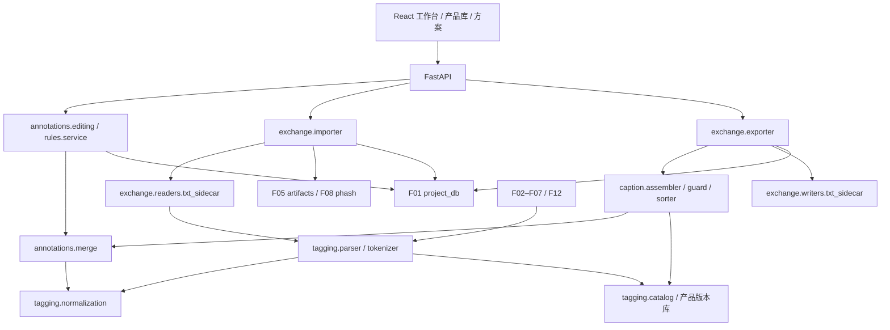

# F09–F10 标注编辑与导入导出设计（含 F22）

实现补充（0.59.0）：中断导出可显式扫描，完整复制产物逐项核验后发布；其余目录可先记账再归档保留，不删除或补写产物。万图导入/导出与实际文件验收已完成，见 [本地综合验收](66-本地功能收尾与综合验收.md)。

版本：设计稿 v0.1；日期：2026-10-12。仅设计规格、接口声明、伪代码与测试清单；不含实现代码，不改架构文件，不 commit。

实现同步（2026-10-26，v0.29.0）：C14 已按“默认严格 UTF-8、可选 UTF-8→GBK 回退”落实，并同步 05 §10.5；不是统计编码探测。预览包含逐项实际编码与完整清单的回退计数，原始标注保存请求编码、实际编码、回退标记和提示；暂停续导、收据恢复及重新打开项目可查询。见 [编码兼容验收](34-F10-导入编码兼容验收.md)。v0.28.0 已实现 C16 可选硬链接（见 [35](35-F10-硬链接导出验收.md)）；v0.29.0 已实现 C13 prompt_pyramid 本地纯排序与冻结分类上下文（见 [36](36-F09-F10-R4-本地排序验收.md)）。默认仍为 layer_first，非空 pipeline 仍明确拒绝。

## 1. 依据、边界与依赖图

硬约束：[05](05-项目结构与数据模型.md) §4、§5.7–5.9、§7–8、§10；[F01](F01-project-db-设计.md) §6–7.4、Q09；[04](04-工作流程与架构草案.md) F09/F10/F22。协作合同：[F02–F05](F02-F05-生成后端设计.md) §6、[F06–F07](F06-F07-提示词生产设计.md) §8、[F08–F12](F08-F12-视觉与执行器设计.md) §5/8；禁用规则引用 [R1 §3.5](../skills/prompt-composer/SKILL.md)，R4 引用 [06](06-Skill需求清单.md) §R4。
本文拥有解析、编辑、规则计算、caption、导入/导出适配；F01 拥有持久事务/撤销，F05 拥有图片收据/登记，F08/F12/F15 拥有图像分析与标注产出，均只调用不重复实现。无新增项目表、列、jobs.executor 值。
权威约束优先；C11 起为建议同步/变更，未采纳边界见 §15。默认导出仅 keep；按 05 §10.4，reject 始终跳过，file_missing 永远跳过。F01 Q09 的 reject 显式选入用于执行器/编辑范围，不据此放宽导出。



标签翻译和规则库只在产品层；项目只保存实际规则全文、解析版本/必要证据及方案快照，不保存产品文件路径。纯计算模块不依赖 FastAPI/SQLite；网络、文件复制不跨数据库事务。

## 2. 包布局与模块合同

路径以 `src/stylelora/` 为根；表内同组文件共享模块合同，公开接口见各节，最小测试指向 §14。现有设计中的 normalize_tag 入口重导出同一实现，不保留多套 tokenizer。

| 模块 | 职责与依赖 | 错误处理 / 幂等性 | 最小测试 |
|---|---|---|---|
| tagging/types.py、normalization.py、tokenizer.py、parser.py | 类型、规范键、语法识别、original 分类；标准库/catalog | 未知语法 unverifiable、保留原文；同版本输入确定且 normalize 幂等 | T01–T03 |
| tagging/catalog.py、translations.py、migration.py、launcher.py | 产品索引/翻译/旧格式预览、可选 MCP；F02 只读客户端 | 错格式整批拒绝，revision CAS；迁移摘要去重，远端失败不污染本地 | T04–T05 |
| annotations/merge.py、editing.py、projection.py | 全层有效视图、manual 编辑、WD 对照；F01/tokenizer | CAS 冲突整批回滚；完整语义相同 no-op | T06–T08、T12–T13 |
| rules/types.py、library.py、engine.py、service.py | 产品规则库、纯计算、预览提交协调；merge/F01 | 过期预览重做；零变化无日志，撤销由 F01 原子处理 | T05、T09–T11 |
| caption/assembler.py、blocklist.py、sorters.py；tagging/trigger_validation.py | caption、保险检查、F22/R4；merge/catalog | 不可验证明确报告；固定快照确定输出，不写标注 | T12–T16 |
| exchange/types.py、schemes.py、readers/base.py、readers/txt_sidecar.py、importer.py | 方案验证、reader、递归导入；F05/F01 | 编码/坏图图级失败；item/attempt 收据及 sha256 防重复 | T17–T21 |
| exchange/writers/base.py、writers/txt_sidecar.py、exporter.py、report.py、pipeline.py | 只读导出、文件发布/报告、预留链；caption/F01 | 文件对失败清理本次暂存；版本目录不重用，相同快照字节确定 | T22–T26 |
| api/annotations.py、rules.py、tag_library.py、exchange.py | FastAPI DTO/分页与会话进度；上述服务 | 422/409/410/503；不自动重放未知成功的创建/应用 | T27 |

React 仅消费后端投影和预览；组件建议 `AnnotationEditor / WdComparison / RulePreview / ExchangeSchemeEditor / ExportReport`。展示翻译与英文 tag 分离，中文不进入 caption；不在前端另算合并、命中与移除边界。

## 3. 公共数据类与共享 tokenizer

以下为 frozen dataclass/Protocol 声明规格；省略函数体。复用 F01 的 `JsonObject、Tag、AnnotationInput、CurrentRef、Scope、ImageRow、AnnotationRow、ProjectHandle、Page、WriteResult`。

```python
TokenSyntax = Literal['plain', 'weight', 'escaped', 'separator', 'unknown']
TagLookup = Literal['known', 'alias', 'unknown', 'unverifiable']
@dataclass(frozen=True)
class Token:
    raw: str; normalized: str; syntax: TokenSyntax
    escaped: bool; weight: float | None; lookup: TagLookup
@dataclass(frozen=True)
class ParsedSegment:
    raw: str; token: Token | None; kind: Literal['tag','nl','empty']
    reason: str | None
@dataclass(frozen=True)
class ParsedPrompt:
    tags: tuple[Tag,...]; natural_language: str | None
    segments: tuple[ParsedSegment,...]; tokenizer_version: str
    unverifiable: tuple[str,...]
@dataclass(frozen=True)
class CatalogHit:
    query: str; canonical: str | None; category: str | None
    translation: str | None; match: TagLookup; catalog_revision: str
@dataclass(frozen=True)
class AnnotationView:
    image_id: int; tags: tuple[Tag,...]; natural_language: str | None
    layers: Mapping[str, AnnotationRow | None]; refs: tuple[CurrentRef,...]
    missing_original: bool; wd_overlap: Mapping[str, bool]
@dataclass(frozen=True)
class ManualEdit:
    image_id: int; tags: tuple[Tag,...]; natural_language: str | None
    read_set: tuple[CurrentRef,...]; write_nl: bool = False
# RulePlan / RuleImageChange / OriginalInput 原样复用 F01 §6.1，不另建同名 DTO。
@dataclass(frozen=True)
class CaptionResult:
    tags: tuple[Tag,...]; natural_language: str | None
    warnings: tuple[str,...]; removed_blocklist: tuple[str,...]
    trigger_valid: bool; sorter: str
```

```python
def normalize_tag(value: str) -> str: ...
def tokenize_prompt(text: str, *, catalog: TagCatalog) -> tuple[Token,...]: ...
def parse_original_prompt(text: str, *, catalog: TagCatalog) -> ParsedPrompt: ...
def lookup_tag(catalog: TagCatalog, value: str) -> CatalogHit: ...
def canonical_json(value: JsonObject | list[JsonObject]) -> str: ...
```

`normalize_tag` 严格为 F01 的 `value.strip().lower().replace('_', ' ').strip()`，不折叠内部空白、不做 NFKC、不动态展开 alias。合并键与 merge_meta 的键始终使用此函数。F02/F06 的连续空白折叠/别名折叠需求归同模块的显式 `resolve_input_tag(value: str, catalog: TagCatalog, *, collapse_spaces: bool=False) -> CatalogHit`；只在新输入阶段采用已验证 alias，保存解析证据，不因词库升级重新解释旧标注；对齐提案 C11。

基础语法版本 `comma-v1` 按字面逗号切分，保留 raw/偏移；普通 token 精确查询命中算 tag，其余顺序归 NL。识别 `(...)`/`[...]`/`{...}`、`:数值`、`数值::...::`、反斜杠转义与 BREAK/AND/管道；识别不等于支持求值。已知 `name (series)`、`bow (weapon)` 完整库项是消歧 tag。权重、转义逗号跨段、未知嵌套均报 unverifiable，相关原片段保留到 NL/诊断；F05 因此不得判校验通过。可验证的解权重/转义语法版本见 Q02，首版不靠删括号猜测。
结构化 WD/LLM/manual tags 不按库命中删去未知 tag；它们只做规范键和语法验证。original 解析才执行 05 §8.2 的已知 tag / 未知 NL 分类。段内 unknown 用 `, ` 保序连接，参数保存 tokenizer/catalog 版本及 raw 证据；缺失索引拒绝该次解析，正常索引的 unknown 才能归 NL。

## 4. 产品标签库、翻译库与迁移

辅助 DTO：Issue(code/message:str、severity:Literal['warning','error']、field:str|None)；ImportPreview(preview_id/digest:str、base_revision:str、payload:JsonObject、issues:tuple[Issue,...])；CommitReport(revision:str、inserted/skipped:int、issues:tuple[Issue,...])；PipelineReport(files:tuple[FileResult,...]、warnings:tuple[Issue,...])。CaptionConfig/ImportParams/OutputConfig 由 §11 schema 映射 frozen dataclass（integer→int、number→float、array→tuple、enum→Literal，null→None），不使用 Any 绕过类型。
产品层以统一 `TagCatalog` 门面查询翻译条目及可选 Danbooru canonical/alias/category 索引；翻译表已有键即是可查 tag，未翻译的已知 Danbooru tag 也可识别。独立索引选型仍属 Q01；没有任何可用库时返回 unverifiable。局部库 unknown 可按原始解析归 NL，但不足以证明 F22 未与全部 Danbooru 冲突。

建议产品层格式：`%APPDATA%/StyleLoraAutom/tagging/`，原子替换、UTF-8、确定性 JSON。

```json
{"schema_version":1,"kind":"tag_catalog","revision":3,
 "tags":[{"tag":"long hair","category":"general","aliases":["long_hair"]}],
 "source":"danbooru-export","source_revision":"<digest>"}
```

```json
{"schema_version":1,"kind":"translations","revision":2,
 "entries":{"long hair":"长发","1girl":"一名女孩"},
 "operations":{"<request_key>":{"digest":"<sha256>","revision":2}}}
```

公开接口：

```python
class TagCatalog(Protocol):
    revision: str
    def lookup(self, value: str) -> CatalogHit: ...
    def search(self, query: str, *, limit: int = 20) -> tuple[CatalogHit,...]: ...
def load_catalog() -> TagCatalog: ...
def preview_catalog_import(data: bytes, *, format: Literal['json','tsv']) -> ImportPreview: ...
def commit_catalog_import(preview: ImportPreview, *, expected_revision: str,
                          request_key: str) -> CommitReport: ...
def get_translation(tag: str) -> str | None: ...
def put_translation(tag: str, value: str, *, expected_revision: int) -> WriteResult[int]: ...
def import_tagcleaner_translations(data: bytes, *, request_key: str) -> CommitReport: ...
def import_tagcleaner_rules(data: bytes, *, request_key: str) -> CommitReport: ...
```

已核对 TagCleaner [server.py](https://github.com/Mon-Landis/TagCleaner/blob/77cb22c7b95455ebefd4b8f82b1af7889c2d7436/server.py)：`.tagcleaner-data/translations.json` 是字符串映射；`replacement-rules.json` 是对象数组，delete/write/condition 接受逗号串或数组，deleteMode/writeMode/conditionMode 缺省 any。迁移映射 all/any，原顺序保留，id/name 作产品显示字段；旧程序用载入时 originalTags 判条件/删除，本项目遵守 05 的 original 层条件及有效视图删除，预览标注此语义差异。
翻译空项在导入时跳过并报告，不能默默删除本地已有翻译；只有明确 PUT 空值才删除。规范键/alias 合并造成不同翻译冲突则停止提交供选择。`search_tags` 的 translate 能力仅在 F02 tools/list 的真实 schema 证明支持时启用，不假设存在独立 translate 工具；候选不会自动写入 canonical。追加 `async def query_launcher_tags(query: str, *, translate: bool=False) -> tuple[CatalogHit,...]: ...`。

迁移是产品层事务：临时文件 + flush/fsync + replace；失败保留旧文件。相同摘要和 request_key 重放返回原报告，不重复追加；同内容不同 revision 由 CAS 冲突。最小配置：catalog 本地优先、translation 缺省空、Launcher 查询关闭。

## 5. 手动编辑与工作台投影

`get_annotation_view()` 读取五层 current，调用 merge 生成有效视图，同时返回每层 current ref、original 是否存在、WD 与 original 的规范键重合及 conf。无 original 时 WD 对照自身并设置 `missing_original=True`，UI 显示「无原始标签」。original/manual/rule 的历史不覆盖。

```python
def get_annotation_view(project: ProjectHandle, image_id: int,
                        config: CaptionConfig) -> AnnotationView: ...
def edit_manual(project: ProjectHandle, edit: ManualEdit) -> ManualResult: ...
def bulk_edit_manual(project: ProjectHandle, image_ids: Sequence[int], *,
                     add: Sequence[Tag], remove: Sequence[Tag],
                     expected: Mapping[int, tuple[CurrentRef,...]]) -> BulkEditResult: ...
```

手动编辑以无导出阈值的有效全层视图为输入：删除差集形成 removals，未触及 tag 继承原证据，新增形成本次 ID 的 origin；参数由服务端构造，不接收客户端 cutoff。完整 read_set 在 writer 事务中验证（含缺失层），tags 调 F01 `edit_manual_tags`；NL 调 `append_version(expected=单个 CurrentRef, policy='content')`，tags/NL 同事务。内容及 merge_meta 完全相同 no-op，过期读集409；同读集的合法新目标可正常写入。
ManualEdit 增加 `write_nl: bool=False`，None 在 write_nl=true 时写空 NL，否则不触及 NL；空 NL 按 F01 回落到下一非空层，不能借空串屏蔽下层。编辑返回改为 `ManualResult`（annotation_ids: tuple[int,...]、changed: bool）；BulkEditResult 为 results: Mapping[int,ManualResult]、changed_count: int。批量 add/remove 集合相交报422，不为已存在 add 刷新 origin。

批量 add/remove 是多图独立预读、一次 F01 短事务；任一 read_set 失效则整批拒绝。文件缺失、reject 不阻止编辑范围，只有 file_missing 的图片仍不得被导出；编辑不改变 review_status。
## 6. 批量规则 schema、预览、执行与撤销

以下是 JSON Schema 2020-12；所有对象拒绝未知字段。空条件=null；删除/写入至少一组非空，组内规范键去重保首位，三组允许交集（先删后加），空数组须在预览显式规范为 null。
```json
{"$schema":"https://json-schema.org/draft/2020-12/schema","$id":"urn:stylelora:rule:v1",
 "type":"object","additionalProperties":false,"required":["schema_version","delete","write","condition"],
 "properties":{"schema_version":{"const":1},"delete":{"$ref":"#/$defs/group"},
 "write":{"$ref":"#/$defs/group"},"condition":{"$ref":"#/$defs/group"}},
 "anyOf":[{"properties":{"delete":{"type":"object"}}},{"properties":{"write":{"type":"object"}}}],
 "$defs":{"group":{"oneOf":[{"type":"null"},{"type":"object","additionalProperties":false,
 "required":["mode","tags"],"properties":{"mode":{"enum":["all","any"]},
 "tags":{"type":"array","minItems":1,"uniqueItems":true,"items":{"type":"string","minLength":1}}}}]}}}
```
产品规则库信封：`schema_version:1, kind:'replacement_rules', revision:int, rules:[{id:str,name:str,rule:RuleSpec}], operations:{request_key:{digest,revision}}`；id 为 UUID，操作凭据不导出。`save_rule_library(value: RuleLibrary, *, expected_revision: int, request_key: str) -> CommitReport`；规则正文 RuleSpec 对应上述 schema。每次只应用一条规则；多选逐条预览、各自操作，不隐含旧版规则链语义。

| 组 | all | any |
|---|---|---|
| 条件 | 原始 tags 全含 | 至少含一个；null 无条件 |
| 删除 | 当前有效集合全含，才全删 | 删除实际命中项；零命中失败 |
| 写入 | 删除后集合全部不含，才全写 | 补所有缺失；不是随机挑一个 |

有删除组且删除失败，写入不执行；只有写入组直接判断。条件用 original/tags，即使该行是空数组也不退到 WD；没有 original tags 行才退 WD，仍无 WD 则有条件规则不满足，UI 标「无原始标签」。条件不使用导出阈值，不受 rule/manual 移除影响。
```python
def preview_rule(project: ProjectHandle, rule: RuleSpec, scope: Scope) -> RulePreview: ...
def evaluate_rule(rule: RuleSpec, view: MergeView, condition_tags: tuple[Tag,...] | None) -> RuleDelta: ...
def apply_preview(project: ProjectHandle, preview_id: str, digest: str) -> RuleApplyResult: ...
def undo_latest_rule(project: ProjectHandle, op_id: int) -> WriteResult[OperationRow]: ...
```
RulePreview：preview_id/digest:str、plan: F01.RulePlan、matched_count/changed_count:int、examples:tuple[RuleDelta,...]、reasons:Mapping[str,int]；RuleDelta：image_id:int、before/after:tuple[Tag,...]、removed/added:tuple[str,...]、reason:str|None。摘要包含规则全文、冻结有序 IDs、全读集、语义变化、词库版本，不仅包含命中数；预览会话有效期推荐15分钟。
范围选 selected_ids 或 filter，二者互斥；默认过滤排除 reject，可显式选入。预览物化全部 IDs，新增图片不自动纳入；所有候选（含未命中图）五个 tags current/缺失 ref 均冻结，提交前重新校验。前端必须展示命中数、变化数、增删示例和 WD 退化提示后才启用执行。
执行调用 F01 apply_rule，整批写完整 rule/tags 快照及一条 operation_log；无变化不建日志。读集失效要求重新预览。相同预览同进程重交返回原结果；跨重启预览失效410，不承诺无持久请求键的 API exactly-once。结果未知先查 operation_log 新旧行证据，无法证明则提示核查，不盲重放。
撤销只允许全局最近 applied：逐图 new 仍 current、previous 非 current，且无之后 manual/WD/LLM 变更；任何冲突整批拒绝并返回 image_id/层/冲突 ID。按 F01 §7.2 排除已 undone 操作的新 rule 历史行；先撤 B 再撤 A 可成功。已 undone 重撤 no-op；无 redo，重新执行需新预览。

## 7. 合并算法与 caption 组装

```text
merge(rows, config, editing=False):                         # 伪代码，非实现
  current = 各参与层 current tags；检查 merge_meta 同图引用
  cutoff[tag] = current rule/manual.removals 的最大 cutoff_annotation_id
  按 layer_priority 和层内首次位置遍历候选（规范键 k）:
    origins = 普通层自身证据，或快照 tag_origins[k] 原始证据列表
    eligible = origins 中通过 WD 阈值的证据（editing=True 时不筛 conf）
    eligible = eligible 中 annotation_id > cutoff[k] 的证据；无 cutoff 不筛年龄
    若 eligible 非空：收集证据并在首次有效位置加入 k，重复位置不再插入
  NL = 开启时按 manual/llm/original 取最高非空 current nl，否则 None
  返回 tags、全部有效 origins、各层移除记录和 NL（不加触发词）
snapshot_edit(view, target, previous_operation_layer):
  保留目标 tag 的既有证据；显式新增使用 SELF_ID 占位证据
  继承本操作层旧 removals；只对实际删除更新 cutoff=SELF_ID
  最终仍保留 tag 不新增移除；无关编辑不刷新旧 cutoff
  比较完整 tags+merge_meta；有变化才由 DAL 分配 ID 并解析 SELF_ID
assemble(view, config, trigger):
  对 tags/NL 做 blocklist 检查；按 warn/remove 策略产生导出副本
  可选纯排序器只重排内容 tags，验收输入输出为相同规范键集合
  规范化触发词、移除内容中重复项，再前挂触发词且仅出现一次
  序列化第一行；启用且非空 NL 时写空行和一段 NL
```
```python
def merge_annotations(rows: Sequence[AnnotationRow], config: CaptionConfig, *, editing: bool=False) -> MergeView: ...
def assemble_caption(view: MergeView, config: CaptionConfig, trigger: str,
                     guard: BlocklistSnapshot, sorter: TagSorter | None) -> CaptionResult: ...
```
MergeView：tags:tuple[Tag,...]、origins:Mapping[str,tuple[Origin,...]]、removals:Mapping[str,tuple[Removal,...]]、nl:str|None；Origin/Removal 精确沿用 F01 §7.4。同键多证据任一通过即可；复制自 WD 仍看 WD 原 conf，快照的显示层位置不能冒充证据年龄。禁用 rule 层同时禁用该层 removals，但其它参与快照所携带的合法旧证据仍按年龄判断。
例：original#10=[A] → rule#20=[B]、A cutoff20 → 输出 `trigger, b`；wd#30=[A, conf=.9] → `trigger, b, a`；rule#40 再删 A、cutoff40 → `trigger, b`。若 #40 仅加入 C，A cutoff 仍20 → `trigger, b, a, c`（快照实际顺序决定）；撤销 #40 恢复 #20 的元数据。#30 晚于 #20，会阻止直接撤销 #20。
NULL WD conf 默认排除；编辑/规则有效视图不应用导出阈值，故不能从某导出预览的隐藏项推导手动删除。NL 空 manual 回落 llm，不拼 original；本版不提供“空字符串屏蔽全部下层 NL”的语义。

## 8. blocklist、F22 与 R4 排序接口

BlocklistSnapshot：style_tags:frozenset[str]、rules_hash/catalog_hash:str、mode:Literal['warn','remove']；Hit：tag:str|None、nl_span:tuple[int,int]|None、category/reason:str、certainty:Literal['exact','review_required']。每图从所属 source.style_prompt 派生，叠加 R1 §3.5 A–J 规则和可信 artist 分类；不读 PNG prompt，不把 style_prompt 拼入 caption。保留通用短词完整匹配、物体属性/消歧括号/frame 例外，语义不明报告待审，不声称正则覆盖全部同义表达。
按本任务，默认 warn，命中保留并逐图报告；remove 仅剔除确认命中的完整 tag，不回写标注。NL 不截词破坏语义：remove 下存在 NL 命中则该图失败 `blocklist:nl_review_required`，编辑后重导；不确定 tag 亦需人工处理。触发词命中不自动剔除，返回 `trigger:blocklist_conflict`；先解决冲突才能执行 remove。默认行为与 05 §10.3 待确认剔除项的同步列 C12。
F22 补全：trigger 必填且是可单行输出的单一非空 token，禁止逗号、换行、权重/控制语法；按规范键查完整 Danbooru canonical/alias。命中已有 tag 是可明确强制通过的警告，按 05 §10.4 优先于 F06 的一般422描述。强制选择绑定 trigger+词库版本摘要、写导出报告，不修改项目结构。
检查项目所有 sources.style_prompt 的规范化连续文本是否包含 trigger；命中硬错误，不因已有 tag 强制选项绕过。索引覆盖不完整、未知权重导致无法证实则 unverifiable，推荐阻止正式导出但允许暂存项目设置（Q05）。旧两参数 validate_trigger 保留兼容；导出服务逐源检查并汇总。
```python
def build_blocklist(style_prompt: str, catalog: TagCatalog, *, mode: str) -> BlocklistSnapshot: ...
def check_blocklist(tags: Sequence[Tag], nl: str | None, snapshot: BlocklistSnapshot) -> tuple[Hit,...]: ...
def validate_trigger(trigger: str, style_prompt: str) -> tuple[Issue,...]: ...
class TagSorter(Protocol):
    version: str
    def sort(self, tags: tuple[str,...], context: SortContext) -> tuple[str,...]: ...
```
SortContext：catalog_revision:str、skill_hash:str、categories:Mapping[str,str]；R4 是纯排序适配器，不注册 jobs、不新增标注、不调用 clean 角色。采用本地稳定分类排序，目标顺序为主体→动作表情→服装→构图→场景→光照，其余稳定放末尾；触发词由 assembler 排第一。类别不明保相对顺序，不能猜人物归属。v0.29.0 已按 C13 实现：上下文封装在不可变 PyramidSorter 中；包内 142 条精确映射与契约文档各自计算摘要，词库别名只辅助分类，显式 pyramid:* 类别可补充，character 进入主体，artist/copyright/meta 等保持未分类。规则与词库实际内容摘要一起冻结进计划；缺失/损坏报错，变更使旧预览失效。详见 [36 验收](36-F09-F10-R4-本地排序验收.md)。
已核对上游 [runtime-prompt](https://github.com/Mon-Landis/TagCleaner/blob/77cb22c7b95455ebefd4b8f82b1af7889c2d7436/skills/prompt-pyramid/runtime-prompt.md)：含删画师、去重、解矛盾、服装先于动作，不能原样迁移。C13 建议迁移为排序专用规则和类别 fixture，规范化交共享模块；未适配时选择 prompt_pyramid 必报 UnsupportedSorter，不静默回落。任何排序器增删/改名/重复 tag 均拒绝。

## 9. 导入 reader 与文件状态

```python
class CaptionReader(Protocol):
    name: str
    def read(self, image: Path, params: ImportParams, catalog: TagCatalog) -> ReadResult: ...
def decode_sidecar(data: bytes, encoding: Literal['utf-8-sig','gbk','auto']) -> DecodedText: ...
def scan_import(root: Path, *, recursive: bool=True) -> ImportManifest: ...
async def start_import(project: ProjectHandle, source_id: int, root_handle: str) -> SourceRow: ...
```
ImportParams 见 §11；ReadResult：originals:tuple[OriginalInput,...]、encoding:str|None、warnings:tuple[Issue,...]、sidecar_sha256:str|None；DecodedText：text/encoding:str、fallback:bool。ImportManifest：entries:tuple[ManifestEntry,...]；ManifestEntry：seq:int、relative_path:str、image_sha256:str、sidecar_sha256:str|None。外部根仅会话 root_handle 解析，持久 config.import_manifest 不存绝对路径。
严格解码路径：UTF-8-BOM 首先按 utf-8-sig；无 BOM 优先 UTF-8；仅用户选择 auto 时失败后试 GBK，成功提示 `encoding:gbk_fallback`，不宣称统计探测可靠；全失败图级 error，禁止 errors=replace。显式 gbk 不先试 UTF-8。BOM 存在但非法 UTF-8 不回退 GBK。F01 默认仍 utf-8-sig；auto 能力/推荐开关见 C14，未采纳不启用自动回退。
标准格式为第一行 tags 候选、一空行、后续 NL；CRLF/CR 统一 LF，NL 保留内部换行，边界空白去除。第一行 unknown 片段按 §3 归 NL，放显式 NL 之前并报告；无空行且有多行报 `sidecar:invalid_layout`，不擅自 flatten。仅第一行 known tags 不建 NL；空 txt 写 original/tags=[]，与无 txt 完全不写 original 区分。第一行 unknown 但无空行的 NL 归属与 05 §10.5 字面冲突见 C15，未裁决时拒绝此歧义布局并要求预览修正。
递归枚举支持的 PNG/JPEG/WebP/BMP/GIF/TIFF（Pillow 完整解码；动画处理沿图像模块），稳定按相对路径 `(casefold,原文)` 排序；不跟随目录链接/junction、不进入项目自身 images/exports/.pending，目录选择覆盖项目时拒绝。同目录同主干 txt；大小写多匹配歧义报错，多扩展同主干共用 txt 给警告。
冻结 reader/params/tokenizer/catalog 版本与 manifest 到 sources.config_json，source_items.prompt 只存原文件名。读取字节 SHA 必须与冻结清单一致，恢复需重选根并校验；内容变更报 input_changed，不悄悄导入另一文件。无 txt 警告继续复制、不写 original；PNG 元数据仅留档，不用作 reader。
流程序：计算预检 SHA→查重命中调用 skip_duplicate→否则 mark_sent 提交→复制 staging→完整校验/重新 SHA、pHash/元数据及 originals→收据→F01 complete_item。最终 writer 事务内再次查重，串行防同批/并发重复；命中 sent→skipped，image_id=NULL/error=duplicate_sha256，不合并归属、不合并标注。
复制失败/解码失败发生 sent 后 fail_item，源可继续其它项；未 sent 的预检失败先报告/暂停，不能写非法 pending→failed。恢复复用 F05 收据，done/skipped 永不重做；缺文件的已有 sha256 仍算重复，不自动修复 missing 图片。评级委托 F08–F12，网络不在入库事务。

## 10. 导出 writer、报告与处理链

```python
class CaptionWriter(Protocol):
    name: str
    def write_caption(self, path: Path, caption: str, *, encoding: str) -> FileResult: ...
    def write_image(self, src: Path, dst: Path, *, mode: Literal['copy','hardlink']) -> FileResult: ...
def export_project(project: ProjectHandle, scheme_id: int, *, request_key: str | None=None,
                   trigger_override_digest: str | None=None) -> ExportReport: ...
def execute_pipeline(path: Path, pipeline: PipelineSpec) -> PipelineReport: ...
```
`FileResult`：path:str（导出相对路径）、bytes:int、sha256:str、action:str；`ExportReport`：schema_version:Literal[1]、export_id/dir:str、selected/exported/skipped/failed:int、skip_reasons/failure_reasons:Mapping[str,int]、blocklist_hits:tuple[Hit,...]、tag_frequency:Mapping[str,int]、trigger_count:int、files:tuple[FileResult,...]、warnings:tuple[Issue,...]。Hit 另含 image_id:int、action:str；报告必须有逐图结果列表（image_id、kind、reason、files），selected=exported+skipped+failed，频次每成功图每键计一次。报告写版本目录 report.json，不新增业务表。
导出协调器读取同一 F01 ReadSession 快照，冻结 IDs、方案、原始证据、所有源和项目 metadata（元数据锁与读快照协调），之后 writer 只读文件不碰 DAL。候选先按 source_ids 取全集再逐图分类 filter/reject/missing，故报告可展示未审/剔除数；每图只取一个主跳过码，missing>reject>review_filter。真实文件读取复核路径/sha256，清理服务共享图级文件租约防删文件竞态。创建 `exports/<scheme_id>/<UTC时间>-<随机短码>/`，模板以 §11 为准，先验证整批输出名唯一，永不覆盖旧目录。
图片默认 copy；C16 于 v0.28.0 实现，同步 05 §10.2：hardlink 仅同卷、目标不存在、pipeline=[] 时可选，失败报错不回退。硬链接共享文件内容，外部修改导出图会影响项目原图；选择界面说明风险，执行必须提交与当前导出计划绑定的 hardlink_ack_digest。CLI 使用 --acknowledge-hardlink 显式确认并绑定计划。创建后及发布前核对源/目标文件身份、大小和 SHA-256；取消、发布失败尽力移除本次临时链接，系统阻止清理则保留 interrupted 收据与 hardlink_cleanup_pending 标记。硬链接的成功报告只证明发布时核对，后续外部修改会共享到其他链接。未来修改图片的处理器必须先断开硬链接并复制。见 [硬链接导出验收](35-F10-硬链接导出验收.md)。
在目标父目录创建本次 `.partial-<export_id>`，逐图图片/txt/可选 JSON 全写完并校验 SHA 后才计成功，失败删除本次该图全部输出；文件对不是两次 rename 就天然原子。完成后原子写 report.json，再整体无覆盖 rename 成正式 UTC-短码目录；磁盘满/取消不发布，保留 interrupted 收据，重启只展示中断并允许清理/重新导出，不续写旧正式目录。
caption 先 assemble：触发词固定第一；只写内容 tags/NL，绝不带 `sources.style_prompt`；NL 开启写第一行 tags、空行、自然语言，否则只一行。txt 默认 UTF-8 无 BOM；导入 reader 的默认 utf-8-sig 可读无 BOM/有 BOM。图片无 current tags 仍可输出触发词单项并 warning，是否拒绝由 `require_nonempty_tags` 默认 false；file_missing/reject 在导出选择阶段永远 skip，reject 不受 filter 覆盖。
`tag_frequency` 统计实际写入 caption 的规范 tag，触发词单独 `trigger_count` 或包含在频次中由报告 schema 明示（默认包含）；blocklist 命中逐图记录 source tag/NL、category、action，warn 仍 exported，remove 后重新统计。报告不存完整 prompt，仅 caption 摘要哈希、tag 频次和安全诊断。

pipeline 只校验/预留：
```python
@dataclass(frozen=True)
class PipelineStep:
    processor: Literal['metadata_strip','local_upscale']
    params: JsonObject
@dataclass(frozen=True)
class PipelineSpec:
    schema_version: int; steps: tuple[PipelineStep,...]
class ExportProcessor(Protocol):
    name: str
    def process(self, image: Path, params: JsonObject) -> FileResult: ...
```
本版非空链一律返回 `pipeline:unsupported` 并不发布“已处理”产物；空 `[]` 与无字段等价。`metadata_strip`、`local_upscale` 只有名称/参数 schema 预留，不调用、不静默跳过。若未来启用，必须定义处理后 sha256、caption 配套关系、失败回滚和 F01 事务外收据，不在本模块推断。

## 11. 方案 JSON schema 与默认配置

`CaptionConfig`：`schema_version=1`、`tag_layers` 默认五层、`layer_priority=['manual','rule','llm','wd','original']`、`wd_min_confidence=0.0`、`wd_null_confidence='exclude'`、`include_nl=false`、`nl_priority=['manual','llm','original']`、`tag_sort='layer_first'`、`blocklist_mode='warn'`、`separator=', '`、`trigger_position='first'`。`prompt_pyramid` 仅允许合约可用时选择。`filter_json` 默认 `review_statuses=['keep']`、`source_ids=null`、`include_missing=false`；reject/file_missing 服务端强制排除。
```json
{"schema_version":1,"tag_layers":["original","wd","llm","manual","rule"],
 "layer_priority":["manual","rule","llm","wd","original"],"wd_min_confidence":0.0,
 "wd_null_confidence":"exclude","include_nl":false,"nl_priority":["manual","llm","original"],
 "tag_sort":"layer_first","blocklist_mode":"warn","separator":", ","trigger_position":"first"}
```
```json
{"schema_version":1,"review_statuses":["keep"],"source_ids":null,"include_missing":false}
```
`ImportParams` 默认 `encoding='utf-8-sig'`、`recursive=true`、`layout='first_line_blank_nl'`、`tokenizer_version='comma-v1'`、`on_unverifiable='preview_error'`；`auto` 仅 C14 采纳后允许。`OutputConfig` 默认 `image_mode='copy'`、`filename='{image_id}{ext}'`、`caption_encoding='utf-8'`、`include_json=false`、`require_nonempty_tags=false`。`pipeline_json=[]`。
`ExportSchemeInput/ImportSchemeInput` 调 F01 schemes repository；仅更新需 expected_updated_at，创建没有旧时间。全部字段先填默认再验证，拒绝重复 JSON 键、NaN、bool 冒充整数、高版本及未知字段；保存结构有效的预留配置不等于支持执行。

以下为方案的 JSON Schema 2020-12：本地 `$defs/caption` 由下一块定义，导出/导入共用 `$defs`；顶层 oneOf 明确两种方案。所有业务字段必填，时间/ID 由 DAL 生成。
```json
{"$schema":"https://json-schema.org/draft/2020-12/schema","oneOf":[{"$ref":"#/$defs/export"},{"$ref":"#/$defs/import"}],
 "$defs":{
 "import":{"type":"object","additionalProperties":false,"required":["name","reader","params_json","is_default"],
 "properties":{"name":{"type":"string","minLength":1},"reader":{"const":"txt_sidecar"},"is_default":{"type":"boolean"},"params_json":{"$ref":"#/$defs/reader"}}},
 "reader":{"type":"object","additionalProperties":false,"required":["schema_version","encoding","recursive","layout","tokenizer_version","on_unverifiable"],
 "properties":{"schema_version":{"const":1},"encoding":{"enum":["utf-8-sig","gbk","auto"]},"recursive":{"type":"boolean"},
 "layout":{"const":"first_line_blank_nl"},"tokenizer_version":{"const":"comma-v1"},"on_unverifiable":{"const":"preview_error"}}},
 "export":{"type":"object","additionalProperties":false,"required":["name","exporter","filter_json","caption_config_json","output_config_json","pipeline_json"],
 "properties":{"name":{"type":"string","minLength":1},"exporter":{"const":"image_txt"},"filter_json":{"$ref":"#/$defs/filter"},
 "caption_config_json":{"$ref":"#/$defs/caption"},"output_config_json":{"$ref":"#/$defs/output"},"pipeline_json":{"$ref":"#/$defs/pipeline"}}},
 "filter":{"type":"object","additionalProperties":false,"required":["schema_version","review_statuses","source_ids","include_missing"],
 "properties":{"schema_version":{"const":1},"review_statuses":{"type":"array","uniqueItems":true,"items":{"enum":["keep","unreviewed"]}},
 "source_ids":{"type":["array","null"],"uniqueItems":true,"items":{"type":"integer","minimum":1}},"include_missing":{"const":false}}},
 "output":{"type":"object","additionalProperties":false,"required":["schema_version","image_mode","filename","caption_encoding","include_json","require_nonempty_tags","subdirectory","overwrite"],
 "properties":{"schema_version":{"const":1},"image_mode":{"enum":["copy","hardlink"]},"filename":{"enum":["{image_id}{ext}","{stem}-{image_id}{ext}"]},
 "caption_encoding":{"const":"utf-8"},"include_json":{"type":"boolean"},"require_nonempty_tags":{"type":"boolean"},"subdirectory":{"type":"string"},"overwrite":{"enum":["error","skip"]}}},
 "pipeline":{"type":"array","items":{"type":"object","additionalProperties":false,"required":["processor","params"],
 "properties":{"processor":{"enum":["metadata_strip","local_upscale"]},"params":{"type":"object"}}}}
 }}
```
本块是 schema 组合片段：将其 caption 值放入上块 `$defs.caption`，再交验证器；不是未解析引用即可直接验证的独立文件。未提供 params 的未来处理器细节不视作已支持。
```json
{"caption":{"type":"object","additionalProperties":false,
 "required":["schema_version","tag_layers","layer_priority","wd_min_confidence","wd_null_confidence","include_nl","nl_priority","tag_sort","blocklist_mode","separator","trigger_position"],
 "properties":{"schema_version":{"const":1},
 "tag_layers":{"type":"array","uniqueItems":true,"items":{"enum":["original","wd","llm","manual","rule"]}},
 "layer_priority":{"type":"array","minItems":5,"maxItems":5,"uniqueItems":true,"items":{"enum":["original","wd","llm","manual","rule"]}},
 "wd_min_confidence":{"type":"number","minimum":0,"maximum":1},"wd_null_confidence":{"enum":["include","exclude"]},
 "include_nl":{"type":"boolean"},"nl_priority":{"const":["manual","llm","original"]},"tag_sort":{"enum":["layer_first","prompt_pyramid"]},
 "blocklist_mode":{"enum":["warn","remove"]},"separator":{"const":", "},"trigger_position":{"const":"first"}}}}
```
OutputConfig 补齐默认 schema_version=1、subdirectory=''、overwrite='error'；subdirectory 仅为版本目录内部相对子目录，stem 是 images.filename 主干，不是外部绝对路径。模板路径预检必须唯一；大小写碰撞也冲突，error 整次预检拒绝、skip 整图跳过，永不覆盖旧版本。include_json=true 输出同主干 `.json` 的 png_meta_json（无值写 JSON null），不将其作为 reader。
内存 PipelineSpec 是适配 DTO，落库严格只有 `[{'processor':..., 'params':...}]`，不包 schema_version/steps 对象。注册表键 `exporter='image_txt'` 指向 `writers.txt_sidecar`，`reader='txt_sidecar'` 指向 readers 实现；其它插件只声明 Protocol，不修改 F01 CHECK。


## 12. 状态、事务与 F01 DAL 调用点

导出只读：ReadSession 内取 scheme、project.trigger_word、sources.style_prompt、图片行及 current annotations；释放读连接后读文件并 assemble。方案/标签库/产品配置变更不影响已开始导出，已冻结目录继续完成；文件变化按 sha256 报 image_changed，不写项目。导出失败不改变 images/annotations/review_status。
导入按 F01 `create_source`→`start_source`（items）→每图 `mark_sent`→外部复制/reader→`complete_item(artifact, originals)`；查重 `find_by_sha256` 只读，最终由 command 再查证。original 解析与图片登记同一 complete_item 事务，不能先写 annotations 再复制。无 txt 完成图片但不写 original。
编辑调用 `get_current/is_covered` 只读，再由 `edit_manual_tags/append_version`；规则调用 `apply_rule/undo_rule`；导出调用 `get_export_scheme/list_images/get_current/get_source`，不直写 SQL。F01 repository 只验证结构和引用，不实现规则/合并语义。所有写经 `submit_write`，网络、扫描、hash、图片 copy 在事务外。
状态错误：预览 stale 不落库；数据库 busy 在无副作用前有限重试；COMMIT unknown 先查当前 annotation/op/item/export report，未知不重放。文件发布没有业务表状态，`export_id` 仅报告/路径身份；同 request_key 若无持久 export 表不能保证 exactly-once，查询目录报告确认。

| 状态/事务 | 完整约束 |
|---|---|
| 原始导入 source | 沿 F01 draft→running↔paused→done/canceled；sent 核查不明保持 paused，failed 重试仅用户触发；不增加 import jobs |
| manual 批量 | 同一 read_snapshot 读取全部图/五层 refs；writer 先检查全读集，再调用各 edit_manual_tags；NL 与 tags 同事务。上限同规则5000图/16MiB计划，超限413不暗拆 |
| 规则 preview | 会话 prepared→consumed/expired；提交失败可保留计划，但 stale 必須新预览；超过5000图或16MiB changes 在执行前拒绝 |
| 规则 applied→undone | F01 一事务改变所有 new/previous current 位和日志状态；所有验证先于写入，撤销不按 created_at 猜年龄 |
| 导出会话 | planned→running→finished/failed/canceled；进程重启未正式发布记 interrupted。无 paused/resume，无 DB job；重新导出新目录 |
| 产品库迁移 | 预览冻结源摘要与 revision，commit 二者 CAS；products operations 凭据和文件原子替换，未知成功先查凭据 |

F01 RuleImageChange.merge_meta 在事务外不能伪造 SELF_ID 数字；使用受控服务内部 PendingOrigin/PendingRemoval DTO（继承证据为 int，新证据为本地 SelfRef），由 F01 §7.4 的分配 ID 步骤解析后验证同图/非未来引用，再落合法 JSON。这只是 DAL 内部构造阶段，不修改 RulePlan 对外 schema。manual 元数据同理；完整语义比较排除待分配占位符带来的假变化。
幂等是结果比较而非“同规则永远只运行一次”：新 WD 后重触发会产生新快照，旧规则不自动重算。网络超时重放旧 read_set 应409而非重复追加；同进程请求凭据可返回已提交结果，跨重启未查证不能声称成功或再次应用。
导入续跑必须取得冻结 catalog/tokenizer 版本；版本内容保存在产品版本库，不复制整库进项目。缺版本暂停而不是用新版同 hash；已复制项靠收据原始解析结果恢复，收据扩展保存 originals/encoding/sidecar_sha256（项目内相对路径），不在恢复时重新猜编码。
其它建议默认：产品 JSON 导入上限10MiB、单 txt 上限1MiB、页大小200/上限1000、规则预览15分钟、图片复制worker=1；目录扫描无网络。范围 selected 为空应422，filter 空命中返回正常零结果；NL/翻译不进入规则条件。

## 13. API 草案与错误码

前缀 `/api/projects/{project_id}`；project_id 为服务句柄，不接受绝对路径。分页 keyset 默认200/上限1000；写请求由本地随机 token 保护，响应脱敏。
其中标签/翻译/规则库（GET/PUT /rules）端点使用产品前缀 `/api`；项目规则 preview/apply/undo、标注、方案与交换端点用项目前缀。F22 沿用 POST `/api/validation/trigger`。方案 GET 列表、POST 创建、PUT `/{scheme_id}` 更新、DELETE `/{scheme_id}` 删除，默认导入方案须同事务先切换，最后一条可用方案不可删除。

| 方法 / 路径 | 输入 → 输出 | 约束 |
|---|---|---|
| GET `/annotations/{image_id}` | config → AnnotationView | 翻译、重合、无原始提示；只读 |
| PUT `/annotations/{image_id}/manual` | ManualEdit + read_set → ManualResult | 409 CAS；不改 original |
| POST `/annotations/manual/bulk` | ids/add/remove/read_set → BulkEditResult | 全批事务；file_missing 允许编辑 |
| GET `/tagging/search` | q/limit → CatalogHit[] | 仅建议；不写库 |
| POST `/tagging/import/preview` | file/format → ImportPreview | 产品层，不写项目 |
| POST `/tagging/import/commit` | preview/digest/revision/key → CommitReport | revision CAS |
| PUT `/translations/{tag}` | value/revision → revision | 空值删除；CAS |
| GET/PUT `/rules` | library/revision → RuleLibrary | request_key 重放同摘要复用 |
| POST `/rules/preview` | rule/scope → RulePreview | 不写 annotations |
| POST `/rules/apply` | preview_id/digest → RuleApplyResult | 读集校验，409 stale |
| POST `/rules/undo` | op_id → OperationRow | 仅最近 applied |
| GET/POST/PUT `/import-schemes[/{id}]` | scheme/expected_updated_at → scheme | 默认方案删除须先切换 |
| POST `/imports` | scheme/root_handle → SourceRow | 202；递归、复制、查重 |
| GET/POST/PUT `/export-schemes[/{id}]` | scheme/expected_updated_at → scheme | pipeline 非空仅保存，执行报 unsupported |
| POST `/exports` | scheme_id/trigger_override_digest → export_id | 202；GET 状态及最终报告；新版本目录 |
| GET `/exports/{id}/report` | 无 → ExportReport | 文件报告，不回写项目 |

错误 DTO：`{code, safe_message, retryable, details, request_id}`；不返回 SQL、原始 LLM/Launcher、密钥、绝对导入根路径。
新增 POST `/exports/preview` 返回过滤计数、caption 样例、blocklist/F22 警告和校验摘要；执行重新冻结输入，强制警告摘要失效则409。POST `/exports/{id}/cancel` 只取消本次暂存任务，GET `/exports/{id}` 返回状态/计数，GET report 仅 finished 可读；任务只在会话内，重启按目录收据发现 interrupted。非空 pipeline、sorter 不可用和 F22 硬错误均在创建目录前拒绝。

| 原因码 | HTTP / 行为 |
|---|---|
| `input:invalid` / `schema:invalid` / `path:unsafe` | 422；不创建/不写 |
| `tag:unverifiable` / `tokenizer:unsupported_syntax` | 422 预览诊断；不静默剥语法 |
| `catalog:unavailable` / `catalog:revision_conflict` | 503/409；保留旧产品文件 |
| `manual:current_conflict` / `rule:preview_stale` | 409；重新读取/预览 |
| `rule:empty` / `rule:condition_unmet` / `rule:batch_too_large` | 分别422 / 正常预览未命中原因 / 413；零变化无日志 |
| `undo:not_latest` / `undo:conflict` | 409；整批不撤销 |
| `trigger:missing` / `trigger:existing_tag` / `trigger:in_style_prompt` / `trigger:unverifiable` | missing/style 硬422；existing_tag 为可强制警告；unverifiable 按 Q05 |
| `blocklist:hit` / `blocklist:nl_review_required` | warn 继续；remove 的明确 tag 命中剔除后继续，NL/不确定图级失败 |
| `sorter:unsupported` / `sorter:contract_violation` | 501/422；不静默回落 |
| `import:root_unavailable` / `import:input_changed` | 409/503；源暂停或要求重选根 |
| `sidecar:missing` / `sidecar:invalid_layout` / `encoding:invalid` | warning/422；无 txt 可继续但无 original |
| `import:duplicate_sha256` | item skipped；不作为 HTTP 错误 |
| `image:decode_failed` / `image:file_missing` | 图级失败/skip；不写成功标注 |
| `export:reject` / `export:file_missing` | 报告 skip；不可 force |
| `export:image_changed` / `export:write_failed` | 图级失败；保留源与已有版本目录 |
| `pipeline:unsupported` | 501；空链才执行 |
| `storage:busy` / `storage:disk_full` / `storage:commit_unknown` | 503；查证后再操作 |

## 14. unittest 验收清单

使用 `unittest`、`TemporaryDirectory`、真实 sqlite3/F01 fake writer、固定 UTC 时钟、fake Catalog/Launcher/Pillow 文件和可控 CAS；不调用真实 MCP、模型或远端翻译。
编码 fixture 固定文本 `1girl, long_hair\n\n一名女孩站在树旁。`：UTF-8 无 BOM、EF BB BF+UTF-8、GBK（含 D2 BB）、CRLF 各一份；非法 UTF-8/GBK 用孤立 FF，BOM 后 FF 必须失败。额外纯 ASCII 两种编码均合法应优先 UTF-8，测试不得用“能 decode”证明可靠编码识别。本次仅列测试规格，未编写或运行实现测试。

| ID | 最小断言 |
|---|---|
| T01 | 大小写/下划线/空白规范化符合 F01；同输入幂等；WD NULL conf 与空 tag 边界 |
| T02 | 逗号切分、CRLF、BOM、权重/转义/消歧括号；unknown→NL；unsupported→unverifiable，不改 raw |
| T03 | 同一 tokenizer 供 F02/F06/F09；verified alias 才折 canonical；缺索引不可证明不存在 |
| T04 | translations.json 导入、空值删除、revision/request_key 重放；坏 JSON/未知版本不改旧文件 |
| T05 | replacement-rules.json 三组/any-all 迁移；未知字段逐项诊断；旧规则不伪造 operation |
| T06 | original + WD 重合及 conf；无 original WD 自对照并返回 missing_original；manual 不覆盖 original |
| T07 | manual 单图和批量 add/remove；相同提交 no-op；read_set 变化整批409；NL 空值回落 |
| T08 | original#10 A→rule#20 B→wd#30 A：输出 B,A；rule#40 删 A 后仅 B；无关 C 不刷新 A cutoff |
| T09 | A/B 规则快照先撤 B 再撤 A；非最近、后续 manual/WD、new 非 current 均整批 UndoConflict |
| T10 | delete all/any、write all/any、condition 原始优先；无 original→WD；删除失败不写入；无条件组 |
| T11 | 规则预览 digest/read_set；预览后缺失层新增也 stale；零变化不写日志；BatchTooLarge 不部分提交 |
| T12 | 五层全量合并、layer_priority、显式移除 cutoff、tag_origins、A→B 与撤销元数据恢复 |
| T13 | NL 只取最高非空 manual>llm>original；不拼接；触发词第一且只一次；分隔符确定 |
| T14 | blocklist 从 style_prompt 派生；R1 禁用词 exact/例外；warn 保留并报告，remove 剔除 tag 不回写，NL 命中待审 |
| T15 | F22 trigger 已有 tag 为可强制警告；style_prompt 命中不可强制；索引不全 unverifiable |
| T16 | R4 sorter 只重排同集合；不可用报错，不增删/改 tag；未分类保持稳定 |
| T17 | txt reader UTF-8、UTF-8-BOM、坏 UTF-8→GBK fixture；显式/auto 边界及 no-replace；tags/NL 分段 |
| T18 | 递归排序、目录链接逃逸、多扩展同名、无 txt；Manifest 相对路径，原绝对路径不落库 |
| T19 | 导入复制、宽高/hash/phash、complete_item 与 original 同事务；重复 sha256 skipped且image_id=NULL |
| T20 | 导入崩溃/收据重放只登记一次；done/skipped 不重做；changed source 暂停/报 input_changed |
| T21 | 默认 scheme/reader 快照；改产品方案不改变已锁 source reader |
| T22 | export 默认 keep；reject/file_missing 永远 skip；输出同名 txt/空行 NL/UTF-8 无 BOM |
| T23 | 导出重复新版本目录；copy/hardlink/同卷失败策略；不覆盖旧文件；报告计数/原因/频次/blocklist 命中准确 |
| T24 | 非空 pipeline 保存可读但执行 `pipeline:unsupported`；空链行为等价缺省；不改源图/标注 |
| T25 | 导出过程中 review/annotation 并发变化使用冻结 snapshot；图片 hash 变更只报 image_changed |
| T26 | 5k/16MiB 规则限制、DB busy/disk full/CommitUnknown 查询后不重放；API 错误脱敏 |
| T27 | API 422/409/410/501/503 映射，分页上限，request_key 同摘要重放；不接受绝对路径/secret |
| T28 | copy 的源 SHA 始终不变；hardlink 不可用时拒绝，启用后的共享写入风险有 UI 提示；半文件对/磁盘满/取消不得发布正式目录 |
| T29 | 合并阈值过滤复制 WD origin，NULL exclude/include、多证据任一有效；关 rule 同时关 removals；仅 meta 变化也新版本、同微秒 ID 顺序正确 |
| T30 | 规则/方案 Schema 合法默认通过，未知字段/错层/错范围/错输出模板拒绝；有 NL 的 sidecar 往返保段，未知触发词回读 C15 分支可见 |

## 15. 建议变更 Cxx 与待确认 Qxx

C11–C16 为本文新增建议，未修改既有文档；仅采纳后再同步对应权威合同。

| 编号 | 建议变更 | 推荐；未采纳边界 |
|---|---|---|
| C11 | 对齐 F02/F06 的空白/alias 说明与 F01 合并键，统一调用 tagging 公共模块 | 推荐分开 normalize_tag（F01 精确键）与显式输入解析策略；未同步时 F09 仍以 F01 为准，不用别名更新重写历史 |
| C12 | 在 05 §10.3 明确 blocklist 默认 `warn`，并规定 remove 只作用导出副本、NL 命中待审 | 推荐 warn；未采纳时按方案显式选择，不能把“剔除”默认为回写标注 |
| C13 | 同步 R4 为纯排序器契约，删除/冲突处理放到 caption 合并和 blocklist，不迁移上游删词行为 | v0.29.0 已实现纯排序适配；默认 layer_first，明确选择后使用；F01 防增删/改名/重复校验保持，契约违规报422 |
| C14 | 扩展 import_schemes.params_json 的编码枚举说明，允许显式 `auto=utf8_then_gbk` 并记录实际 encoding | v0.27.0 已落实：默认严格 utf-8-sig、auto 可选，GBK 回退报告提示并保留持久证据；见 34 验收文档 |
| C15 | 澄清 05 §8.2 unknown→NL 与 §10.5 无第二段不建 NL 的交集，以及自造触发词回读 | 推荐第一行未知片段保留为 NL 并提示，显式 NL 不重分类；无空行多行拒绝。自造触发词应先加入产品已知 tag 再回读以保 tags；未采纳时无第二段却有未知片段的布局拒绝并要求修正，不宣称任意 caption 无损回读 |
| C16 | 扩展 05 §10.2 默认复制为可选 hardlink，默认仍 copy | v0.28.0 已实现：显式选择、同卷、空 pipeline，并要求计划绑定的共享内容确认；失败不回退，不能假称隔离副本 |

Qxx 为本文局部编号；每条都有推荐，未确认项保持保守错误/不可用。

| 编号 | 待确认 | 推荐 |
|---|---|---|
| Q01 | Danbooru 全量 tag/alias/category 数据源、许可证、刷新方式；翻译库是否同时承担标签存在性 | 本地版本化索引作为判定源，翻译只是补充；无完整索引时 F22 为 unverifiable，不能用 Launcher search 证明不存在 |
| Q02 | 支持哪些权重/转义语法，以及 tokenizer 是否需要把权重归一后再分类 | 首版只识别并标 unverifiable，original 原文不改；用 fixture 逐项批准后才增加 parser 版本 |
| Q03 | TagCleaner 翻译/规则文件的正式迁移版本和冲突策略 | 锁定上游 77cb22c 的已读结构；同键同翻译去重、不同翻译必须选择，不静默丢后项；规则未知字段拒绝 |
| Q04 | 导出 blocklist 命中默认 warn 还是 remove | 推荐 warn；remove 作为显式方案开关并仅改导出副本，避免数据不可逆 |
| Q05 | trigger 命中现有 Danbooru tag、词库缺失时的正式导出门禁 | 沿 05：已有 tag 警告可强制；索引缺失/不可验证推荐阻止导出但允许暂存 |
| Q06 | hardlink 是否作为首版 UI 选项及跨卷失败处理 | v0.28.0 已实现选项、默认 copy；明确共享写入风险并逐次确认，失败不自动回退，处理链非空拒绝 |
| Q07 | `tag_frequency` 是否含 trigger、是否输出完整 caption 摘要 | 推荐含 trigger，报告另列 trigger_count；不存完整 caption，保留 per-file sha256 与频次 |
| Q08 | 导出 report.json 是否应纳入 exports 占用统计及保留策略 | 推荐随版本目录保留、计入 exports；清理导出时整目录清理，不新增 DB 表 |
| Q09 | 规则库是否支持多规则链/规则优先级 | 推荐首版单条规则单操作；链式行为由用户逐次预览执行，避免改变“最近一次撤销”语义 |
| Q10 | F22 强制通过是否需要持久化“用户确认” | 推荐每次导出请求显式传 override 摘要，仅报告保存，不自动沿用旧方案授权；无需新增列 |
